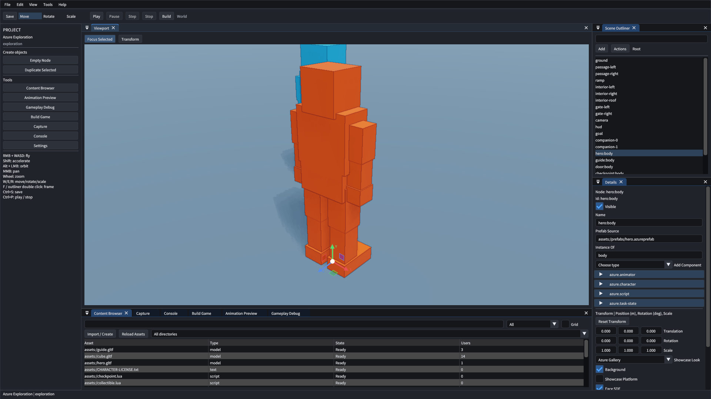

# AzureRender 工程

[主线 CPU 注册回归](docs/acceptance/nr/current-registered-cpu.md#管线缓存保留构建)记录两种配置各 333 项检查的结果。
[主线 GPU 定向复验](docs/acceptance/nr/current-registered-gpu-recoveries.md)记录三项 Release 用例的复验结果。
[GPU 注册回归的产物预约与管线缓存](docs/acceptance/nr/registered-gpu-infrastructure.md)记录双配置雾效结果、编辑器重建计时和目录规模复验。
[编辑器与资产主线复验](docs/acceptance/nr/registered-gpu-infrastructure.md#编辑器与资产主线复验)记录标准构建的目录规模、热重载和两条编辑器工作流。
[Windows 发布安装](docs/acceptance/nr/registered-gpu-infrastructure.md#windows-发布安装)记录安装文档核对和两种发布包的注册验收。
[材质视图管线缓存](docs/acceptance/nr/registered-gpu-infrastructure.md#材质视图管线缓存)记录双配置材质视图的读回与验证结果。

[着色器注册回归](docs/acceptance/nr/frozen-public-visual.md#着色器注册回归)记录双配置的编译结果和历史诊断产物的恢复信息。

[联合场景热点纹理分配](docs/acceptance/nr/joint-texture-hot-placement.md)记录 1440p 同驱动逐字节比较及固定 80 W 配对计时。
[联合场景 80 W 复验](docs/acceptance/nr/joint-nonlocal-texture-placement.md#独显空闲复验)记录独显空闲启动后的帧耗时、容量和热状态。
[最高风扇档复验](docs/acceptance/nr/joint-nonlocal-texture-placement.md#最高风扇档复验)记录同一冻结负载的持续帧时间和热状态。
[进程级 CPU 节能对照](docs/acceptance/nr/joint-nonlocal-texture-placement.md#进程级-cpu-节能对照)记录固定 80 W 的 GPU 负载、帧时间和热状态。
[平衡电源计划复验](docs/acceptance/nr/joint-nonlocal-texture-placement.md#平衡电源计划的处理器节能首选项)记录固定 80 W 联合场景三轮通过和每轮设备设置的恢复。
[标准构建定向复验](docs/acceptance/nr/current-registered-gpu-recoveries.md#标准构建定向复验)记录四项注册用例和两项应用管线缓存对照。
[正式工作集与管线缓存](docs/acceptance/nr/registered-working-set-cache.md)记录缓存保留配对验证及五类正式负载十五轮通过。
[冻结画面标准构建复验](docs/acceptance/nr/frozen-public-visual.md#管线缓存保留的标准构建复验)记录三条路径在双配置下的 42 张零差异捕获。
[标准发布包复验](docs/acceptance/nr/registered-gpu-infrastructure.md#管线缓存保留的发布包复验)记录五项注册检查及两个移动交付目录。
[聚光灯范围与辐照度系数](docs/acceptance/nr/joint-gpu-pass-budget.md#聚光灯范围与辐照度系数)记录联合场景缓冲、辐照度系数和快照绘制成本。

[三纹理采样与视口选择集成](docs/acceptance/nr/projected-hair-viewport-integration.md)通过两种配置及双显卡参考附件核对。
主线投影头发和表面响应的注册用例通过 Debug 与 Release 复测。

[相机捕获清单](docs/acceptance/nr/capture-camera.md#主线清单版本)通过两种配置的投影偏移及镜头元数据检查。

[公开角色冻结画面](docs/acceptance/nr/frozen-public-visual.md#冻结驱动复测)记录 595.79 下三条渲染路径的逐像素核对。

[主线联合场景短测](docs/acceptance/nr/performance-bottlenecks.md#主线联合场景短测)记录帧耗时、渲染通道及显存峰值。

[可玩包关卡提交](docs/acceptance/p1/2026-11-13-level-commit.md)通过隔离运行、切关和重启验收。
[可玩包三十分钟长跑](docs/acceptance/p1/2026-11-13-playable-30min.md)通过 67 次关卡提交、窗口恢复及资源释放检查。

[空白视口选择](docs/acceptance/nr/editor-empty-viewport-selection.md)通过两种配置的实际编辑输入核对。

[参考头发半层采样集成](docs/acceptance/nr/reference-hair-boundary-integration.md)通过两种配置及双显卡参考附件核对。

[画质与性能集成验收](docs/acceptance/nr/quality-performance-integration.md)通过两种配置的构建、双显卡参考附件及原始四帧核对。

[材质组合管线范围验收](docs/acceptance/nr/material-viewquad-pipeline-scope.md)通过原始四帧、工作集和短时净收益检查。
[主线材质候选采样](docs/acceptance/nr/material-viewquad-integration.md)记录 1800 帧的 GPU P95 为 18.56 毫秒，设备本地内存峰值约为 2.593 GiB。

[参考相机渲染主线验收](docs/acceptance/nr/reference-camera-binding-main-integration.md)通过双配置 46 项检查及双设备采集。
保守剔除、实际光栅、拾取与重采原始四帧通过。

[材质组合深度策略验收](docs/acceptance/nr/material-viewquad-production.md)通过关闭深度回退与严格四帧核对。
候选受工作集与 GPU 帧预算约束，标准构建采用参考族。

[场景参考相机主线验收](docs/acceptance/nr/scene-reference-camera-main-integration.md)通过双配置三十四项检查。
实际移动误差、四次光栅回归及重采原始四帧通过。

[光栅位置与项目视图主线验收](docs/acceptance/nr/reference-raster-project-main-integration.md)通过双配置二十六项检查。
四次设备检查与重采原始四帧通过，场景消费绑定继续推进。

[深度可见性组合原生验收](docs/acceptance/nr/quad-depth-combination-native.md)通过严格四帧及成对短时净收益。
GPU 均值减少约 13.58%，生产接入及正式帧预算继续验收。

[四像素组深度可见性组合](docs/acceptance/nr/quad-depth-visibility.md)通过六附件及局部效率准入。
完整材质降幅约 21.21%，原生四帧及成对净收益继续验证。

[四像素组覆盖接收](docs/acceptance/nr/quad-coverage-receiver.md)通过十份程序与六附件核对。
固定类别成本增加约 0.31%，候选保持隔离。

[材质片元工作量](docs/acceptance/nr/material-fragment-work-scope.md)完成全部 1006 次绘制的模式及类别分组。
固定类别约占整帧 25.45%，透明裁剪依赖按实际候选继续核验。

[参考相机视图主线验收](docs/acceptance/nr/reference-camera-view-main-integration.md)通过双配置二十项检查及八次设备检查。
实际射线与可见顶点通过，重采原始四帧摘要精确一致。

[驻留色彩图像通道范围](docs/acceptance/nr/resident-srgb-channel-scope.md)核对 180 份实际图像的全部多级内容。
四十份满足单通道像素关系，设备与正式内存按所属门禁继续验收。

[材质一致索引局部效率](docs/acceptance/nr/uniform-material-descriptor.md)通过十份程序及六附件核对。
测得材质成本增加约 0.48%，候选保持隔离。

[DDS 块存储范围](docs/acceptance/nr/dds-block-storage-scope.md)完成八十五份源文件及两设备格式查询。
源容量与实际 GPU 缓存节省分别记录，正式内存继续验收。

[参考位置帧主线验收](docs/acceptance/nr/reference-position-frame-main-integration.md)通过双配置十八项检查及十二次设备检查。
原始四帧摘要一致，主线每配置包含 859 份程序。

[四像素组级联需求](docs/acceptance/nr/quad-cascade-demand-local-qualification.md)的两个候选通过六附件核对。
完整材质降幅至多约 14.41%，效率未准入，候选保持隔离。

[四像素组设备与捕获资格](docs/acceptance/nr/quad-device-capture-qualification.md)通过私有设备及严格四帧核对。
3453 个事件和 76 条管线完整映射，级联控制的效率见所属验收。

[材质纹理梯度主线验收](docs/acceptance/nr/material-uv-main-integration.md)通过双配置十八项检查及两设备六组复验。
原始四帧摘要一致，主线每配置包含 856 份程序。

[纹理格式能力与容量](docs/acceptance/nr/texture-storage-format-scope.md)保存两设备实际查询及源图像容量范围。
NVIDIA 的 RGB8 路径缺少采样能力，正式内存预算继续按实际工作负载验收。

[展开接收计算的局部效率](docs/acceptance/nr/unrolled-computed-view-local-qualification.md)通过两种候选的六附件核对。
完整材质降幅至多约 19.49%，效率未准入，候选保持隔离。
关闭风格化的独立控制降幅约 18.86%，六附件逐字节一致。

[椭圆层级主线集成](docs/acceptance/nr/reference-alpha-ellipse-main-integration.md)通过双配置、双设备及原四帧核对。
原有 687 份程序保持摘要，Intel 九十六处深度差异继续定位。

[独立材质视图](docs/acceptance/nr/material-view-determinism.md)通过接收计算、双配置及双设备回归。
原始四帧摘要一致，计算视图与 UV 接入按新受检基线继续验证。

[场景参考法线与对象身份主线验收](docs/acceptance/nr/scene-reference-normal-main-integration.md)通过双配置、双设备附件与原始四帧核对。

[场景参考深度主线验收](docs/acceptance/nr/scene-reference-depth-main-integration.md)通过双配置、双设备逐位深度读回及原始四帧。

[椭圆覆盖选级主线验收](docs/acceptance/nr/material-ellipse-coverage-main-integration.md)通过双配置、双设备及原始四帧核对。

[材质视图回归矩阵](docs/acceptance/nr/material-view-regression-matrix.md)核对两种配置的视图读回、覆盖拒绝及生成层级。

[捕获布局回归](docs/acceptance/nr/capture-layout-regression.md)核对材质与相机常量布局及两种配置的多采样轮廓光。

[编辑器采样回归](docs/acceptance/nr/editor-sampling-regression.md)核对五种采样模式、窗口尺寸变更及保存重开。

[编辑器资产刷新](docs/acceptance/nr/editor-asset-refresh.md)核对缩略图的来源指纹、句柄和刷新预算。

[编辑器视口模型加载](docs/acceptance/nr/editor-placed-resource-loading.md)核对导入、首次放置、文件更新及完整可玩编辑流程。

[材质光照回归矩阵](docs/acceptance/nr/material-lighting-regression.md)核对通用材质、织物和对象阴影的双绑定输出。

[NPR 渐变组合回归矩阵](docs/acceptance/nr/npr-ramp-regression.md)核对通用材质、织物及两种绑定的像素输出。

[NullRhi 录制相机](docs/acceptance/nr/null-rhi-camera-regression.md)验证常规视角与远距背向场景的裁剪记录。

[主深度颜色附件范围](docs/acceptance/nr/main-depth-attachment-range.md)通过三个颜色附件的实际渲染和两种配置的八项所属回归。

[材质组合级联成本](docs/acceptance/nr/computed-cascade-demand-comparison.md)记录四像素组按需级联计算的实际回放。

[阴影圆盘行范围成本](docs/acceptance/nr/shadow-disk-row-interval.md)记录采样范围、实际附件和逐事件耗时。

[快照视图组合](docs/acceptance/nr/snapshot-default-view-combination.md)的动态照明控制通过六附件核对。
新增收益未达准入条件，候选保持隔离。

[完整管线成本](docs/acceptance/nr/complete-capture-cost-map.md)覆盖全部 3453 个计时事件。
实际材质绘制占约 74.41%，快照常量继续局部评估。

[正式功率条件](docs/acceptance/nr/gpu-power-limit-qualification.md)记录驱动设置结果与厂商控制面板状态。
固定 80W 采样等待可用的设备控制入口。

[阴影接收需求](docs/acceptance/nr/shadow-receiver-demand-scope.md)已核对实际光源和材质字段。
当前输入的条件跳过预期缩减为零，正式性能继续验收。

[公共梯度主线集成](docs/acceptance/nr/public-uv-gradient-main-integration.md)通过双配置及双设备检查。
默认宿主及既有程序摘要保持一致，生产取样绑定继续验收。

[并行资源调度](docs/development/shared-resources.md)统一编译、GPU 检查及跨工作树输入保护。

论文三路径基准见[独立实验](experiments/thesis/README.md)。
传统多遍、子通道及动态渲染局部读取已完成桌面正确性核对。
正式跨平台矩阵及结果分析等待移动实机资格。

开发产物使用[目录维护技能](tools/skills/azurerender-artifact-maintenance/SKILL.md)。
仓库[技能入口](../../.agents/skills/azurerender-artifact-maintenance/SKILL.md)及完整规则均保存在 D 盘。
[任务临时目录](docs/acceptance/recovery/managed-temporary-storage.md)随任务计入配额及每日回收，子进程沿用项目所在卷。
[前台空间监控](docs/acceptance/recovery/storage-monitor-cost.md)保持每秒配额检查，局部夹具的监控 CPU 耗时减少约 82%。
按天回收、精简证据及累计预算见[产物规则](docs/development/artifact-retention.md)。
历史模型的[每日维护](docs/acceptance/nr/daily-asset-copies.md)已接入技能入口，项目产物均保存在 D 卷。

开发管线采用[有界共享缓存](docs/acceptance/nr/pipeline-cache-workflow.md)。
[程序代次缓存](docs/acceptance/nr/bounded-development-cache.md)的当前载荷约为 26.04 MiB，全部代次共用原容量上限。
原生暖启动的 645 次创建全部命中，受管 SDK 缓存位于 D 盘任务内。
图像加载通过[缓冲所有权](docs/acceptance/nr/owned-image-conversion.md)转移八位像素，两配置的格式、共享及保存重开检查通过。
[缓冲类型统计](docs/acceptance/nr/buffer-memory-properties.md)记录真实选定属性，当前原生可映射 GPU 用途的非本地子集为零。
[聚簇灯影响盒](docs/acceptance/nr/clustered-influence-bounds.md)保持原始四帧一致，短测 GPU 均值减少约 0.83 毫秒，正式预算继续验收。
[接收范围](docs/acceptance/nr/clustered-receiver-ranges.md)的头表与索引写入量减少约 88%，双设备各十七项所属用例通过。
[网格分辨率范围](docs/acceptance/nr/clustered-grid-scope.md)完成冻结夹具核对，生产沿用当前尺寸。
[材质驻留范围](docs/acceptance/nr/material-storage-scope.md)核对 385 份纹理，采样器造成的重复仅为 3136 字节。
[缓存写入生命周期](docs/acceptance/nr/material-cache-seal.md)在加载后释放约 1.66 GB 身份像素，双配置及原四帧通过。
[快照颜色历史](docs/acceptance/nr/snapshot-color-history.md)保持原四帧零差，整数附件混合验证未通过，候选已封存。
[浮点身份编码](docs/acceptance/nr/float-history-identity.md)通过双设备完整 24 位键域、覆盖与遮挡核对，场景候选继续验证。
[浮点快照历史](docs/acceptance/nr/float-snapshot-history.md)通过严格四帧，三进程短测未达效率门槛，候选已封存。
[冻结纹理通道](docs/acceptance/nr/texture-channel-scope.md)记录 468 份唯一源图像的通道关系，实际驻留收益独立验收。
[线性通道存储](docs/acceptance/nr/linear-texture-channel-storage.md)通过双设备及原四帧，107 份纹理减少约 303 MB 纹素存储，正式内存及帧预算持续待验。
[像素无损容量](docs/acceptance/nr/texture-payload-compression-scope.md)完成 468 份源基础层的还原核查，[预备载荷计划](docs/plans/2026-11-10-prepared-pixel-payloads.md)继续处理加载期持有范围。
[不可变载荷入口](docs/acceptance/nr/immutable-byte-payloads.md)提供共享只读输入，双配置所属回归及双设备输入等价通过。
[预备像素加载](docs/acceptance/nr/prepared-material-loading.md)通过双配置 32 项及冻结四帧，本场景加载峰值观察约为 1.9227 GiB，正式内存矩阵继续验收。
[输出与加载集成](docs/acceptance/nr/output-pixel-loading-integration.md)通过双配置 34 项。
双设备大纹理组合及原四帧通过，单次加载工作集峰值约为 1.9026 GiB。
[当前场景成本](docs/acceptance/nr/compact-texture-gpu-cost.md)取得紧凑纹理程序的 3453 个重放事件。
重点材质程序的受检时间约占 57.66%，后续候选按实际局部成本准入。
[过滤半径常量控制](docs/acceptance/nr/shadow-filter-constant-control.md)保持附件零差。
局部变化未达准入门槛，生产保持运行时参数。
[级联成本控制](docs/acceptance/nr/cascade-shadow-cost-control.md)记录当前名义差值和环境漂移。
[滑动范围表](docs/plans/2026-11-10-sliding-shadow-range.md)先执行独立位值与查询成本核对。
[范围查询原型](docs/acceptance/nr/sliding-shadow-range-prototype.md)通过双设备完整位值核对。
独立查询成本已记录，实际着色与整帧净收益继续核定。
[圆盘零权重控制](docs/acceptance/nr/shadow-disk-zero-rejection.md)通过完整位值及附件核对。
局部效率条件未通过，生产保持当前过滤实现。
[内部采样控制](docs/acceptance/nr/shadow-interior-gather-control.md)保持六附件一致，局部效率未通过。
相同字节码空控制已记录，后续比较统一双方的替换路径。
[所选级联状态](docs/acceptance/nr/selected-shadow-receiver-control.md)保持六附件一致。
经空控制校准后局部减少约 15.25%，组合准入继续核定。
[所选状态与默认视图组合](docs/acceptance/nr/selected-default-view-combination.md)保持六附件一致。
局部减少约 21.28%，原生四帧与整帧成本继续验收。
[原生组合验证](docs/acceptance/nr/selected-default-view-native.md)保持原四帧摘要一致。
短时 GPU 均值减少约 12.64%，生产资格接入及正式帧预算继续验收。
[计算视图接入核对](docs/acceptance/nr/computed-material-view-production-attempt.md)保留生产候选与身份控制。
独立参考的可重复资格未通过，生产源码保持受检实现。
级联归属修复使静止局部灯的首帧与绑定路径保持一致，原始四帧继续零差。
[运动矢量绑定](docs/acceptance/nr/motion-descriptor-reuse.md)按帧槽复用稳定资源，所属十项检查及原生四帧核对通过。
[展示照明按需计算](docs/acceptance/nr/presentation-environment-demand.md)的候选未达区间效率门槛，生产已恢复受检内容。
照明复用的[接收面核对](docs/acceptance/nr/radiance-receiver-entry.md)保存入口位置与图像来源。
阴影圆盘的[局部成本](docs/acceptance/nr/shadow-disk-kernel.md)未形成收益，候选保持隔离。
[权重分类](docs/acceptance/nr/shadow-disk-classification.md)通过百万组逐位核对，局部效率门槛未通过。
[阴影范围索引](docs/acceptance/nr/shadow-range-index.md)的局部净成本减少约 42.64%，场景收益继续核定。
[标量阴影复用](docs/acceptance/nr/surface-shadow-reuse.md)的两种诊断配置均保持严格四帧一致，整帧收益未成立，候选隔离保存。
[历史资格策略](docs/acceptance/nr/shadow-history-runtime-scope.md)覆盖身份、投影误差和提交失效。
[主颜色历史接入](docs/acceptance/nr/shadow-history-runtime-integration.md)保持实际启用四帧零差。
短时整帧净收益未成立，实验选项默认关闭。
[阴影历史资源](docs/acceptance/nr/shadow-history-resources.md)通过有界容量、帧槽及双设备同步检查，运行时接入继续开发。
[材质范围核对](docs/acceptance/nr/shadow-cost-scope.md)按三十五份实际管线常量分组，历史缓存支持范围对应约 1.47 毫秒控制差值。
[零反射复用提案](docs/acceptance/nr/surface-lighting-reuse.md)保存反射贡献范围，实际材质覆盖依据尚未成立。
对象接收的[同输入模型](docs/acceptance/nr/object-receiver-input-model.md)复现 17017 处原生可见量，场景集成继续验收。
[屏幕对象可见量](docs/acceptance/nr/screen-object-visibility.md)提供公共图形通道。
[参考算术配置](docs/acceptance/nr/visibility-reference-arithmetic.md)通过双设备原生区域核对，当前场景接入及完整颜色继续验收。
[主光亮度饱和度](docs/acceptance/nr/hair-main-brightness-saturation.md)提供显式头发照明选项，双设备所属检查及原四帧通过，完整颜色继续验收。
[色度与缓存集成](docs/acceptance/nr/main-chroma-seal-integration.md)通过主线双配置 24 项及冻结四帧，缓存封存与缺省画面契约均保持成立。

[参考透明层级](docs/acceptance/nr/reference-alpha-ellipse.md)提供显式椭圆策略。
原生 NVIDIA 整区一致，Intel 剩余九十六处深度超差继续修正。
[相位原点](docs/acceptance/nr/visibility-phase-origin.md)支持两种行号约定，默认原生区域保持逐字节一致。
[设备深度核对](docs/acceptance/nr/receiver-device-depth.md)确认当前快照的整区关系，源投影和深度生产精度继续待验收。
[线性深度核对](docs/acceptance/nr/receiver-linear-depth.md)仍有 216 处超差，接收输入的生产精度继续待验收。
[生产投影核对](docs/acceptance/nr/receiver-projection-producer.md)定位原生深度写入链，完整区域仍有 200 处超差。
[顶点精度核对](docs/acceptance/nr/clip-depth-roundtrip.md)逐位复现原生 11564 个顶点，当前变换输入的精度继续待核定。
[接收运算核对](docs/acceptance/nr/receiver-reciprocal-arithmetic.md)区分齐次计算及倒数误差，兼容实现继续待验收。
CPU 的[消费范围](docs/acceptance/nr/cpu-consumed-preparation.md)按实际顶点和索引核对，后续批次沿用收益门槛。
[准备批次评估](docs/acceptance/nr/cpu-preparation-batch.md)的更新均值降低约 7.46%，未达到本批门槛，候选保持隔离。
[GPU 透明索引准备](docs/acceptance/nr/gpu-transparent-index-sort.md)通过十二项所属检查及严格四帧，局部 CPU 准备减少约 0.99 毫秒。
[绘制阶段归因](docs/acceptance/nr/gpu-draw-stage-cost.md)定位保守遮挡候选，调用统计与实际片元结果保持一致。
[保守剔除机制](docs/acceptance/nr/gpu-conservative-occlusion.md)通过双设备检查，独立深度候选的整帧收益未成立。
[主通道深度复用](docs/acceptance/nr/main-depth-reuse.md)保持冻结四帧完全一致，短时 GPU 均值减少约 0.87 毫秒。
[多阶段遮挡范围](docs/acceptance/nr/snapshot-shared-occlusion.md)的增量上界约为 0.32 毫秒，候选保持提案状态。
[默认隔离材质管线](docs/acceptance/nr/default-isolation-pipelines.md)通过严格四帧，实验程序的片元寄存器减少 25%。
[短时成本](docs/acceptance/nr/default-isolation-cost.md)的整帧净差约为 0.04 毫秒，策略由默认关闭的构建选项控制。
[固定类别范围](docs/acceptance/nr/fixed-class-isolation-scope.md)约占历史事件耗时的 22.67%，保留范围结论。
[共享照明组合](docs/acceptance/nr/radiance-precision-boundaries.md)通过四项小数据 GPU 检查，既有渲染程序保持原字节。
[照明缓存接入](docs/acceptance/nr/radiance-cache-precision-integration.md)通过严格四帧及设备回退检查，短时 GPU 均值增加约 0.72 毫秒，实验选项默认关闭。
[消费计数](docs/acceptance/nr/radiance-consumption-counters.md)提供实际访问与整组接受诊断，计数及复用选项默认关闭。
[同帧资格核验](docs/acceptance/nr/radiance-validation-path.md)通过严格四帧及安全回退检查。
[独立深度重放](docs/acceptance/nr/radiance-depth-replay.md)通过精度与严格四帧检查。
[逐绘制资格](docs/acceptance/nr/radiance-draw-selection.md)已在原生采集中启用轻量绘制。
[四像素组消费](docs/acceptance/nr/quad-safe-radiance-consumer.md)通过严格四帧检查。
本地 GPU 净成本未取得显著收益，实验入口默认关闭。
[稀疏消费归因](docs/acceptance/nr/sparse-consumer-attribution.md)完成一次原生诊断。
四像素组接受占消费采样约 30.23%，后续按主场景分段选择优化。
[GPU 通道归因](docs/acceptance/nr/gpu-pass-attribution.md)已接入显式分段计时。
十九个通道均有实际结果，后续核对共享形变输出的数据成本。
[紧凑蒙皮输出](docs/acceptance/nr/compact-skinning-output.md)通过十四项检查及严格四帧。
缓冲容量减少约 125.65 MiB，本地 GPU 均值减少约 0.43 毫秒。
[计算归约门槛](docs/acceptance/nr/bounded-compute-reductions.md)完成局部评估，候选保持隔离。
[阴影分块批处理](docs/acceptance/nr/shadow-tile-batching.md)已接入默认配置。
严格四帧一致，独立内核减少约 43%，本地整帧减少约 0.11 毫秒。
[资产快照压缩](docs/acceptance/nr/compressed-asset-snapshots.md)已部署，当前 864 份快照逐字节通过，实际释放约 646 MiB。

阴影接收面采用[入口计算](docs/acceptance/nr/shadow-receiver-entry.md)。
双设备时序检查与原冻结四帧通过，整体性能和画质按原门槛验收。

GPU 可映射缓冲的用途选择及双设备检查见[内存分配](docs/acceptance/nr/focused-device-buffers.md)。
分配策略的原四帧证据对应 `f015e5d`，整帧收益待原功率条件确认。

纹理缓存的[分桶计算](docs/acceptance/nr/texture-content-buckets.md)通过八项双配置检查。
局部哈希中位耗时降低约 73.62%，完整场景结果待集中验证。

完整材质的[二进制图像准备](docs/acceptance/nr/binary-material-images.md)通过十六项检查。
十四份角色材质的局部合计耗时降低约 81.05%。
当前三个生产批次通过[原生四帧集中验证](docs/acceptance/nr/consolidated-preparation-images.md)。
正式帧预算及整体画质继续验收。

最终交付目标与当前执行顺序见[开发总计划](docs/plans/azure-engine-plan.md)。
任务预算、失败转交和验证分级见[协作与验收](docs/development-workflow.md)。
当前完整构建、跨设备纹理容量及输出提交见[入口核验](docs/acceptance/recovery/acceptance-preflight.md)。
编辑预览复用处于[候选隔离](docs/plans/2026-11-05-pipeline-reuse.md)状态。
完整联合性能的来源、方案和落地顺序见[渲染架构调研](docs/research/2026-11-05-render-performance-architecture.md)。
当前 CPU 阶段、GPU 热点及带宽指标见[性能归因](docs/acceptance/nr/performance-bottlenecks.md)。
实际指令、存储及缓存计数见[GPU 硬件归因](docs/acceptance/nr/gpu-hardware-counters.md)。
持续运行的 CPU 阶段及执行状态见[长时诊断](docs/acceptance/nr/cpu-long-run-growth.md)。

厂商温度、组件依赖及复测条件见[环境核验](docs/acceptance/nr/thermal-environment.md)。
接手环境、空间分级及当前复测条件见[恢复核验](docs/acceptance/nr/resume-storage-performance.md)。
自动空间恢复、缓存备份及复测见[执行记录](docs/acceptance/nr/autonomous-cleanup-performance.md)。
场景着色、透明准备及光照存储的批次优化见[性能记录](docs/acceptance/nr/batched-performance.md)。
场景快照复用、摄像机准备及阶段测量见[CPU 优化](docs/acceptance/nr/cpu-scene-preparation.md)。
反射探针空间候选的范围、结果及恢复见[候选评估](docs/acceptance/nr/probe-spatial-candidates.md)。
场景变换与透明缓存的隔离结果见[准备评估](docs/acceptance/nr/static-transparent-preparation.md)。
同帧阴影结果复用的兼容、分支及成本见[阴影评估](docs/acceptance/nr/shadow-visibility-reuse.md)。
当前子阶段及实际资源控制见[CPU 热点](docs/acceptance/nr/cpu-substage-update.md)。
当前源码的二十帧准备阶段及真实输入控制见[帧准备成本](docs/acceptance/nr/current-frame-preparation.md)。
完整 GPU 叶绘制归因、计算反射模式与覆盖控制见[材质成本](docs/acceptance/nr/computed-material-cost.md)。
计算反射材质的原生失败、单因素控制及恢复核对见[候选核验](docs/acceptance/nr/computed-material-view.md)。
[普通材质视图控制](docs/acceptance/nr/computed-view-controls.md)通过严格四帧，场景区间效率门槛未通过，候选保持隔离。
[参考算术集成](docs/acceptance/nr/visibility-reference-integration.md)通过双配置 32 项检查及原冻结四帧。
逐绘制纹理索引的合法设备前提及收益判定见[索引核验](docs/acceptance/nr/uniform-material-index.md)。
无光照混合表面的主输出、零像素对照及约 12% 短时 GPU 改善见[着色优化](docs/acceptance/nr/unlit-blend-fast-path.md)。
专用场景快照与渲染描述的复用、失效及约 23% 短时 CPU 改善见[宿主优化](docs/acceptance/nr/host-scene-preparation.md)。
透明几何并行准备与运动历史复用见[动态几何优化](docs/acceptance/nr/dynamic-geometry-preparation.md)。
命令准备与缓冲读取范围的合并见[同步优化](docs/acceptance/nr/read-scope-barriers.md)。
同帧单精度照明复用的隔离原因及零像素边界见[着色复用评估](docs/acceptance/nr/surface-radiance-reuse.md)。
稳定场景的变换历史与矩阵复用见[准备优化](docs/acceptance/nr/stable-frame-preparation.md)。
当前短时 CPU P95 为 7.97 毫秒；GPU 帧预算、正式性能及整体画质继续验收。
当前验收的持续执行顺序见[自主执行](docs/plans/2026-11-07-autonomous-acceptance.md)。
实际 GPU 缓冲位置、驻留候选及原生差异见[驻留评估](docs/acceptance/nr/gpu-buffer-residency.md)。
任务配额、卷余量及逐批清理见[产物规则](docs/development/artifact-retention.md#空间门禁)。
每周清理任务的目录、期限及执行状态见[调度收据](docs/development/artifact-automation.json)。
归档任务的实际释放及保护核对见[维护记录](docs/acceptance/nr/archived-p0-maintenance.md)。
文档物化及重复文件查询的局部成本见[路径诊断](docs/acceptance/nr/resource-resolution-cost.md)。
加载会话的路径复用、失效及同输入收益见[活动表验证](docs/acceptance/nr/prepared-resource-paths.md)。

透明准备的稳定排序、同输入成本及工作规模见[验证记录](docs/acceptance/nr/stable-depth-sort.md)。
提前深度的工作量、严格图像及原生帧结果见[成本验证](docs/acceptance/nr/early-depth-counter-control.md)。
运行时身份直接查询及双配置检查见[身份验证](docs/acceptance/nr/runtime-node-identity.md)。
运动向量的命令复用和双设备结果见[绑定验证](docs/acceptance/nr/motion-bindings.md)。
同帧场景输入及性能采集条件见[快照验证](docs/acceptance/nr/frame-context-snapshot.md)。
相机与场景的共享输入见[呈现契约](docs/runtime/game-render-snapshot.md)和[CPU 验证](docs/acceptance/nr/render-camera-snapshot.md)。
节点快照的分配和完整性见[复制验证](docs/acceptance/nr/runtime-snapshot-copy.md)。
混合场景的透明排序开销见[分配验证](docs/acceptance/nr/opaque-transparency-scratch.md)。
日常短检与集中构建入口见[构建范围](docs/development/build-scopes.md)。
缓冲依赖的 CPU 契约及设备待项见[批量提交验证](docs/acceptance/nr/buffer-barrier-batching.md)。

[双设备及原生复测](docs/acceptance/nr/idle-gpu-validation.md)完成。
完整场景 CPU 工作 P95 为 24.83 毫秒，GPU 为 39.81 毫秒。
原帧预算和热状态检查未通过。
阴影接收的[成本分项](docs/acceptance/nr/shadow-receiver-cost.md)持有诊断范围。
完整覆盖阴影的[纯深度提交](docs/acceptance/nr/depth-only-shadow.md)通过双设备及原生四帧检查。
本轮短时 GPU 帧 P95 为 33.93 毫秒，正式预算继续待验收。
相机[物化输入共享](docs/acceptance/nr/materialized-camera-input.md)通过两配置各十四项及原生四帧检查。
短时成对 CPU 均值降低约百分之 6.06，工作 P95 为 21.79 毫秒。
[静态变形输出复用](docs/acceptance/nr/static-skinning-output.md)通过双设备、生命周期及原生四帧检查。
实际帧复用 742,213 个顶点请求，完整帧预算与热状态继续未通过。
完整覆盖的[深度预填充](docs/acceptance/nr/covered-depth-prefill.md)通过两配置各三十二项及双设备检查。
原生四帧冻结对照一致，完整画质及帧预算保持待验收。
当前运行产物的捕获、程序身份及材质常量见[GPU 事件分解](docs/acceptance/nr/current-gpu-events.md)。
静态实例的[只读姿态共享](docs/acceptance/nr/shared-bind-pose.md)通过双配置 CPU 及原生四帧检查。
完整场景每帧有八百六十个共享实例，Intel 时间解析条件继续待修复。
动画[局部初始化](docs/acceptance/nr/animation-local-pose.md)通过双配置、姿态及运动检查。
原生四帧与二百二十次同输入姿态的原字检查通过。

动画[曲线预备采样](docs/acceptance/nr/animation-curve-validation.md)通过双配置及双设备检查。
同输入采样局部合计均值为 0.431 毫秒，完整帧收益单独验收。

联合画质验收未通过，当前诊断见[输入核验](docs/acceptance/nr/joint-visual-input-isolation.md)。
主光接收范围、阴影来源及参考灯实验见[机制验证](docs/acceptance/nr/receiver-directional-light.md)。
原生姿态、同条件材质对照及 GI 覆盖见[输入核验](docs/acceptance/nr/native-material-input-audit.md)。
直接贡献、环境贡献与阴影差异见[照明分项](docs/acceptance/nr/joint-lighting-components.md)。

完整线性输出、眼睛自发光及曝光换算见[辐亮度验证](docs/acceptance/nr/material-radiance-normalization.md)。
原生调色表的实际影响及颜色边界见[显示域核验](docs/acceptance/nr/material-display-domain.md)。
材质显示归属及主辅视图契约见[显示变换](docs/runtime/material-display-transform.md)。
原生角色关键区域及环境兼容见[显示验证](docs/acceptance/nr/material-display-transform.md)。

联合可玩候选、普通启动入口及原生响应见[组合验证](docs/acceptance/nr/joint-playable-display.md)。

含雾关卡的资源身份、重开复用及画面兼容见[复用验证](docs/acceptance/recovery/view-fog-resource-reuse.md)。

全身衣料的实际差异、材质区域及辐照响应见[全身对照](docs/acceptance/nr/full-body-native-comparison.md)。

材质环境来源、主光对象阴影及原生对照见[接收验证](docs/acceptance/nr/material-lighting-reception.md)。
五份衣料的实际高光资源及参数差异见[原生输入核验](docs/acceptance/nr/native-cloth-inputs.md)。
视角色带、室内颜色及漫反射权重见[颜色合成核验](docs/acceptance/nr/npr-view-ramp-composition.md)。
公共接入与三十六个匹配区域的检查见[运行时验证](docs/acceptance/nr/npr-ramp-runtime.md)。

原始角色入口及动态近景见[参考核验](docs/acceptance/nr/portrait-input-recovery.md)。
头发覆盖按[独立裁剪图计划](docs/plans/2026-11-02-independent-coverage.md)推进。
公共输入、来源层级及失败回收见[覆盖验证](docs/acceptance/nr/material-coverage.md)。
自动生成层级的覆盖保持见[层级验证](docs/acceptance/nr/material-coverage-mips.md)。
原生动态接入及完整头发失败范围见[联合验证](docs/acceptance/nr/native-coverage-integration.md)。
角色展示站位与阴影输入见[构图核验](docs/acceptance/nr/joint-visual-state.md)。
近侧站位与中央物流见[动态验收](docs/acceptance/nr/joint-conveyor-motion.md)。
原生待机与循环输入见[循环验收](docs/acceptance/nr/joint-idle-loop.md)。
实例时钟、透明度及项目重开见[动态回归](docs/acceptance/nr/joint-dynamics-regression.md)。
衣料与头部角饰的法线方向见[原生核验](docs/acceptance/nr/native-normal-orientation.md)。
对应的角色、物流及倒影见[联合回归](docs/acceptance/nr/joint-normal-orientation.md)。
材质覆盖层的深度、混合及场景雾见[公共验收](docs/acceptance/nr/material-overlay-depth.md)。
覆盖图元的资产保留及来源追踪见[工具验收](docs/acceptance/nr/material-overlays.md)。
受光透明表面的深度配置及遮挡见[深度验收](docs/acceptance/nr/blend-depth.md)。
表面发光的反射快照、附件归属及联合重开见[覆盖验收](docs/acceptance/nr/opaque-surface-overlays.md)。
角色混色灯对独立发光层的作用见[表面覆盖配置](docs/runtime/opaque-surface-overlays.md)。


本机环境与后续任务见[环境恢复与开发计划](docs/plans/2026-10-30-development-recovery.md)。

完整物流场景的当前截图与启动入口见[画面恢复](docs/acceptance/recovery/full-scene-visual.md)。

完整环境与角色同屏的实际画面见[联合验证](docs/acceptance/recovery/full-scene-character.md)。

地面反射、角色近景及原始 GPU 输入见[画质诊断](docs/acceptance/nr/scene-material-quality-diagnosis.md)。
完整材质与角色外观继续验收。

用户正面角色图的实际入口与复现结果见[角色参考](docs/acceptance/recovery/character-reference.md)。

眼部固定区域、照明候选与环境兼容见[照明联合验证](docs/acceptance/nr/character-illumination-integration.md)。

动态头发的来源坐标恢复与当前画面见[坐标验收](docs/acceptance/nr/hair-source-uv.md)。

资产引用、热刷新及内存验证见[依赖索引](docs/acceptance/recovery/asset-dependency-index.md)。

项目启动共享、双配置完整入口及图像见[启动快照验证](docs/acceptance/recovery/project-startup-context.md)。

原生射线的计算顺序及冻结数值参考见[顺序验证](docs/acceptance/nr/native-ray-arithmetic-order.md)。

双配置 Vulkan 完整输出、载荷及复现见[射线参考验证](docs/acceptance/nr/native-ray-vulkan-reference.md)。

公共投影射线的输入、编码及资源顺序见[接口说明](docs/runtime/projected-reflection-ray.md)。

相机变换、线性运动及独立镜面见[相机适配验证](docs/acceptance/nr/projected-camera-adapter.md)。

投影深度、法线转换及分帧所有权见[表面准备](docs/runtime/projected-reflection-preparation.md)。

公共生产、历史输入和足迹过滤见[投影反射组合](docs/runtime/projected-screen-reflection.md)。

完整程序清单及 DXC 热重载见[编译配置](docs/development/shader-hot-reload.md)。

类型化算法及真实 Player 当前帧生产见[场景接入](docs/acceptance/nr/projected-main-scene.md)。

采样位移校正及历史运动接收见[运动验证](docs/acceptance/nr/projected-history-motion.md)。

成功提交身份、实际采样及完整场景见[历史装配](docs/acceptance/nr/projected-main-history.md)。

重装与迁移后先阅读[恢复交接](docs/plans/2026-10-29-reinstall-handoff.md)。

代码定位与有界读取见[源码导航](docs/development/source-navigation.md)。
显式管线编译统计见[GPU 管线检查](docs/development/pipeline-inspection.md)。
实际主场景热点与保留预算见[成本验证](docs/acceptance/nr/main-aa-cost-attribution.md)。

普通材质专用化及完整快照路径见[材质验证](docs/acceptance/nr/ordinary-material-specialization.md)。
基础功能集合、视图标志及编译依赖见[功能裁剪](docs/acceptance/nr/generic-material-feature-folding.md)。
类别共享功能位及动态回退见[特化验证](docs/acceptance/nr/material-class-feature-specialization.md)。

三层体积、公共材质及主场景绑定见[辐照接入](docs/acceptance/nr/irradiance-clipmap-scene.md)。
精确采样抖动及 NPR 接收边界见[查询位置](docs/acceptance/nr/irradiance-query.md)。
像素原点、镜像场方向及实际镜头见[查询坐标](docs/acceptance/nr/irradiance-query-frame.md)。
地面实际 UV 绑定及颜色上传见[地面绑定](docs/acceptance/nr/floor-runtime-binding.md)。

探针身份、动态反射链及对照镜头见[运行核验](docs/acceptance/nr/native-reflection-bindings.md)。
可配置的探针预滤波层级见[层级验收](docs/acceptance/nr/reflection-lod.md)。
有序体积、辐照亮度适配及生产消费见[探针验收](docs/acceptance/nr/reflection-probe-fields.md)。
双面镜像的法线、GI 及积分头发联合路径见[朝向验收](docs/acceptance/nr/surface-facing.md)。

截帧资源定位、明确来源和关卡快照见[来源选择](docs/acceptance/nr/scene-source-selection.md)。
原生 UV1、网格烘焙和统一运行表面见[坐标验收](docs/acceptance/nr/surface-uv-domain.md)。
Lit 法线阈值、重建下限及实际材质见[解码验收](docs/acceptance/nr/lit-normal-decoding.md)。
网格作者法线、角点及生产入口见[来源验收](docs/acceptance/nr/mesh-corner-normals.md)。

局部灯档案、实体身份及实际镜头见[倍率绑定](docs/acceptance/nr/local-light-profile-binding.md)。
活动主光的辐照输入及方向核对见[主光验收](docs/acceptance/nr/main-light-runtime-binding.md)。
级联上游遮挡范围及滤波尺度见[阴影验收](docs/acceptance/nr/cascade-caster-depth.md)。
局部灯源颜色、单精度解码及温度边界见[颜色验收](docs/acceptance/nr/local-light-color-space.md)。

活动颜色表、硬件采样及实际镜头见[调色验收](docs/acceptance/nr/captured-color-grading-lut.md)。
活动灯光索引、公共快照及接收范围见[灯光验收](docs/acceptance/nr/captured-active-lights.md)。
静态作者法线与精确轴置换见[批量验收](docs/acceptance/nr/static-authored-normals.md)。
上方与后方来源接入见[围护验收](docs/acceptance/nr/enclosure-authored-normals.md)。

物流图层、完整材质与实际绘制见[图层接入](docs/runtime/unlit-texture-layers.md)。
活动物流图层、颜色及采样来源见[截帧绑定](docs/acceptance/nr/captured-vfx-layers.md)。
层级采样、覆盖率及实际实例见[绘制验收](docs/acceptance/nr/vfx-mip-and-coverage.md)。
近远淡出、材质保留行及实际图层见[深度验收](docs/acceptance/nr/vfx-view-depth-fade.md)。

公共顶点颜色、多流绑定及实际特效见[颜色验收](docs/acceptance/nr/vertex-color-streams.md)。
柱面视角覆盖率与加色合成见[合成验收](docs/acceptance/nr/view-dependent-vfx-coverage.md)。
实际箱体姿态、共享材质及完整镜头见[箱体验收](docs/acceptance/nr/captured-logistics-boxes.md)。
独立覆盖率、作者层级及实际字形见[覆盖率验收](docs/acceptance/nr/unlit-coverage-texture.md)。

三项原生材质组合与隔离绘制见[组合验收](docs/acceptance/nr/remaining-vfx-combinations.md)。
基础坐标扰动、独立采样及实际墙面见[扰动验收](docs/acceptance/nr/base-uv-distortion.md)。
中央字形柱与独立覆盖率组合见[字形柱验收](docs/acceptance/nr/central-glyph-composition.md)。
雾效传输、体积格式及原版载荷见[雾效数据验收](docs/acceptance/nr/fog-transport-data.md)。

三维雾场上传、原版采样及资源释放见[雾场 GPU 验收](docs/acceptance/nr/fog-volume-gpu.md)。
像素原点、抖动及深度映射见[视图坐标验收](docs/acceptance/nr/view-fog-projection.md)。
场景资源、捕获视图及保存重开见[绑定验收](docs/acceptance/nr/view-fog-scene-binding.md)。
预积分雾场、实际表面与资源隔离见[表面验收](docs/acceptance/nr/view-fog-surfaces.md)。

中央白色标识与浮点附件对照见[标识验收](docs/acceptance/nr/central-late-glyph.md)。
逐采样深度、覆盖率与双配置回归见[轮廓验收](docs/acceptance/nr/view-fog-multisample.md)。
普通无光照表面、附件一致性及 GPU 成本见[预算验收](docs/acceptance/nr/unlit-opaque-budget.md)。
光谱大气、远端片元与公共数值见[解析雾验收](docs/acceptance/nr/analytic-fog.md)。

场景支持[解析雾配置](docs/runtime/scene-fog.md)及独立解析介质。
双配置、真实片元与完整候选见[合成验收](docs/acceptance/nr/scene-fog.md)。
阶段截图、机位和待验差异见[画面记录](docs/acceptance/nr/visual-history.md)。
物流彩色环带的源实例及采样见[还原验收](docs/acceptance/nr/opaque-logistics-rings.md)。

公共 glTF 采样器及完整场景结果见[采样器验收](docs/acceptance/nr/gltf-sampler-contract.md)。
原版动态反射过滤及公共接入边界见[来源验收](docs/acceptance/nr/reflection-filter-source.md)。
四通道表面快照及格式选择见[快照契约](docs/runtime/reflection-surface-snapshot.md)。
最近深度、反向深度及奇数维度归约见[层级契约](docs/runtime/depth-pyramid.md)。

计算射线、投影重建及基础信号生产见[射线契约](docs/runtime/reflection-ray.md)。
主场景计算生产、资源预算及消费见[组合契约](docs/runtime/screen-reflection.md)。
半分辨率生产、真实深度及整数选样见[尺寸验收](docs/acceptance/nr/reflection-resolution.md)。
反射历史计算及借用图像资源见[时间过滤契约](docs/runtime/reflection-temporal.md)。

时间核的公共组合与槽位验证见[组合验收](docs/acceptance/nr/reflection-temporal-composition.md)。
公共运动选样及深度接收见[重投影契约](docs/runtime/reflection-reprojection.md)。
前置运动与主场景反射历史见[装配验收](docs/acceptance/nr/main-reflection-history.md)。
完整场景的逐事件成本见[GPU 热点](docs/acceptance/nr/reflection-pass-profile.md)。

普通材质快照特化及画面兼容见[预算验证](docs/acceptance/nr/snapshot-shading-budget.md)。
原版射线输入、过滤足迹及数值待项见[来源核验](docs/acceptance/nr/native-ray-source.md)。
共享运动目标及画面兼容范围见[共享验收](docs/acceptance/nr/shared-motion.md)。
时序 KK 动态夹具及剩余范围见[运动边缘验证](docs/acceptance/nr/temporal-motion-edges.md)。

隐藏平台的运动覆盖及实际附件见[可见性验证](docs/acceptance/nr/motion-visible-surfaces.md)。
服饰及 KK 动态门槛见[轮廓显示验证](docs/acceptance/nr/temporal-display-edges.md)。
独立过滤资源及双配置结果见[公共过滤验收](docs/acceptance/nr/reflection-spatial-filter.md)。
实际镜头、上向量及输入指纹见[相机来源](docs/acceptance/nr/capture-camera.md)。

原生数组、零符号约定及双配置硬件采样见[数组验收](docs/acceptance/nr/octahedral-environment.md)。

原生时序输入与运动解码见[时序核验](docs/acceptance/nr/native-temporal-inputs.md)。
主辅视图的历史提交边界见[时序帧状态](docs/runtime/temporal-frame-state.md)。

材质变体资源归属与实际片元核对见[合成验证](docs/acceptance/nr/character-composite-diagnosis.md)。
逐材质 NPR 光色及真实皮肤色带见[光色验证](docs/acceptance/nr/npr-material-lighting.md)。
材质边缘响应、视角色彩及正交切线见[边缘验证](docs/acceptance/nr/material-rim-and-view-tint.md)。
脸部遮罩、头部朝向及宽度混合见[脸部轮廓光](docs/runtime/face-masked-rim.md)。
服装内部描边和外轮廓的配置见[描边投影](docs/runtime/outline-projection.md)。
屏幕表面法线与头发独立法线快照见[输入核验](docs/acceptance/nr/screen-surface-normal.md)。
虹膜的导出坐标和验证方法见[眼部输入](docs/acceptance/nr/eye-npr-inputs.md)。
有符号主光色带及身体输入见[色带验证](docs/acceptance/nr/signed-main-ramp.md)。

角色可见量来源及对象阴影生产见[阴影验证](docs/acceptance/nr/character-visibility-inputs.md)。
实例 GPU 布局及原生投影输入见[实例验证](docs/acceptance/nr/instance-gpu-contract.md)。
逐材质完整几何与平方根 Alpha 投影见[覆盖验证](docs/acceptance/nr/material-shadow-coverage.md)。
对象阴影的注册配置、文档及投影见[配置验证](docs/acceptance/nr/object-shadow-configuration.md)。

独立深度输入、共享采样器及实际画面见[采样验证](docs/acceptance/nr/shared-depth-sampling.md)。
对象图集、GPU 过滤及真实角色边界见[对象阴影验证](docs/acceptance/nr/object-shadow-gpu.md)。
公共对象可见量隔离支持生产输入与光照贡献分别核对。
逐材质局部漫反射下限见[响应验证](docs/acceptance/nr/material-local-wrap.md)。

对象接收位置与原生可见量见[坐标验证](docs/acceptance/nr/object-shadow-receiver.md)。

眼睛 NPR 适配及完整材质文档见[输入验收](docs/acceptance/nr/eye-npr-inputs.md)。
原生采样器、硬件层级及梯度进入独立证据核对。
完整眼部区域、层级边界及动态姿态继续验收。
材质槽位查询与主场景图像回归见[元数据验收](docs/acceptance/nr/material-slot-inspection.md)。

九动画角色、完整文档及实际转身见[主场景验证](docs/acceptance/nr/main-character-integration.md)。
原生双帧的实例及跨阶段调色板见[来源核对](docs/acceptance/nr/material-frame-instance-producer.md)。
身体骨盆原点及双配置验证见[径向原点验收](docs/acceptance/nr/body-rim-origin.md)。
蒙皮齐次位置及剩余严格图像门禁见[位置验收](docs/acceptance/nr/skinning-position-consistency.md)。

服饰二维高光的公共契约与实际画面边界见[服饰验收](docs/acceptance/nr/cloth-specular-ramp.md)。
服饰原生输入、组合照明及主候选见[接入验收](docs/acceptance/nr/cloth-native-integration.md)。
普通材质零贡献光源及主场景预算见[成本验证](docs/acceptance/nr/ordinary-light-zero-energy.md)。
不透明副本预填及共面规则见[预填验证](docs/acceptance/nr/opaque-snapshot-depth-prefill.md)。

不透明主通道预填、实际计数及联合成本见[主通道验证](docs/acceptance/nr/opaque-main-depth-prefill.md)。
完整资产缓存复用、并发恢复及实际入口见[缓存验证](docs/acceptance/nr/complete-asset-cache-reuse.md)。
距离描边的共享数学与深度来源见[分项验证](docs/acceptance/nr/outline-depth-source.md)。
公共材质、可选方向流和独立深度壳见[接入验证](docs/acceptance/nr/outline-material-integration.md)。

实际投影、独立裁剪图及动态主候选见[覆盖验证](docs/acceptance/nr/hair-depth-coverage.md)。
共享角色可见量、环境域及第七版主入口见[接收验收](docs/acceptance/nr/hair-object-visibility.md)。
公共精确深度偏置与原生对象图集见[生产验收](docs/acceptance/nr/object-shadow-exact-bias.md)。
头发与眼睛的硬件层级边界见[采样诊断](docs/acceptance/nr/hair-sampling-boundary.md)。

场景支持[风格化漫反射照明](docs/runtime/npr-illumination.md)。
数值与原生输入范围见[照明验收](docs/acceptance/nr/npr-illumination.md)。
实际顶点与采集调色表见[专项验证](docs/acceptance/nr/captured-vertex-and-grading.md)。
头发手性、色带及分层输入见[坐标约定](docs/acceptance/nr/projected-hair-coordinates.md)。

图片采样、原生 mip 及完整文档见[输入验证](docs/acceptance/nr/typed-image-inputs.md)。
独立层级过滤、偏移及编辑消费见[采样状态](docs/acceptance/nr/sampler-filter-and-bias.md)。
头发材质光色及双叶组合照明见[实际验证](docs/acceptance/nr/projected-hair-lighting.md)。
捕获局部灯的输入和组合顺序见[记录验证](docs/acceptance/nr/captured-character-local-lights.md)。

公共局部灯颜色及场景兼容见[运行验证](docs/acceptance/nr/character-local-light-response.md)。
实际矩阵投影与点光覆盖见[聚簇验证](docs/acceptance/nr/clustered-light-projection.md)。
有限线形积分、旋转与主叶消费见[线形验证](docs/acceptance/nr/character-line-light.md)。
有序颜色混合、轴向距离及分项能量见[混合验证](docs/acceptance/nr/character-color-blend.md)。

屏幕深度与镜面角色灯见[专项验证](docs/acceptance/nr/character-screen-light-modes.md)。
捕获子像素相机与公共射线见[投影验证](docs/acceptance/nr/camera-projection-offset.md)。
真实头发正主叶及逐层关闭对照见[分层验证](docs/acceptance/nr/projected-hair-positive-layers.md)。
共享颜色核与原生片元见[头发照明验证](docs/acceptance/nr/captured-hair-illumination.md)。

全局环境权重与主灯条纹见[贡献验证](docs/acceptance/nr/ambient-weight-and-main-line.md)。
同机位诊断支持[捕获姿态与材质帧](docs/acceptance/nr/captured-character-pose.md)。
投影头发支持显式虚拟主灯与独立条纹。
数值、GPU 及实际消费见[条纹验收](docs/acceptance/nr/projected-hair-line.md)。

完整材质文档接入共享 glTF 解释器与 UUID 依赖。
十三槽真实角色对照见[完整文档验收](docs/acceptance/nr/complete-material-document.md)。

公共材质支持保留源角色效果的参数覆盖。
CPU、GPU 与真实角色对照见[覆盖验收](docs/acceptance/nr/material-parameter-overrides.md)。

主关卡与可玩入口已接入首批角色材质候选。
四次捕获及原生待项见[接入验证](docs/acceptance/nr/main-character-integration.md)。

公共材质文档的正值自发光强度启用对应功能位。
CPU 与编辑回归范围见[解释验证](docs/acceptance/nr/material-document-emission.md)。

渲染接入缺口与架构约束已纳入[当前计划](docs/plans/2026-10-22-render-capability-integration-audit.md)。
环形多层高光、距离描边和公共材质制作仍有明确待项。
专项候选与主项目接入分别验收。

头发次级高光颜色已按实际帧完成线性转换。
范围见[头发高光验收](docs/acceptance/nr/projected-hair.md)。

服饰镜面参数支持独立来源与倍率。
契约与范围见[服饰镜面验收](docs/acceptance/nr/cloth-specular-input.md)。

脸部径向环境法线已通过数值与真实近景检查。
范围见[脸部法线验收](docs/acceptance/nr/face-radial-indirect.md)。

双锚帧的 1271 个事件已有完整管线索引。
范围见[绑定索引](docs/acceptance/nr/native-binding-index.md)。

终末地九份 D3D11 原生帧通过官方 1.46 加载与通道查询。
中庭与莱万汀各一帧完成 2560×1440 实际图像导出。
证据见[原生帧验证](docs/acceptance/nr/native-game-captures.md)。
当前按真实截帧持续实施，入口为[还原计划与交接](docs/plans/2026-10-22-native-render-restoration-handoff.md)。

角色材质支持显式[环境漫反射法线](docs/acceptance/nr/character-indirect-normal.md)。
公共检查及身体皮肤候选已完成分项验证。

角色材质支持显式的影色组合与逐灯接收范围。
主光能量遮挡通过[双配置检查](docs/acceptance/nr/character-main-shadow.md)。
原生组合候选的照明绑定与完整外观继续验收。
实现及结果见[颜色与接收验收](docs/acceptance/nr/character-color-receivers.md)。

原生 GI 工具支持三层组合及方向 Alpha 保留。
离线验证与运行待项见[组合验收](docs/acceptance/nr/irradiance-composition.md)。
三维上传及官方体积输入见[资源验收](docs/acceptance/nr/volume-image-upload.md)。
三层资源与活动片元硬件采样见[精度验收](docs/acceptance/nr/irradiance-clipmap-resource.md)。

反射射线预计算通过双配置图像及动态遮挡回归。
真实中庭短测及边界见[射线验收](docs/acceptance/nr/reflection-ray-math.md)。

粗糙反射支持投影足迹、深度门控及探针回退。
双配置及实际中庭见[过滤验收](docs/acceptance/nr/reflection-roughness.md)。

原生表面转换覆盖三通道颜色、金属度和粗糙度。
公共入口与采样域范围见[地面材质验收](docs/acceptance/nr/floor-surface-conversion.md)。

屏幕空间反射支持本帧角色、场景与探针回退。
实际中庭与检查见[动态反射验收](docs/acceptance/nr/screen-space-reflections.md)。

中庭方向光照覆盖扩展至后方及上下层。
验证范围见[全局光照覆盖](docs/acceptance/nr/irradiance-coverage.md)。

环境镜面支持显式多重散射拟合及介电反射率。
验证与原生待项见[镜面响应验收](docs/acceptance/nr/environment-specular.md)。

局部反射支持原生六面 HDR 层级与独立投影原点。
公共机制及实景待项见[六面反射验收](docs/acceptance/nr/reflection-cube.md)。

径向眼表面支持视差、Matcap 与显式宿主照明。
公共验证及原生待项见[眼睛验收](docs/acceptance/nr/eye-radial-surface.md)。

三个公开模型工程已交付，支持编辑、保存和独立发布。
PT0 至 PT7 已完成，历史 P8 待项按原清单维护。
打开方法见[公开光追演示](docs/tutorials/public-pathtracing-demos.md)。
本轮范围见[路径追踪实施计划](docs/plans/2026-10-15-pathtracing-completion.md)。

WC1 至 WC6 完成，安装入口与演示项目已更新。
操作步骤见[世界参照、相机与路径追踪](docs/tutorials/world-camera-rendering.md)。

界面操作与模块归属见[编辑器界面说明](docs/tutorials/editor-interface.md)。

界面改进方向见[实施方案](docs/plans/2026-10-14-ui-modernization.md)。
可直接打开[视觉提案](docs/design/ui-modernization/preview.html)。
VD0 研究与设计完成，VD1 至 VD5 完成，VD6 为 Ready。
自动交付已验证，可进入集中人工复核。

启动入口与证据见[界面交付记录](docs/acceptance/vd/2026-10-14.md)。

构建目录、临时输出和定期清理见[产物管理](docs/development/artifact-retention.md)。

UX-A 至 UX-D 完成，UX-E 为 Ready。
自动检查已完成，新版使用体验等待集中确认。
交付入口与结果见[本轮交付](docs/acceptance/ux/2026-10-14.md)。
范围与阶段记录见[交互优化计划](docs/editor-usability-audit.md)。

用户已反馈人工复核基本可用，交互体验需要优化。

ED0 至 ED7 开发交付完成，P8 状态为 Ready。
开发任务见[编辑器实施计划](docs/plans/2026-10-14-editor-generalization.md)。
层级提供顶层创建和子级创建入口。
文档保护对话框提供保存、放弃和取消。
文件导入回执可定位结果并返回原浏览位置。
视口观察菜单显示活动渲染器提供的模式。
选择「使用场景显示」可恢复场景的渲染设置。
对应回放见[编辑器交互专项](docs/plans/2026-10-14-editor-generalization.md#编辑器交互专项)。
本轮机器批次已收尾，实体与历史条件待满足。

阶段状态见[当前状态](docs/plans/current-stage-status.md)。
阶段收尾与验收顺序见[执行说明](docs/acceptance/phase-closure.md)。

工作区迁移记录见[UI8 交付结果](docs/acceptance/ui8/2026-10-12.md)。
本轮检查见[P8 收尾记录](docs/acceptance/p8/2026-10-14.md)。

相机、变换与场景视口见[视口指南](docs/tutorials/viewport-workspace.md)。

对象选择与属性操作见[编辑指南](docs/tutorials/selection-properties.md)。

资源查找与日志操作见[面板指南](docs/tutorials/browser-console.md)。
资源与日志迁移结果见[阶段验证](docs/acceptance/ui5/2026-10-12.md)。

安装版入口、UI 与发布能力见[产品化状态](docs/ui-productization-status.md)。
自动工作流与剩余复核见[交付验证](docs/acceptance/ui4/2026-10-12.md)。

AzureRender 是使用 C++17 与原生 Vulkan 的 Windows 引擎。编辑器、运行时和独立 Player 提供内容制作、游戏运行与发布能力。公开探索项目用于验证这些公共能力。

[材质输出精度](docs/runtime/material-output-precision.md)提供可选的无符号 RGB 量化，公共材质与独立工具共用转换规则。

## 阅读入口

| 想了解什么 | 阅读入口 |
| --- | --- |
| 现在完成了什么，还有什么待验 | [项目现状](docs/project-status.md) |
| 接下来按什么顺序开发 | [开发总计划](docs/plans/azure-engine-plan.md) |
| 自动执行怎样推进，检查怎样安排 | [协作与验收](docs/development-workflow.md) |
| 构建并运行项目 | [构建与使用](docs/getting-started.md) |
| 从空项目制作并发布游戏 | [制作教程](docs/tutorials/editor-first-game.md) |
| 从安装版 GUI 创建、重开与发布项目 | [项目中心使用指南](docs/tutorials/project-center.md) |

## 当前可用能力

角色材质支持二维发丝高光与独立表面响应。
源参数、双配置检查及范围见[高光验收](docs/acceptance/nr/projected-hair.md)。
显式角色外轮廓支持实例覆盖与独立渐隐。
真实脸部及兼容待项见[外轮廓验收](docs/acceptance/nr/outline-coverage.md)。

脸部数值控制及其范围见[高光正控制](docs/acceptance/nr/face-specular-control.md)。
场景角色的局部探针消费材质镜面权重与诊断开关。
分项结果见[反射控制](docs/acceptance/nr/character-probe-controls.md)。
特效表面支持显式无光照颜色与透明度组合。

来源及双配置检查见[特效验收](docs/acceptance/nr/unlit-surface.md)。

双击安装目录中的 `bin/AzureRender.exe` 进入项目中心。
新建或打开工程后进入编辑器，项目目录独立保存。
GUI 发布产生项目命名的 exe 与完整游戏目录。
启动和 UI 分层见[应用架构](docs/architecture-ui-productization.md)。

项目打开与资源初始化记录见[启动诊断](docs/development/startup-diagnostics.md)。
窗口最小化的控制与任务轮询见[表面生命周期](docs/runtime/surface-lifecycle.md)。
编辑资源同步采用成功加载的场景快照作为基线。
引用变化、显式刷新及加载失败见[基线验收](docs/acceptance/nr/editor-resource-load-baseline.md)。

主视口、辅助视口与 Player 共用空间抗锯齿。
模式包含关闭、原生分辨率过滤和四子像素超采样。
配置与边界见[抗锯齿说明](docs/runtime/spatial-antialiasing.md)。
模式三的运动、历史和资源契约见[时序抗锯齿](docs/runtime/temporal-antialiasing.md)。

描边输出像素与细线能量见[覆盖验证](docs/acceptance/nr/outline-temporal-footprint.md)。
高光隔离的显示倍率与曝光见[分量测量](docs/runtime/component-radiometry.md)。
投影头发的可选采样积分见[材质验证](docs/acceptance/nr/projected-hair-pixel-integral.md)。
不透明高光运动及部分响应见[运动验证](docs/acceptance/nr/material-motion-response.md)。

混合细线覆盖见[覆盖验证](docs/acceptance/nr/blend-temporal-coverage.md)。
裁剪纹理的缩小覆盖见[层级验证](docs/acceptance/nr/alpha-mip-footprint.md)。
混合节点渐隐及运动覆盖见[渐隐验证](docs/acceptance/nr/blend-fade-motion.md)。
真实角色移动与共面显露见[历史验证](docs/acceptance/nr/native-motion-history.md)。

裁剪足迹与运动外壳见[覆盖验证](docs/acceptance/nr/cutout-motion-coverage.md)。
动态高频门禁及几何样点对照见[细节验证](docs/acceptance/nr/native-detail-sampling.md)。
多样点 RHI 声明及场景目标见[采样契约](docs/runtime/multisample-shading.md)。
角色逐样点材质与动态质量见[材质验证](docs/acceptance/nr/multisample-character-material.md)。

多样点副本、描边和边缘光见[副本验证](docs/acceptance/nr/multisample-snapshot-outline.md)。
副本按颜色与深度需求选择着色，见[成本验证](docs/acceptance/nr/snapshot-depth-demand.md)。
公共脚本镜头与真实角色的动态细节见[镜头验证](docs/acceptance/nr/camera-motion-quality.md)。
公共四样点目标与最近深度解析见[专项验证](docs/acceptance/nr/multisample-scene-target.md)。

主辅视图画质、实际样本与回退见[视图验证](docs/acceptance/nr/multisample-view-quality.md)。
完整画质按[NR7-AA 计划](docs/plans/2026-10-22-spatial-antialiasing.md)推进。
时序历史、材质走样及主场景运动细节保持待验。
公共数值与生命周期结果见[验收记录](docs/acceptance/nr/spatial-antialiasing.md)。

原生中庭的三模式各完成 96 帧对齐采集。
数值结果与展示视频见[中庭抗锯齿验收](docs/acceptance/nr/native-atrium-antialiasing.md)。
后走廊接入后的三模式回归及视频见[联合复验](docs/acceptance/nr/native-atrium-antialiasing-post-corridor.md)。

中庭后方结构、道具及走廊已接入正式和可玩工程。
本轮共接入 605 个原生实例组与 283 份资源。
启动入口、四向画面与验收边界见[中庭完整性](docs/acceptance/nr/atrium-completeness.md)。

材质纹理按处理后像素与采样语义共享。
缓存集中持有 GPU 对象，并提供驻留统计。
使用契约见[纹理共享](docs/runtime/sampled-texture-cache.md)。
画面与释放结果见[验收记录](docs/acceptance/nr/sampled-texture-cache.md)。

场景矩阵导入支持近正负九十度旋转。
分解精度与来源诊断见[变换验收](docs/acceptance/nr/trs-pole-decomposition.md)。

编辑器支持场景层级、属性编辑、选择变换、内容导入、撤销重做和运行预览。运行时提供 ECS、物理、脚本、动画、声音及游戏界面。独立 Player 按项目数据运行，并通过 Windows 游戏包交付。

最近一轮实现了类型化材质画布、像素坐标二维文档及 GIF、PSD、SVG、ASCII USD 导入。格式注册覆盖 29 种输入、20 种输出，各格式有明确支持边界。二维内容和材质图的范围见[项目现状](docs/project-status.md)。

本轮 Debug 与 Release 各核齐 188 项非 GPU 标记检查。
首轮各有 186 项通过，两项修复后定向复测通过。
图形回归、移动交付和正式任务见本轮收尾记录。
实体键鼠、听感与制作效率由人工复核确认。

| 制作任务 | 操作说明 |
| --- | --- |
| 编辑三维关卡 | [编辑器交互](docs/tutorials/editor-interaction.md) |
| 使用材质画布 | [材质制作](docs/runtime/material-authoring.md) |
| 接入二维内容 | [二维内容与投影标签](docs/runtime/scene-2d.md) |
| 导入与导出资产 | [资产交换](docs/runtime/asset-exchange.md)、[扩展格式范围](docs/assets/extended-formats.md) |
| 发布独立游戏 | [Windows 游戏发布](docs/runtime/game-publishing.md) |



图中为公开探索项目。图片用于展示编辑工作区，当前检查范围以[集成验收](docs/acceptance/p9/2026-10-12.md)为准。

## 构建编辑器

Windows 工具链为 MSVC、CMake、Ninja、Vulkan SDK 和 vcpkg。本机验收使用 MSVC 14.44 与 Vulkan SDK 1.4.350。
SDK 须包含 `glslc` 和 `spirv-val`。
GLSL 构建逐模块执行 Vulkan 1.3 布局校验。

```powershell
$env:VULKAN_SDK = "D:/Tools/VulkanSDK/1.4.350.0"
$env:VCPKG_ROOT = "D:/Tools/vcpkg"
./tools/msvc_env.bat cmake --preset msvc-release
./tools/msvc_env.bat cmake --build --preset msvc-release
./build/ninja-msvc-release/AzureRender.exe --editor-project assets_public/exploration/project.azureproject
```

将 vcpkg 路径替换为本机目录。公开示例制作流程使用可写工作副本。安装与发布以完整目录为单位，操作见 [游戏发布](docs/runtime/game-publishing.md)。

## 工程与证据

`src/` 保存模块实现，`shaders/` 保存着色器，`tests/` 保存契约测试。`tools/` 保存构建与验收工具，`docs/` 保存使用说明、计划和证据。架构入口为[引擎基础](docs/runtime/engine-foundation.md)和[渲染器架构](docs/architecture.md)。

本轮证据见[P8 集中收尾](docs/acceptance/p8/2026-10-14.md)。延期条件见[P8 清单](docs/plans/p8-deferred-acceptance-manifest.json)。阶段交付记录见[变更记录](CHANGELOG.md)，整理前的索引见[历史快照](docs/history/2026-10-12-planning/readme-snapshot.md)。

## 资产与许可

`assets_public/` 包含公共示例、测试资产和许可。`assets_private/` 保存本机授权素材。公开包与截图使用许可明确的资源，依赖许可见[第三方声明](THIRD_PARTY_NOTICES.md)。

本批最终候选与收尾进度见[P8 执行记录](docs/acceptance/p8/2026-10-14.md)。

## 资源验证开发

原生可玩还原采用 NR0 至 NR12 阶段体系。
目标涵盖近乎原生画面、WASD 与原生运动动画混合。
场景还原覆盖本机观测到的全部可见对象与效果。
引擎缺失能力及验收见[可玩还原计划](docs/plans/2026-10-17-native-playable-restoration.md)。

实景、公开资料与抓帧见[证据执行计划](docs/plans/2026-10-21-native-render-evidence-execution.md)。
捕获与重放使用[RenderDoc 证据工具](docs/acceptance/nr/renderdoc-capture.md)。
夹具已取得原生浮点输出，抓帧布局校验仍待修复。
场景分项诊断与实景参考见[原生参考基准](docs/acceptance/nr/reference-baseline.md)。

参考校验读取真实图像编码，并核验正式参考的像素尺寸。
公开算法线索见[渲染资料核查](docs/research/2026-10-21-endfield-public-rendering.md)。
后处理支持[版本化颜色查找表](docs/runtime/color-grading-lut.md)。
主视口与辅助视口共享线性输出和曝光契约。

数值、编辑帧及资源回归见[调色验收](docs/acceptance/nr/color-grading-lut.md)。
材质支持独立[影色查找表](docs/runtime/shadow-color-lut.md)及 GPU 诊断。
无纹理基色采用最近字节量化，详见[量化验证](docs/acceptance/nr/base-color-quantization.md)。
原生动作与 WASD 的短路径结果见[操控验证](docs/acceptance/nr/playable-integration.md)。

速度驱动的多片段混合与步态同步已接入公共姿态入口。
动画采用[碰撞解算后的实际运动速度](docs/acceptance/nr/actual-motion-velocity.md)。
双角色与原生动作证据见[混合验证](docs/acceptance/nr/locomotion-blending.md)。
原生走跑完整时域及端点来源见[动作证据](docs/acceptance/nr/native-locomotion.md)。

莱万汀资源验证按 EV0 至 EV8 推进。
通用形变、表情编辑、场景交换与材质恢复已交付。
原生联合展示采用编队待机 01 与中性表情。
原生目录与资源包读取已通过本机验证。

原生读取支持[显式资源分层](docs/acceptance/nr/layered-content.md)。
更新目录与共享基础块可组合读取，并保留来源收据。
场景转换支持[原作最高细节选择](docs/acceptance/nr/source-geometry-detail.md)。
空间筛选采用[世界包围盒相交](docs/research/2026-10-21-native-scene-geometry.md)。

跨区域墙体保留完整几何、源变换及依赖收据。
材质上传采用[可恢复的像素所有权移交](docs/acceptance/nr/material-pixel-lifetime.md)。
多资源装载采用[单次容量统计](docs/acceptance/nr/joint-buffer-capacity.md)。
中央区与上层区已完成[最高细节联合接入](docs/acceptance/nr/highest-detail-integration.md)。

原生待机候选已进入引擎，材质与物理效果待完善。
完整原生走跑已通过[两组速度混合回放](docs/acceptance/nr/native-locomotion.md)。
原生表情源已取得，演示保持中性。
帝江号中心切片已与编队待机 01 完成联合技术采样。

场景实例编辑与保存重开已验证。
47 个场景材质支持表面通道烘焙。
当前版本可读取 232 个静态灯。
联合候选使用 45 个点光及聚光。

颜色、GI 与反射的十二帧结果见[联合验证](docs/acceptance/nr/joint-colour-lighting.md)。
完整着色与原生环境光照还原仍待验收。
通用聚光与显式场景照明通过公开 GPU 夹具。
分项证据见[直接光机制](docs/acceptance/nr/local-lighting.md)。

局部灯支持[显式距离衰减](docs/runtime/local-light-attenuation.md)。
原生指数来源与公共验证见[衰减证据](docs/acceptance/nr/light-attenuation.md)。
场景[方向光](docs/runtime/directional-lights.md)接入光栅及路径追踪。
场景文档保存完整形状与衰减参数。

显式场景照明按主方向光生成级联阴影。
灯光支持独立世界空间的[盒状作用体积](docs/runtime/light-influence-boxes.md)。
独立局部反射支持原作层级、盒投影与体积混合。
公共 GPU 夹具及中庭候选见[反射接入](docs/plans/2026-10-18-local-reflection-probe.md)。

中庭反射候选已完成四帧采样，整体照明仍待还原。
方向辐照网格支持世界插值及场景资源定位。
公共 GPU 验证见[网格契约](docs/runtime/irradiance-volumes.md)。
中枢物流已读取 21 个原生样条描述。

运行语义与实例接入见[物流样条证据](docs/acceptance/nr/logistics-evidence.md)。
十发射器候选含 91 个槽位，已完成四秒实际采样。
源材质、运动及待项见[物流联合验收](docs/acceptance/nr/logistics-multiclip.md)。
离线管线见[路径资产转换](docs/assets/native-spline-conversion.md)。

53 个上层对象已完成[联合采样](docs/acceptance/nr/upper-geometry.md)。
角色表面及显式切线见[角色通道接入](docs/acceptance/nr/character-surfaces.md)。

脸部支持[双图距离场](docs/runtime/dual-face-sdf.md)与独立线性色带。
蓝色通道法线用于局部漫反射与轮廓光。
分支范围与数值验证见[脸部法线证据](docs/acceptance/nr/face-sdf-normal.md)。
局部场景灯逐灯消费脸部色带及头部动画。

灯光支持[逐灯镜面倍率](docs/runtime/light-specular-response.md)，原生中庭源倍率已进入联合候选。
原生局部算法已核验，完整角色着色仍待还原。
场景角色支持显式材质色带、高光及外轮廓。
当前绑定与限制见[角色场景验收](docs/acceptance/nr/character-scene-lighting.md)。

覆盖阴影支持[乘法颜色合成](docs/acceptance/nr/multiply-composite.md)。
动态实例支持[节点透明度与渐隐描边](docs/acceptance/nr/node-opacity.md)。
四机位工程视频及 WASD 回放见[角色与物流联合验证](docs/acceptance/nr/character-logistics-joint.md)。
透明表面支持[场景颜色折射](docs/runtime/scene-color-refraction.md)。

中庭一个原生玻璃材质已进入[联合候选](docs/acceptance/nr/native-glass.md)。

展示记录见[帝江号材质与光照](docs/acceptance/ev/dijiang-lighting-video.md)。
该展示提供 1080p、24 帧、16 秒的实际引擎录像。
获取主线见[原生资产计划](docs/plans/2026-10-17-endfield-native-assets.md)。
实际证据见[原生资产验收](docs/acceptance/ev/native-assets.md)。

历史画面基准与 GPU 性能验收保留待项。
实施范围见[资源验证计划](docs/plans/2026-10-16-endfield-resource-validation.md)。
当前证据见[联合验收](docs/acceptance/ev/2026-10-16.md)。

视角颜色遮罩、影色饱和度及来源片元见[颜色核验](docs/acceptance/nr/npr-view-mask.md)。

屏幕法线的对象阴影偏置及径向控制见[阴影核验](docs/acceptance/nr/screen-normal-shadow.md)。

受光描边、完整头发区域及透明背景见[输入核验](docs/acceptance/nr/lit-surfaces.md)。
联合动画、两种构建重开及可玩路线见[运动核验](docs/acceptance/nr/evidence/2026-11-05/lit-surfaces-motion/results.json)。
编辑器保存、移动重开及发行包入口见[受光表面交付](docs/acceptance/nr/lit-surfaces-delivery.md)。
完整着色目录与双配置恢复见[重载核验](docs/acceptance/recovery/shader-catalog-reload.md)。
深度壳的快照顺序及背景法线见[来源核验](docs/acceptance/nr/outline-snapshot-order.md)。

[公共 UV 梯度助手](docs/runtime/material-uv-gradients.md)提供纵向镜像四像素足迹及设备能力校验。
斜边三角形的覆盖外辅助调用通过双配置、双设备补验。

[主 UV 取样候选](docs/acceptance/nr/material-mirrored-uv-candidate.md)保存设备差异及隔离来源。
公开材质绑定通过所属检查，相机投影与真实深度来源继续推进。

[参考裁剪投影](docs/acceptance/nr/reference-clip-projection.md)通过原生向量与双设备位精度核对。
公共内核与原四帧回归通过，相机及深度生产继续接入。
[投影主线集成](docs/acceptance/nr/public-clip-projection-main-integration.md)通过双配置十二项检查。
两设备共 316096 个原生及解析裁剪分量逐位一致，既有宿主与程序摘要保持一致。


[参考几何深度](docs/acceptance/nr/reference-depth-source.md)通过双配置、双设备及原四帧回归。
公共不透明生产通过，原生覆盖、壳层和可见量继续接入。
[几何深度与覆盖主线集成](docs/acceptance/nr/geometry-depth-coverage-main-integration.md)通过双配置十六项检查。
深度、覆盖及投影的双设备复核通过，重建后的实际 Player 原四帧摘要一致。

[几何深度与可见量](docs/acceptance/nr/geometry-depth-visibility.md)完成双设备成对核对。
原生深度控制通过，几何来源的七处及一百零三处超差继续修正。

[深度透明覆盖](docs/acceptance/nr/reference-depth-coverage.md)通过公共表面及默认四帧检查。
NVIDIA 完整原生深度与可见量精确一致，Intel 九十七处超差继续修正。

[Intel 深度与透明取样来源](docs/acceptance/nr/intel-depth-alpha-footprint.md)完成位精度控制。
九十七处超差分为七十六处单末位、二十处较大深度差及一处透明判定差。

[实际顶点裁剪读回](docs/acceptance/nr/actual-vertex-clip-readback.md)通过双设备位精度核对。
每设备四万三千零四十四个向量精确一致，后续核对视口及光栅插值。

[光栅图元与深度模型](docs/acceptance/nr/raster-primitive-depth-model.md)完成双设备来源核对。
九十六处超差来自相同图元，透明层级及插值数值继续修正。

[材质主 UV 绑定](docs/acceptance/nr/material-primary-uv-policy.md)通过两配置、双设备的三十六组检查。
公开材质、阴影、覆盖、足迹正控制及失败清理通过，原始四帧摘要精确一致。
当前程序集为 858 份，实际相机与几何深度组合继续验收。

[实际网格位置](docs/acceptance/nr/actual-world-depth-source.md)通过公开深度的完整区域来源核对。
两设备的可见量与原生位置控制逐字节一致，场景级投影继续接入。

[参考坐标帧与世界坐标深度](docs/acceptance/nr/reference-position-frame.md)通过双配置、双设备核对。
公开世界坐标路径的完整深度平面与 CPU 预转换控制逐位一致，原始四帧摘要精确一致。
实际索引、朝向及 UV 组合继续独立验收。

[实际索引与正面方向](docs/acceptance/nr/actual-geometry-index-source.md)通过双设备来源核对。
两份完整深度平面与来源控制逐位一致，实际 UV 组合继续验收。

[实际网格主坐标来源](docs/acceptance/nr/actual-geometry-uv-source.md)完成双设备的实际位置、索引及 UV 组合核对。
完整深度平面及可见量与来源控制一致，后续接入统一场景视图。

[参考相机视图契约](docs/acceptance/nr/reference-camera-view.md)通过两配置空间查询及双设备深度适配。
17017 条来源射线的往返误差满足八位子像素门槛，宿主视图选择与绘制绑定继续接入。

[参考光栅位置](docs/acceptance/nr/reference-raster-projection.md)通过两配置、双设备数值核对。
组合保留设备最终深度及屏幕偏移，场景宿主绑定继续接入。

[项目参考视图配置](docs/acceptance/nr/project-reference-views.md)通过版本、参数位值、保存重开及目录移动核对。
两配置项目契约及当前原四帧通过，场景选择继续接入。

[场景参考相机选择](docs/acceptance/nr/scene-reference-camera-selection.md)通过持久锚点、刚性移动及优先级核对。
两配置十二组检查及当前原四帧通过，光栅与拾取消费继续接入。

[保守剔除参数](docs/acceptance/nr/conservative-frustum-transport.md)通过两配置、两设备及旧模块兼容检查。
128 字节布局及原四帧通过，参考混合平面继续接入。

[参考光栅混合视锥](docs/acceptance/nr/reference-raster-frustum.md)完成两配置、两设备检查。
有界参数、退化回退及原四帧通过，光栅与拾取继续接入。

[参考相机生产接入](docs/acceptance/nr/reference-camera-render-binding.md)完成共享标定、光栅、拾取及编辑入口检查。
两配置、两设备的实际几何掩码和原四帧通过，完整外观按所属门槛继续验收。

[原生头发参考光栅](docs/acceptance/nr/native-hair-reference-raster.md)记录实际区域结果。
组合保留 NVIDIA 43 处及 Intel 597 处颜色超差。
完整颜色门槛继续验收。

[头发覆盖层级](docs/acceptance/nr/native-hair-coverage-lod.md)记录实际取样对照。
[椭圆选级](docs/acceptance/nr/material-ellipse-coverage-policy.md)记录公开材质策略及实际头发的验证。
[原生深度设备对照](docs/acceptance/nr/native-d3d11-depth-devices.md)记录双设备重放及参考差异。
Intel 已知边界点的误差为两字节，完整区域继续验收。

[场景参考深度](docs/acceptance/nr/scene-reference-depth.md)记录实际 Player 的 R32 与 D32 读回。
NVIDIA 的 17,017 个冻结头发深度逐位一致。
Intel 设备差异与完整颜色继续验收。

[场景参考法线与对象身份](docs/acceptance/nr/scene-reference-normal.md)记录同帧输入。
NVIDIA 法线来源控制的 17,017 个可见量均在一字节内。

[场景参考对象可见量](docs/acceptance/nr/scene-reference-object-visibility.md)接入实际图集和记录。
完整接收及头发区域继续按一字节门槛核对。

[对象可见量逆投影标定](docs/acceptance/nr/scene-visibility-reference-calibration.md)记录原生矩阵及当前场景坐标。
双设备的冻结区域仍按一字节门槛验收。

[原生图集与接收输入来源](docs/acceptance/nr/native-atlas-and-receiver-producers.md)记录逐事件实际读回。
图集投影、服饰几何及接收输入按来源继续核对。

[对象可见量深度方向](docs/acceptance/nr/visibility-projection-depth.md)定义图集与逐对象投影的约定。
同一图集可由正向和反向记录共同使用。

[原生对象记录标定](docs/acceptance/nr/native-object-record-calibration.md)接入实际对象可见量。
NVIDIA 头发区域的 182 处超差均与图集单项对照重合。

[参考对象图集光栅](docs/acceptance/nr/reference-object-shadow-raster.md)以标定投影写入实际图集。
NVIDIA 的 17,017 个头发可见量位置满足一字节门槛。
Intel、完整接收及材质颜色继续按冻结区域验收。

[材质参考对象可见量](docs/acceptance/nr/material-reference-object-visibility.md)读取同帧附件。
NVIDIA 的 17,017 个头发颜色位置均在一字节内。
Intel 颜色及完整接收按冻结区域继续验收。

[Intel 参考可见量来源](docs/acceptance/nr/intel-reference-visibility-sources.md)记录实际图集及原生选级。
同输入的参考算术在两块设备满足一字节门槛。

[项目参考可见量算术](docs/acceptance/nr/project-reference-visibility-profile.md)接入编辑器、Player 和发布包。
Intel 实际 Player 的完整可见量附件逐字节匹配固定输入的 `ProfileV1` 对照。

[原生接收输入来源](docs/acceptance/nr/native-receiver-producer-replay.md)核对服饰法线和头发外扩深度。

[参考场景外扩深度](docs/acceptance/nr/reference-scene-outline-depth.md)记录反向深度写入与双设备验收。
完整接收可见量和 Intel 头发颜色继续按冻结区域验收。

[原生服饰接收法线输入](docs/acceptance/nr/native-cloth-receiver-normal-input.md)记录双设备一致的原生层级与 UV 方向。

[服饰接收法线层级](docs/acceptance/nr/cloth-receiver-authored-mips.md)记录原生层级输入的双配置实测。

[服饰接收法线采样](docs/acceptance/nr/cloth-receiver-native-sampler.md)记录双设备采样与接收结果。

[服饰接收法线绿色方向](docs/acceptance/nr/cloth-receiver-normal-y.md)记录切线空间转换和剩余误差。

[参考法线采样后重建](docs/acceptance/nr/reference-normal-sampled-rg.md)记录材质入口、参考附件及双设备回归。

[眉部接收深度与法线来源](docs/acceptance/nr/eyebrow-receiver-producer.md)记录实际附件写入顺序和对应顶点。

[原生头发法线纹理层级偏移](docs/acceptance/nr/native-hair-normal-mip-bias.md)记录双设备的层级边界与固定偏移对照。

[原生眉部与头发模板](docs/acceptance/nr/native-eyebrow-hair-stencil.md)记录双设备模板状态、附件和像素历史。

[参考深度模板覆盖](docs/acceptance/nr/reference-depth-stencil-coverage.md)记录保护位材质入口、实际接收附件和双配置回归。

[参考几何法线](docs/acceptance/nr/reference-geometric-normal.md)记录眉部、脸部及其剩余接收超差。

[参考接收输入对照](docs/acceptance/nr/reference-receiver-source-isolation.md)记录双设备完整可见量附件复现及深度、法线和阴影图集的独立影响。

[参考外壳深度投影](docs/acceptance/nr/reference-outline-projection.md)记录独立深度系数及双设备冻结外壳对照。

[原生纹理取样足迹](docs/acceptance/nr/native-texture-sampling-footprint.md)记录双设备点选层级、受控梯度及冻结头发对照。

[参考头发选层边界](docs/acceptance/nr/reference-hair-mip-footprint.md)记录实际场景的双设备选层候选及未通过的字节门槛。

[参考头发片元层级](docs/acceptance/nr/reference-hair-live-lod.md)记录实际片元层级和半层边界读回。

[参考头发近邻层级](docs/acceptance/nr/reference-hair-mip-boundary.md)记录参考法线的边界采样和双设备场景验收。

[头发着色双法线采样](docs/acceptance/nr/reference-hair-color-source.md)记录固定着色程序的实际颜色和参考附件。

[头发参数与双法线选层](docs/acceptance/nr/reference-hair-color-pair.md)记录着色纹理的独立和联合对照。

[头发基色与三纹理选层](docs/acceptance/nr/reference-hair-color-triple.md)记录基色和三纹理的实际着色对照。

[体表接收法线纹理](docs/acceptance/nr/native-body-normal-source.md)记录原生和夹具的法线层级内容。

[投影头发主纹理层级](docs/acceptance/nr/projected-hair-point-mip.md)记录可选材质路径及双设备生产回归。
