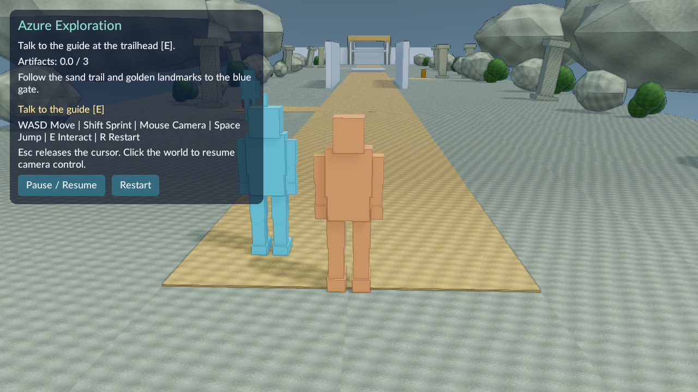
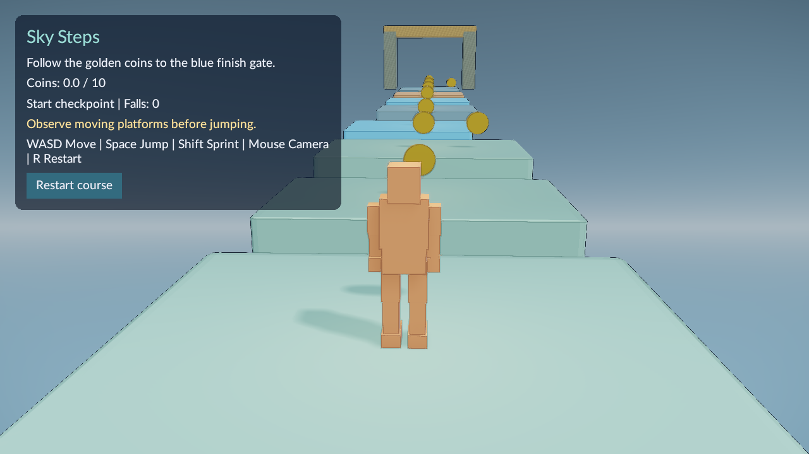
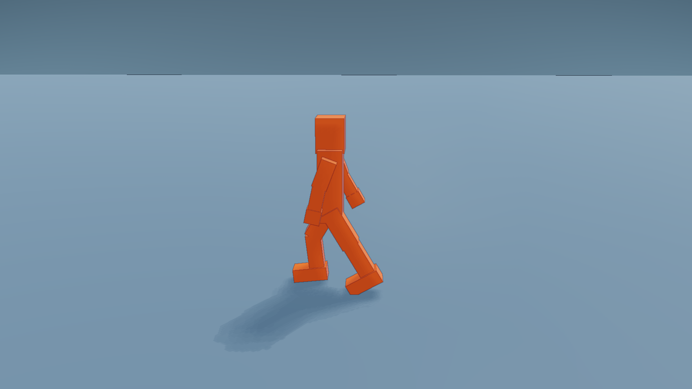

# AzureRender 工程

阶段状态见[当前状态](docs/plans/current-stage-status.md)。
阶段收尾与验收顺序见[执行说明](docs/acceptance/phase-closure.md)。

工作区迁移与本轮检查见[交付结果](docs/acceptance/ui8/2026-10-12.md)。
Debug 与 Release 各 187 项 CPU 回归通过。

相机、变换与场景视口见[视口指南](docs/tutorials/viewport-workspace.md)。

对象选择与属性操作见[编辑指南](docs/tutorials/selection-properties.md)。

资源查找与日志操作见[面板指南](docs/tutorials/browser-console.md)。
资源与日志迁移结果见[阶段验证](docs/acceptance/ui5/2026-10-12.md)。

安装版入口、UI 与发布能力见[产品化状态](docs/ui-productization-status.md)。
自动工作流与剩余复核见[交付验证](docs/acceptance/ui4/2026-10-12.md)。

双击安装目录中的 bin/AzureRender.exe 进入项目中心。
项目可以独立创建、重开、编辑保存与 GUI 发布。
发布目录包含项目命名的游戏 exe、Runtime 与资源。

使用步骤见[项目中心指南](docs/tutorials/project-center.md)。
模块边界见[应用与 UI 架构](docs/architecture-ui-productization.md)。

音频设备通知通过有界队列处理重路由。
关闭先结束通知任务，再释放音频设备。
短时结果见[关闭修复](docs/acceptance/b1/2026-10-12.md)。

材质画布通过固定类型连接图生成公共材质文档。
布局、连接与编译值随材质保存，并共用撤销历史。
公共编辑入口为 `material.graph`。

长跑工具失败清理采用异步关闭与限时退出。
观察数据与强制终止结果独立保存。
范围见[有界清理验收](docs/acceptance/p8/2026-10-12-bounded-cleanup.md)。

P8 可推进的自动检查已执行。
公共矩阵在两配置中覆盖二十五种格式。
两配置各一百七十四项 CPU 回归通过。
两配置全部 GPU 用例通过，首轮失败保留。

最终六包与十组双设备移动隔离运行通过。
正式性能十五轮中，完整门禁通过十一轮。
四轮记录运行期热降频或热余量不足。
长跑和集中复核按[P8 验收](docs/acceptance/p8/2026-10-12.md)登记。

集中复核见[P8 人工操作表](docs/acceptance/p8/manual-review.md)。
历史限制见[归因复核](docs/acceptance/p8/historical-causality.md)。

G23 压缩音频通过非延期自动验收。
Opus/MP3 导出记录有效帧、延迟及填充。
两个项目完成公共制作和双设备移动发布。

证据见[G23 验收](docs/acceptance/g23/2026-10-12.md)。
P8 完整门禁按阶段结果及剩余条件验收。
正式性能、长跑及实体复核在 P8 验收。

G22 二维 DDS/KTX2 交换通过自动验收。
原始 mip 进入公共材料与实际纹理上传。
两个项目完成双设备移动包验证。

证据见[G22 验收](docs/acceptance/g22/2026-10-12.md)。
G23 结果按所属阶段来源维护。
正式性能及人工复核集中在 P8。

P7 第一批格式制作与交付通过自动验收。
两个空文档项目完成三类资产制作及往返。
材料、声音和动画通过实际生产路径验证。
两配置各一百七十二项 CPU 回归通过。

证据见[P7 验收](docs/acceptance/p7/2026-10-12.md)。
G22 结果按所属阶段来源维护。
正式性能及人工复核集中在 P8。

U17 资产交换体验通过非延期自动门禁。
资产及子树导出共用规划与任务服务。
中文及表情字符路径通过双宿主验证。
两配置各一百七十一项 CPU 回归通过。

证据见[U17 验收](docs/acceptance/u17/2026-10-12.md)。
P7 结果按所属阶段来源维护。
实体复核及正式性能集中在 P8。

G21 通用导出与往返通过自动验收。
十六种输出共用规划、写入与发布契约。
两配置各一百七十项 CPU 回归通过。
独立工具及导出项目通过移动交付检查。

教程见[资产交换](docs/runtime/asset-exchange.md)。
证据见[G21 验收](docs/acceptance/g21/2026-10-12.md)。
U17 结果按所属阶段来源维护。

G20 音频解码与生命周期通过自动验收。
四种输入共用导入、重导入及播放接口。
两配置各一百六十八项 CPU 回归通过。
四格式制作项目通过双设备移动发布检查。

指南见[音频导入](docs/runtime/audio-format-import.md)。
证据见[G20 验收](docs/acceptance/g20/2026-10-12.md)。
音频结果按所属阶段来源维护。

G19 图像格式与精度语义通过自动验收。
九种输入共用材质、预览及环境解码接口。
两配置各一百六十六项 CPU 回归通过。
两配置各二十二组新图像双设备渲染通过。

指南见[图像导入](docs/runtime/image-format-import.md)。
证据见[G19 验收](docs/acceptance/g19/2026-10-12.md)。
图像结果按所属阶段来源维护。

G18 模型互操作通过自动验收。
七种模型输入共用注册与 GLB 运行管线。
两配置各一百六十五项 CPU 回归通过。
最终源码两配置各十四组双设备转换渲染通过。

指南见[模型导入](docs/runtime/model-format-import.md)。
证据见[G18 验收](docs/acceptance/g18/2026-10-12.md)。
模型结果按所属阶段来源维护。

G17 格式注册与共享传输通过自动验收。
两配置共三百二十八项 CPU 及二十八项 GPU 回归通过。
契约见[资产格式服务](docs/runtime/asset-formats.md)。
格式能力按阶段持续验收。

双工作流制作及五项目双设备移动发布通过。
范围见[P6 自动验收](docs/acceptance/p6/2026-10-12.md)。
资产格式阶段按公共契约连续推进。

创建、目录取消及制作恢复两配置各十一项回归通过。
范围见[U16 自动验收](docs/acceptance/u16/2026-10-12.md)。

## 当前自动制作验收

两种空项目的生产制作回放通过。
范围见[U15 自动验收](docs/acceptance/u15/2026-10-12.md)。
实体操作与真实效率在 P8 复核。

P5 剩余门禁在 P8 集中验收。
U15 至 G23 按自身功能、回归及发布门禁连续推进。
范围见[P8 集中门禁](docs/plans/2026-10-12-p5-deferred-to-p8.md)。

帧调度候选的回归与范围见[机制验收](docs/acceptance/p5/closure/frame-pacing.md)。
人工待项在 P8 复核，非桌面输入 GPU 回归通过。
正式性能十四轮通过，一轮热状态失败。
来源与待项见[本轮验收](docs/acceptance/p5/closure/automatic-resume.md)。

正式测量使用运行期间的周期设备观察。
范围与证据见[环境观察验收](docs/acceptance/p5/closure/run-environment-monitor.md)。

各阶段自动门禁按[执行计划](docs/plans/2026-10-11-automatic-through-p8.md)连续推进。
实体操作、听感和制作效率在 P8 集中复核。

OBS 层对照、正式十五轮及驱动提交见[诊断验收](docs/acceptance/p5/closure/obs-layer-control.md)。
人工验收保持待验，结果按真实操作填写。

长跑观测机制与正式平台路线见[验收记录](docs/acceptance/p5/closure/observation-control.md)。
完整性能、归因与人工体验按各阶段门禁维护。

缺页追踪与原目标复测见[诊断记录](docs/acceptance/p5/closure/pagefault-trace-results.md)。
正式性能、完整归因与实体使用按阶段证据验收。

内容目录通过自有任务回收缓存与快照。
万文件取消及连续重置按一百毫秒验收。
机制与证据见[目录回收验收](docs/acceptance/u16/directory-reclamation.md)。

系统追踪已核验采集与已知调用覆盖。
完整内存归因仍待验收。
结果见[系统追踪验收](docs/acceptance/p5/closure/system-trace-results.md)。

脚本服务使用统一绑定描述与对象身份守卫。
Lua 为默认后端，CoreCLR 与 NativeAOT 为可选原型。
范围与部署见[脚本服务](docs/runtime/script-services.md)。

AzureRender 使用 C++17 与原生 Vulkan 实现渲染核心。引擎提供 Windows 编辑器、独立 Player、资产管线和第三人称玩法。公开探索项目贯通制作、运行与游戏发布。


公开场景由 Release 构建捕获。设备为 RTX 4060 Laptop，分辨率为 1920×1080。编辑器与探索场景采用 100 实体负载。


截图展示公开探索项目。菜单、停靠面板和制作流程见[关卡制作教程](docs/tutorials/editor-first-game.md)。

探索主路由沙土道路、金色地标和蓝色终点引导。
平台关卡依据角色实测轨迹布置连续跳跃。
以下运行画面均使用公开程序化资源。





## 使用入口

交付门禁与人工复核见[P5 验收](docs/acceptance/p5/2026-10-10.md)。

平台跳跃、承载与连续通关见[平台关卡](docs/runtime/platformer-gameplay.md)。

探索路线、Blender 与材质见[环境制作](docs/runtime/exploration-environment.md)。

场景标签、动画、脚本与 Prefab 见[内容制作](docs/runtime/authoring-workflows.md)。

右键漂浮、六向视图与辅助见[视口导航](docs/runtime/viewport-navigation.md)。

材质参数、贴图与槽位覆盖见[材质制作](docs/runtime/material-authoring.md)。
独立模拟、碰撞形状与铰链见[物理制作](docs/runtime/physics-authoring.md)。
目录导航、资产打开与基础创建见[内容导航](docs/runtime/content-navigation.md)。
文件制作与纹理设置见[内容事务](docs/runtime/content-transactions.md)。
批量属性、三轴重置与引用见[属性编辑](docs/runtime/property-editing.md)。
项目创建、最近项目与布局见[项目工作区](docs/runtime/project-workspace.md)。
产品化与游戏阶段见[正式实施计划](docs/plans/2026-10-09-editor-productization.md)。

独立预览、缩略图与重载见[开发期资源服务](docs/runtime/development-previews.md)。编译诊断和图像输出通过生产操作查询。

可选内容辅助见[内容提案](docs/runtime/content-proposals.md)。场景候选经事务应用，资产候选保存生成来源。

界面基础、扩展面板与设置见[UI 与设置](docs/runtime/ui-settings.md)。用户偏好按来源分层，在帧边界生效。

自动观察与生成来源见[运行时说明](docs/runtime/observations-generation.md)。统一工具见[开发命令参考](docs/reference/developer-cli.md)。查询、输入与编辑使用生产契约。

编辑服务与文档版本见[编辑操作参考](docs/runtime/edit-operations.md)。批量失败保持文档与历史。菜单、快捷键与自动工具调用同一注册入口。

| 目标 | 文档 |
| --- | --- |
| 构建和运行 | [构建与使用](docs/getting-started.md) |
| 运行公开游戏 | [第三人称探索关卡](docs/runtime/exploration-gameplay.md) |
| 制作关卡 | [从空关卡制作并发布游戏](docs/tutorials/editor-first-game.md) |
| 发布游戏 | [Windows 游戏发布](docs/runtime/game-publishing.md) |

## 构建编辑器

Windows 工具链为 MSVC、CMake、Ninja、Vulkan SDK 和 vcpkg。本机验收使用 MSVC 14.44 与 Vulkan SDK 1.4.350。

```powershell
$env:VULKAN_SDK = "C:/VulkanSDK/1.4.350.0"
$env:VCPKG_ROOT = "C:/path/to/vcpkg"
./tools/msvc_env.bat cmake --preset msvc-release
./tools/msvc_env.bat cmake --build --preset msvc-release
./build/ninja-msvc-release/AzureRender.exe --editor-project assets_public/exploration/project.azureproject
```

将 vcpkg 路径替换为本机目录。公开示例制作流程使用可写工作副本。安装与发布以完整目录为单位，操作见 [游戏发布](docs/runtime/game-publishing.md)。

## 引擎能力

| 范围 | 内容 |
| --- | --- |
| Render Core | Render Graph、GPU 场景、蒙皮、光照、阴影、透明、描边、诊断与捕获 |
| Runtime | ECS、反射、版本化关卡、Prefab、Jolt、Lua、动画、声音与 RmlUi |
| Editor | 层级、属性、导入、撤销、预览、玩法调试和构建 |
| Player | 项目挂载、输入、角色与相机、任务、切关、重开和退出 |
| 场景扩展 | Character、Blackhole、Sample 与进程内 Renderer SDK |

架构入口为 [引擎基础](docs/runtime/engine-foundation.md)和[渲染器架构](docs/architecture.md)。场景与接口职责通过源码、Schema 和测试定义。

## 验证

```powershell
./tools/msvc_env.bat cmake --preset msvc-debug
./tools/msvc_env.bat cmake --build --preset msvc-debug
ctest --test-dir build/ninja-msvc-debug -C Debug --output-on-failure
cmake -DBUILD_DIR=build/ninja-msvc-release -DCONFIG=Release -P tools/run_release_gate.cmake
python tools/audit_repository.py --source ../.. --output build/repository-audit.json
```

GPU 验收串行执行。发布门禁覆盖真实游戏包、移动安装树、隔离运行和许可清单。视觉与性能结果见[可玩关卡性能](docs/runtime/playable-performance.md)和 [P2 验收](docs/acceptance/p2/2026-10-05.md)。

| 平台与设备 | 范围 |
| --- | --- |
| Windows x64、RTX 4060 Laptop | 1080p 完整预算、制作、任务与长跑 |
| Windows x64、Intel 核显 | 540p 完整任务、重开与释放 |
| Ubuntu 24.04 CI | 公共构建、软件渲染与文档回归 |

## 公开游戏画面



侧面视角展示公开机器人的行走姿态。输入事件、角色场景和捕获帧进入展示清单。


探索场景展示主角、同伴、关卡与任务界面。图片来源见[展示清单](portfolio/portfolio_manifest.json)。

## 工程结构

`src/` 保存模块实现，`shaders/` 保存 GLSL 与 Slang 模块。`tests/` 保存契约测试，`tools/` 保存构建与验收工具。`docs/` 保存活动说明和阶段证据。`portfolio/` 保存精选公共图像及 manifest。

## 当前开发

编辑器提供共享输入路由、尺度构图和保存保护。
选择服务支持过滤多选、范围选择与大纲揭示。
操纵器提供空间变换、组操作、吸附及取消恢复。
内容制作共享引用描述、资产目录和会话任务。
层级拖拽、组件编辑和射线放置经公共操作执行。
操作见[编辑器交互教程](docs/tutorials/editor-interaction.md)。
问题与修复顺序见[体验实施计划](docs/plans/2026-10-07-editor-usability.md)。

[引擎实施计划](docs/plans/2026-10-06-engine-evolution.md)纳入全部 18 项借鉴。[架构评估](docs/research/2026-10-06-gknextengine.md)保留分级、源码和风险。F4、G8、U3、F5、U4、G9、R7、G10、R8、R9 已验收。

系统组合与配置说明见[运行系统装配](docs/runtime/system-composition.md)。F4 至 P3 的功能与交付验收已完成。

程序化内容通过生成器与标准资产管线进入项目。
几何与刚体契约见[程序化内容说明](docs/runtime/procedural-content.md)。
制作步骤见[生成内容教程](docs/tutorials/procedural-content.md)。

资源档位与稳定表面标识见[资源可见性说明](docs/runtime/resource-visibility.md)。

共享参数与可选着色策略见[着色模块说明](docs/runtime/shader-modules.md)。

公共能力通过探索项目和独立工具验收。

F1 至 P1、F3 和 R6 已完成。G7 角色方向与冲刺已验收。U2 工作区与教程、P2 展示与独立交付均已验收。

[总计划](docs/plans/azure-engine-plan.md)管理状态。[可玩体验优化步骤](docs/plans/2026-10-05-quality-round.md)定义已验收范围。[CHANGELOG.md](CHANGELOG.md)记录阶段交付。

## 资产与许可

`assets_public/` 包含公共示例、测试资产和许可。`assets_private/` 保存本机授权素材。公开包与截图使用许可明确资源。依赖许可见 [THIRD_PARTY_NOTICES.md](THIRD_PARTY_NOTICES.md)。

引擎交付与限制见[P3 验收](docs/acceptance/p3/2026-10-07.md)。

编辑器交互步骤见[交互教程](docs/tutorials/editor-interaction.md)。
内容类型、引用和任务见[内容制作服务](docs/runtime/content-workflows.md)。

## 角色渲染修复

角色渲染采用版本化材质通道与叠层契约。
根由与验收见[修复计划](docs/plans/2026-10-09-character-rendering-repair.md)。

实时抗锯齿采用边缘自适应过滤。
离线角色视频采用横纵各二倍超采样。
运行入口为 `--anti-aliasing off|edge|supersample`。
质量档通过关卡配置保存，并随尺寸变化重建资源。

角色渲染专项的 P0、P1 与 P2 已验收。
核心验收见[角色验收](docs/acceptance/character/2026-10-09.md)。

展示阴影采用完整圆盘纹素积分与曲率控制。
衣料和金属采用 GGX 高光，调色保留零黑位。
皮肤与脸部采用暖色色阶，间接光保留肤色色度。
诊断见[画面根由报告](docs/research/2026-10-09-character-presentation-refinement.md)。
执行与交付见[画面优化计划](docs/plans/2026-10-09-character-presentation-refinement.md)。
本机工作区 Release 的 175 项回归全部通过。
五段视频与性能边界见[展示验收](docs/acceptance/character/2026-10-09-refinement.md)。

后续路线见[P5 收口与使用体验计划](docs/plans/2026-10-10-p5-closure-and-user-experience.md)。
性能工具进度见[P5-A 验收](docs/acceptance/p5/closure/p5-a.md)。
驻留诊断进度见[P5-B 验收](docs/acceptance/p5/closure/p5-b.md)。
正式十五轮基线有两轮内存失败，归因边界已归档。
返回值追踪通过已知申请、释放及失败探针自检。
正式测量先校验构建来源，并冻结实际运行依赖。
输入与对象创建的 CPU 修复见[U16 记录](docs/acceptance/u16/2026-10-10.md)。
大纲创建与导航组合键的实际界面回放通过。
场景模板根据几何资源选择渲染后端。
切关缓存与第三套资源淘汰经实际运行验证。
后台任务期间的窗口关闭请求由会话保留。
平台实时长跑入口见[运行说明](docs/acceptance/p5/closure/platformer-long-run.md)。
完整制作与交付按[P6 验收表](docs/acceptance/p6/2026-10-10.md)记录。
P5 保持 Active，性能与人工门禁按实际证据维护。
制作体验问题见[双工作流审查](docs/research/2026-10-10-authoring-usability.md)。
双工作流自动制作的输入、耗时与恢复结果已归档。

连续关卡回放按目标提交等待，保持后续输入时序。

内存诊断已关联驱动调用与单区域驻留。
范围见[进程内追踪](docs/acceptance/p5/closure/native-memory-trace.md)。

管线缓存与驱动提交时序见[诊断对照](docs/acceptance/p5/closure/pipeline-timing.md)。

管线执行信息契约见[查询验收](docs/acceptance/p5/closure/pipeline-inspection.md)。
正式十五轮候选测量有一轮工作集增长超限。
原始结果与映射边界见[诊断记录](docs/acceptance/p5/closure/mapping-inspection.md)。

外部文件恢复契约见[文档保护复核](docs/acceptance/p5/closure/document-guard-scan.md)。
两配置完整回归共四百五十四项通过。

回归、移动发布与标准三十分钟长跑通过。
当前结果见[软件候选验收](docs/acceptance/p5/closure/software-candidate-2026-10-11.md)。
正式性能与人工复核保持待验。

界面几何使用共享缓冲页，保留在途退休规则。
界面共享页候选的回归与实测见[界面驻留验收](docs/acceptance/p5/closure/ui-residency.md)。
历史内存归因和人工门禁继续按实际结果维护。

资产缓存使用独立暂存目录与完整文件发布。
Windows 缓存读取共享发布所需的删除访问。
缓存候选的回归与实测见[缓存并发验收](docs/acceptance/u16/cache-publication.md)。
人工门禁与历史内存归因按各自证据维护。

性能测量依据驱动热限制与稳定空闲窗口启动。
温度、热降频与后台占用保留原始观察。
规则和实测见[设备环境验收](docs/acceptance/p5/closure/device-environment.md)。

后续任务与阶段顺序见[开发路线](docs/plans/2026-10-11-next-development.md)。
资产格式后续阶段见[拓展计划](docs/plans/2026-10-11-asset-format-expansion.md)。
当前验收完成后推进模型、图像、音频及导出交换。


## 二维内容与扩展格式

GIF、PSD、SVG 和 USDA 通过公共导入服务接入。
范围见[扩展格式说明](docs/assets/extended-formats.md)。

二维场景支持精灵、矩形及中文文本。
二维图元与投影标签沿用公共渲染资源契约。
使用方式见[二维内容说明](docs/runtime/scene-2d.md)。

集成检查覆盖两配置回归和移动二维项目。
Windows 内存界面文档使用安全来源路径。
音频通知归属底层音频模块并通过边界检查。
结果见[P9 集成记录](docs/acceptance/p9/2026-10-12.md)。
