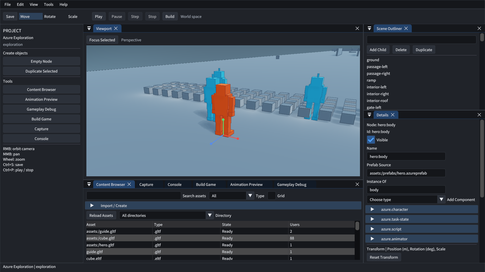

# AzureRender 工程

本机环境与后续任务见[环境恢复与开发计划](docs/plans/2026-10-30-development-recovery.md)。

完整物流场景的当前截图与启动入口见[画面恢复](docs/acceptance/recovery/full-scene-visual.md)。

完整环境与角色同屏的实际画面见[联合验证](docs/acceptance/recovery/full-scene-character.md)。

资产引用、热刷新及内存验证见[依赖索引](docs/acceptance/recovery/asset-dependency-index.md)。

项目启动共享、双配置完整入口及图像见[启动快照验证](docs/acceptance/recovery/project-startup-context.md)。

原生射线的计算顺序及冻结数值参考见[顺序验证](docs/acceptance/nr/native-ray-arithmetic-order.md)。

双配置 Vulkan 完整输出、载荷及复现见[射线参考验证](docs/acceptance/nr/native-ray-vulkan-reference.md)。

公共投影射线的输入、编码及资源顺序见[接口说明](docs/runtime/projected-reflection-ray.md)。

相机变换、线性运动及独立镜面见[相机适配验证](docs/acceptance/nr/projected-camera-adapter.md)。

投影深度、法线转换及分帧所有权见[表面准备](docs/runtime/projected-reflection-preparation.md)。

公共生产、历史输入和足迹过滤见[投影反射组合](docs/runtime/projected-screen-reflection.md)。

完整程序清单及 DXC 热重载见[编译配置](docs/development/shader-hot-reload.md)。

类型化算法及真实 Player 当前帧生产见[场景接入](docs/acceptance/nr/projected-main-scene.md)。

采样位移校正及历史运动接收见[运动验证](docs/acceptance/nr/projected-history-motion.md)。

重装与迁移后先阅读[恢复交接](docs/plans/2026-10-29-reinstall-handoff.md)。

代码定位与有界读取见[源码导航](docs/development/source-navigation.md)。
显式管线编译统计见[GPU 管线检查](docs/development/pipeline-inspection.md)。
实际主场景热点与保留预算见[成本验证](docs/acceptance/nr/main-aa-cost-attribution.md)。

普通材质专用化及完整快照路径见[材质验证](docs/acceptance/nr/ordinary-material-specialization.md)。
基础功能集合、视图标志及编译依赖见[功能裁剪](docs/acceptance/nr/generic-material-feature-folding.md)。
类别共享功能位及动态回退见[特化验证](docs/acceptance/nr/material-class-feature-specialization.md)。

三层体积、公共材质及主场景绑定见[辐照接入](docs/acceptance/nr/irradiance-clipmap-scene.md)。
精确采样抖动及 NPR 接收边界见[查询位置](docs/acceptance/nr/irradiance-query.md)。
像素原点、镜像场方向及实际镜头见[查询坐标](docs/acceptance/nr/irradiance-query-frame.md)。
地面实际 UV 绑定及颜色上传见[地面绑定](docs/acceptance/nr/floor-runtime-binding.md)。

探针身份、动态反射链及对照镜头见[运行核验](docs/acceptance/nr/native-reflection-bindings.md)。
可配置的探针预滤波层级见[层级验收](docs/acceptance/nr/reflection-lod.md)。
有序体积、辐照亮度适配及生产消费见[探针验收](docs/acceptance/nr/reflection-probe-fields.md)。
双面镜像的法线、GI 及积分头发联合路径见[朝向验收](docs/acceptance/nr/surface-facing.md)。

截帧资源定位、明确来源和关卡快照见[来源选择](docs/acceptance/nr/scene-source-selection.md)。
原生 UV1、网格烘焙和统一运行表面见[坐标验收](docs/acceptance/nr/surface-uv-domain.md)。
Lit 法线阈值、重建下限及实际材质见[解码验收](docs/acceptance/nr/lit-normal-decoding.md)。
网格作者法线、角点及生产入口见[来源验收](docs/acceptance/nr/mesh-corner-normals.md)。

局部灯档案、实体身份及实际镜头见[倍率绑定](docs/acceptance/nr/local-light-profile-binding.md)。
活动主光的辐照输入及方向核对见[主光验收](docs/acceptance/nr/main-light-runtime-binding.md)。
级联上游遮挡范围及滤波尺度见[阴影验收](docs/acceptance/nr/cascade-caster-depth.md)。
局部灯源颜色、单精度解码及温度边界见[颜色验收](docs/acceptance/nr/local-light-color-space.md)。

活动颜色表、硬件采样及实际镜头见[调色验收](docs/acceptance/nr/captured-color-grading-lut.md)。
活动灯光索引、公共快照及接收范围见[灯光验收](docs/acceptance/nr/captured-active-lights.md)。
静态作者法线与精确轴置换见[批量验收](docs/acceptance/nr/static-authored-normals.md)。
上方与后方来源接入见[围护验收](docs/acceptance/nr/enclosure-authored-normals.md)。

物流图层、完整材质与实际绘制见[图层接入](docs/runtime/unlit-texture-layers.md)。
活动物流图层、颜色及采样来源见[截帧绑定](docs/acceptance/nr/captured-vfx-layers.md)。
层级采样、覆盖率及实际实例见[绘制验收](docs/acceptance/nr/vfx-mip-and-coverage.md)。
近远淡出、材质保留行及实际图层见[深度验收](docs/acceptance/nr/vfx-view-depth-fade.md)。

公共顶点颜色、多流绑定及实际特效见[颜色验收](docs/acceptance/nr/vertex-color-streams.md)。
柱面视角覆盖率与加色合成见[合成验收](docs/acceptance/nr/view-dependent-vfx-coverage.md)。
实际箱体姿态、共享材质及完整镜头见[箱体验收](docs/acceptance/nr/captured-logistics-boxes.md)。
独立覆盖率、作者层级及实际字形见[覆盖率验收](docs/acceptance/nr/unlit-coverage-texture.md)。

三项原生材质组合与隔离绘制见[组合验收](docs/acceptance/nr/remaining-vfx-combinations.md)。
基础坐标扰动、独立采样及实际墙面见[扰动验收](docs/acceptance/nr/base-uv-distortion.md)。
中央字形柱与独立覆盖率组合见[字形柱验收](docs/acceptance/nr/central-glyph-composition.md)。
雾效传输、体积格式及原版载荷见[雾效数据验收](docs/acceptance/nr/fog-transport-data.md)。

三维雾场上传、原版采样及资源释放见[雾场 GPU 验收](docs/acceptance/nr/fog-volume-gpu.md)。
像素原点、抖动及深度映射见[视图坐标验收](docs/acceptance/nr/view-fog-projection.md)。
场景资源、捕获视图及保存重开见[绑定验收](docs/acceptance/nr/view-fog-scene-binding.md)。
预积分雾场、实际表面与资源隔离见[表面验收](docs/acceptance/nr/view-fog-surfaces.md)。

中央白色标识与浮点附件对照见[标识验收](docs/acceptance/nr/central-late-glyph.md)。
逐采样深度、覆盖率与双配置回归见[轮廓验收](docs/acceptance/nr/view-fog-multisample.md)。
普通无光照表面、附件一致性及 GPU 成本见[预算验收](docs/acceptance/nr/unlit-opaque-budget.md)。
光谱大气、远端片元与公共数值见[解析雾验收](docs/acceptance/nr/analytic-fog.md)。

场景支持[解析雾配置](docs/runtime/scene-fog.md)及独立解析介质。
双配置、真实片元与完整候选见[合成验收](docs/acceptance/nr/scene-fog.md)。
阶段截图、机位和待验差异见[画面记录](docs/acceptance/nr/visual-history.md)。
物流彩色环带的源实例及采样见[还原验收](docs/acceptance/nr/opaque-logistics-rings.md)。

公共 glTF 采样器及完整场景结果见[采样器验收](docs/acceptance/nr/gltf-sampler-contract.md)。
原版动态反射过滤及公共接入边界见[来源验收](docs/acceptance/nr/reflection-filter-source.md)。
四通道表面快照及格式选择见[快照契约](docs/runtime/reflection-surface-snapshot.md)。
最近深度、反向深度及奇数维度归约见[层级契约](docs/runtime/depth-pyramid.md)。

计算射线、投影重建及基础信号生产见[射线契约](docs/runtime/reflection-ray.md)。
主场景计算生产、资源预算及消费见[组合契约](docs/runtime/screen-reflection.md)。
半分辨率生产、真实深度及整数选样见[尺寸验收](docs/acceptance/nr/reflection-resolution.md)。
反射历史计算及借用图像资源见[时间过滤契约](docs/runtime/reflection-temporal.md)。

时间核的公共组合与槽位验证见[组合验收](docs/acceptance/nr/reflection-temporal-composition.md)。
公共运动选样及深度接收见[重投影契约](docs/runtime/reflection-reprojection.md)。
前置运动与主场景反射历史见[装配验收](docs/acceptance/nr/main-reflection-history.md)。
完整场景的逐事件成本见[GPU 热点](docs/acceptance/nr/reflection-pass-profile.md)。

普通材质快照特化及画面兼容见[预算验证](docs/acceptance/nr/snapshot-shading-budget.md)。
原版射线输入、过滤足迹及数值待项见[来源核验](docs/acceptance/nr/native-ray-source.md)。
共享运动目标及画面兼容范围见[共享验收](docs/acceptance/nr/shared-motion.md)。
时序 KK 动态夹具及剩余范围见[运动边缘验证](docs/acceptance/nr/temporal-motion-edges.md)。

隐藏平台的运动覆盖及实际附件见[可见性验证](docs/acceptance/nr/motion-visible-surfaces.md)。
服饰及 KK 动态门槛见[轮廓显示验证](docs/acceptance/nr/temporal-display-edges.md)。
独立过滤资源及双配置结果见[公共过滤验收](docs/acceptance/nr/reflection-spatial-filter.md)。
实际镜头、上向量及输入指纹见[相机来源](docs/acceptance/nr/capture-camera.md)。

原生数组、零符号约定及双配置硬件采样见[数组验收](docs/acceptance/nr/octahedral-environment.md)。

原生时序输入与运动解码见[时序核验](docs/acceptance/nr/native-temporal-inputs.md)。
主辅视图的历史提交边界见[时序帧状态](docs/runtime/temporal-frame-state.md)。

材质变体资源归属与实际片元核对见[合成验证](docs/acceptance/nr/character-composite-diagnosis.md)。
逐材质 NPR 光色及真实皮肤色带见[光色验证](docs/acceptance/nr/npr-material-lighting.md)。
材质边缘响应、视角色彩及正交切线见[边缘验证](docs/acceptance/nr/material-rim-and-view-tint.md)。
有符号主光色带及身体输入见[色带验证](docs/acceptance/nr/signed-main-ramp.md)。

角色可见量来源及对象阴影生产见[阴影验证](docs/acceptance/nr/character-visibility-inputs.md)。
实例 GPU 布局及原生投影输入见[实例验证](docs/acceptance/nr/instance-gpu-contract.md)。
逐材质完整几何与平方根 Alpha 投影见[覆盖验证](docs/acceptance/nr/material-shadow-coverage.md)。
对象阴影的注册配置、文档及投影见[配置验证](docs/acceptance/nr/object-shadow-configuration.md)。

独立深度输入、共享采样器及实际画面见[采样验证](docs/acceptance/nr/shared-depth-sampling.md)。
对象图集、GPU 过滤及真实角色边界见[对象阴影验证](docs/acceptance/nr/object-shadow-gpu.md)。
公共对象可见量隔离支持生产输入与光照贡献分别核对。
逐材质局部漫反射下限见[响应验证](docs/acceptance/nr/material-local-wrap.md)。

对象接收位置与原生可见量见[坐标验证](docs/acceptance/nr/object-shadow-receiver.md)。

眼睛 NPR 适配及完整材质文档见[输入验收](docs/acceptance/nr/eye-npr-inputs.md)。
原生采样器、硬件层级及梯度进入独立证据核对。
完整眼部区域、层级边界及动态姿态继续验收。
材质槽位查询与主场景图像回归见[元数据验收](docs/acceptance/nr/material-slot-inspection.md)。

九动画角色、完整文档及实际转身见[主场景验证](docs/acceptance/nr/main-character-integration.md)。
原生双帧的实例及跨阶段调色板见[来源核对](docs/acceptance/nr/material-frame-instance-producer.md)。
身体骨盆原点及双配置验证见[径向原点验收](docs/acceptance/nr/body-rim-origin.md)。
蒙皮齐次位置及剩余严格图像门禁见[位置验收](docs/acceptance/nr/skinning-position-consistency.md)。

服饰二维高光的公共契约与实际画面边界见[服饰验收](docs/acceptance/nr/cloth-specular-ramp.md)。
服饰原生输入、组合照明及主候选见[接入验收](docs/acceptance/nr/cloth-native-integration.md)。
普通材质零贡献光源及主场景预算见[成本验证](docs/acceptance/nr/ordinary-light-zero-energy.md)。
不透明副本预填及共面规则见[预填验证](docs/acceptance/nr/opaque-snapshot-depth-prefill.md)。

不透明主通道预填、实际计数及联合成本见[主通道验证](docs/acceptance/nr/opaque-main-depth-prefill.md)。
完整资产缓存复用、并发恢复及实际入口见[缓存验证](docs/acceptance/nr/complete-asset-cache-reuse.md)。
距离描边的共享数学与深度来源见[分项验证](docs/acceptance/nr/outline-depth-source.md)。
公共材质、可选方向流和独立深度壳见[接入验证](docs/acceptance/nr/outline-material-integration.md)。

实际投影、独立裁剪图及动态主候选见[覆盖验证](docs/acceptance/nr/hair-depth-coverage.md)。
共享角色可见量、环境域及第七版主入口见[接收验收](docs/acceptance/nr/hair-object-visibility.md)。
公共精确深度偏置与原生对象图集见[生产验收](docs/acceptance/nr/object-shadow-exact-bias.md)。
头发与眼睛的硬件层级边界见[采样诊断](docs/acceptance/nr/hair-sampling-boundary.md)。

场景支持[风格化漫反射照明](docs/runtime/npr-illumination.md)。
数值与原生输入范围见[照明验收](docs/acceptance/nr/npr-illumination.md)。
实际顶点与采集调色表见[专项验证](docs/acceptance/nr/captured-vertex-and-grading.md)。
头发手性、色带及分层输入见[坐标约定](docs/acceptance/nr/projected-hair-coordinates.md)。

图片采样、原生 mip 及完整文档见[输入验证](docs/acceptance/nr/typed-image-inputs.md)。
独立层级过滤、偏移及编辑消费见[采样状态](docs/acceptance/nr/sampler-filter-and-bias.md)。
头发材质光色及双叶组合照明见[实际验证](docs/acceptance/nr/projected-hair-lighting.md)。
捕获局部灯的输入和组合顺序见[记录验证](docs/acceptance/nr/captured-character-local-lights.md)。

公共局部灯颜色及场景兼容见[运行验证](docs/acceptance/nr/character-local-light-response.md)。
实际矩阵投影与点光覆盖见[聚簇验证](docs/acceptance/nr/clustered-light-projection.md)。
有限线形积分、旋转与主叶消费见[线形验证](docs/acceptance/nr/character-line-light.md)。
有序颜色混合、轴向距离及分项能量见[混合验证](docs/acceptance/nr/character-color-blend.md)。

屏幕深度与镜面角色灯见[专项验证](docs/acceptance/nr/character-screen-light-modes.md)。
捕获子像素相机与公共射线见[投影验证](docs/acceptance/nr/camera-projection-offset.md)。
真实头发正主叶及逐层关闭对照见[分层验证](docs/acceptance/nr/projected-hair-positive-layers.md)。
共享颜色核与原生片元见[头发照明验证](docs/acceptance/nr/captured-hair-illumination.md)。

全局环境权重与主灯条纹见[贡献验证](docs/acceptance/nr/ambient-weight-and-main-line.md)。
同机位诊断支持[捕获姿态与材质帧](docs/acceptance/nr/captured-character-pose.md)。
投影头发支持显式虚拟主灯与独立条纹。
数值、GPU 及实际消费见[条纹验收](docs/acceptance/nr/projected-hair-line.md)。

完整材质文档接入共享 glTF 解释器与 UUID 依赖。
十三槽真实角色对照见[完整文档验收](docs/acceptance/nr/complete-material-document.md)。

公共材质支持保留源角色效果的参数覆盖。
CPU、GPU 与真实角色对照见[覆盖验收](docs/acceptance/nr/material-parameter-overrides.md)。

主关卡与可玩入口已接入首批角色材质候选。
四次捕获及原生待项见[接入验证](docs/acceptance/nr/main-character-integration.md)。

公共材质文档的正值自发光强度启用对应功能位。
CPU 与编辑回归范围见[解释验证](docs/acceptance/nr/material-document-emission.md)。

渲染接入缺口与架构约束已纳入[当前计划](docs/plans/2026-10-22-render-capability-integration-audit.md)。
环形多层高光、距离描边和公共材质制作仍有明确待项。
专项候选与主项目接入分别验收。

头发次级高光颜色已按实际帧完成线性转换。
范围见[头发高光验收](docs/acceptance/nr/projected-hair.md)。

服饰镜面参数支持独立来源与倍率。
契约与范围见[服饰镜面验收](docs/acceptance/nr/cloth-specular-input.md)。

脸部径向环境法线已通过数值与真实近景检查。
范围见[脸部法线验收](docs/acceptance/nr/face-radial-indirect.md)。

双锚帧的 1271 个事件已有完整管线索引。
范围见[绑定索引](docs/acceptance/nr/native-binding-index.md)。

终末地九份 D3D11 原生帧通过官方 1.46 加载与通道查询。
中庭与莱万汀各一帧完成 2560×1440 实际图像导出。
证据见[原生帧验证](docs/acceptance/nr/native-game-captures.md)。
当前按真实截帧持续实施，入口为[还原计划与交接](docs/plans/2026-10-22-native-render-restoration-handoff.md)。

角色材质支持显式[环境漫反射法线](docs/acceptance/nr/character-indirect-normal.md)。
公共检查及身体皮肤候选已完成分项验证。

角色材质支持显式的影色组合与逐灯接收范围。
主光能量遮挡通过[双配置检查](docs/acceptance/nr/character-main-shadow.md)。
原生组合候选的照明绑定与完整外观继续验收。
实现及结果见[颜色与接收验收](docs/acceptance/nr/character-color-receivers.md)。

原生 GI 工具支持三层组合及方向 Alpha 保留。
离线验证与运行待项见[组合验收](docs/acceptance/nr/irradiance-composition.md)。
三维上传及官方体积输入见[资源验收](docs/acceptance/nr/volume-image-upload.md)。
三层资源与活动片元硬件采样见[精度验收](docs/acceptance/nr/irradiance-clipmap-resource.md)。

反射射线预计算通过双配置图像及动态遮挡回归。
真实中庭短测及边界见[射线验收](docs/acceptance/nr/reflection-ray-math.md)。

粗糙反射支持投影足迹、深度门控及探针回退。
双配置及实际中庭见[过滤验收](docs/acceptance/nr/reflection-roughness.md)。

原生表面转换覆盖三通道颜色、金属度和粗糙度。
公共入口与采样域范围见[地面材质验收](docs/acceptance/nr/floor-surface-conversion.md)。

屏幕空间反射支持本帧角色、场景与探针回退。
实际中庭与检查见[动态反射验收](docs/acceptance/nr/screen-space-reflections.md)。

中庭方向光照覆盖扩展至后方及上下层。
验证范围见[全局光照覆盖](docs/acceptance/nr/irradiance-coverage.md)。

环境镜面支持显式多重散射拟合及介电反射率。
验证与原生待项见[镜面响应验收](docs/acceptance/nr/environment-specular.md)。

局部反射支持原生六面 HDR 层级与独立投影原点。
公共机制及实景待项见[六面反射验收](docs/acceptance/nr/reflection-cube.md)。

径向眼表面支持视差、Matcap 与显式宿主照明。
公共验证及原生待项见[眼睛验收](docs/acceptance/nr/eye-radial-surface.md)。

三个公开模型工程已交付，支持编辑、保存和独立发布。
PT0 至 PT7 已完成，历史 P8 待项按原清单维护。
打开方法见[公开光追演示](docs/tutorials/public-pathtracing-demos.md)。
本轮范围见[路径追踪实施计划](docs/plans/2026-10-15-pathtracing-completion.md)。

WC1 至 WC6 完成，安装入口与演示项目已更新。
操作步骤见[世界参照、相机与路径追踪](docs/tutorials/world-camera-rendering.md)。

界面操作与模块归属见[编辑器界面说明](docs/tutorials/editor-interface.md)。

界面改进方向见[实施方案](docs/plans/2026-10-14-ui-modernization.md)。
可直接打开[视觉提案](docs/design/ui-modernization/preview.html)。
VD0 研究与设计完成，VD1 至 VD5 完成，VD6 为 Ready。
自动交付已验证，可进入集中人工复核。

启动入口与证据见[界面交付记录](docs/acceptance/vd/2026-10-14.md)。

构建目录、临时输出和定期清理见[产物管理](docs/development/artifact-retention.md)。

UX-A 至 UX-D 完成，UX-E 为 Ready。
自动检查已完成，新版使用体验等待集中确认。
交付入口与结果见[本轮交付](docs/acceptance/ux/2026-10-14.md)。
范围与阶段记录见[交互优化计划](docs/editor-usability-audit.md)。

用户已反馈人工复核基本可用，交互体验需要优化。

ED0 至 ED7 开发交付完成，P8 状态为 Ready。
开发任务见[编辑器实施计划](docs/plans/2026-10-14-editor-generalization.md)。
本轮机器批次已收尾，实体与历史条件待满足。

阶段状态见[当前状态](docs/plans/current-stage-status.md)。
阶段收尾与验收顺序见[执行说明](docs/acceptance/phase-closure.md)。

工作区迁移记录见[UI8 交付结果](docs/acceptance/ui8/2026-10-12.md)。
本轮检查见[P8 收尾记录](docs/acceptance/p8/2026-10-14.md)。

相机、变换与场景视口见[视口指南](docs/tutorials/viewport-workspace.md)。

对象选择与属性操作见[编辑指南](docs/tutorials/selection-properties.md)。

资源查找与日志操作见[面板指南](docs/tutorials/browser-console.md)。
资源与日志迁移结果见[阶段验证](docs/acceptance/ui5/2026-10-12.md)。

安装版入口、UI 与发布能力见[产品化状态](docs/ui-productization-status.md)。
自动工作流与剩余复核见[交付验证](docs/acceptance/ui4/2026-10-12.md)。

AzureRender 是使用 C++17 与原生 Vulkan 的 Windows 引擎。编辑器、运行时和独立 Player 提供内容制作、游戏运行与发布能力。公开探索项目用于验证这些公共能力。

## 阅读入口

| 想了解什么 | 阅读入口 |
| --- | --- |
| 现在完成了什么，还有什么待验 | [项目现状](docs/project-status.md) |
| 接下来按什么顺序开发 | [开发总计划](docs/plans/azure-engine-plan.md) |
| 自动执行怎样推进，检查怎样安排 | [协作与验收](docs/development-workflow.md) |
| 构建并运行项目 | [构建与使用](docs/getting-started.md) |
| 从空项目制作并发布游戏 | [制作教程](docs/tutorials/editor-first-game.md) |
| 从安装版 GUI 创建、重开与发布项目 | [项目中心使用指南](docs/tutorials/project-center.md) |

## 当前可用能力

角色材质支持二维发丝高光与独立表面响应。
源参数、双配置检查及范围见[高光验收](docs/acceptance/nr/projected-hair.md)。
显式角色外轮廓支持实例覆盖与独立渐隐。
真实脸部及兼容待项见[外轮廓验收](docs/acceptance/nr/outline-coverage.md)。

脸部数值控制及其范围见[高光正控制](docs/acceptance/nr/face-specular-control.md)。
场景角色的局部探针消费材质镜面权重与诊断开关。
分项结果见[反射控制](docs/acceptance/nr/character-probe-controls.md)。
特效表面支持显式无光照颜色与透明度组合。

来源及双配置检查见[特效验收](docs/acceptance/nr/unlit-surface.md)。

双击安装目录中的 `bin/AzureRender.exe` 进入项目中心。
新建或打开工程后进入编辑器，项目目录独立保存。
GUI 发布产生项目命名的 exe 与完整游戏目录。
启动和 UI 分层见[应用架构](docs/architecture-ui-productization.md)。

项目打开与资源初始化记录见[启动诊断](docs/development/startup-diagnostics.md)。
窗口最小化的控制与任务轮询见[表面生命周期](docs/runtime/surface-lifecycle.md)。
编辑资源同步采用成功加载的场景快照作为基线。
引用变化、显式刷新及加载失败见[基线验收](docs/acceptance/nr/editor-resource-load-baseline.md)。

主视口、辅助视口与 Player 共用空间抗锯齿。
模式包含关闭、原生分辨率过滤和四子像素超采样。
配置与边界见[抗锯齿说明](docs/runtime/spatial-antialiasing.md)。
模式三的运动、历史和资源契约见[时序抗锯齿](docs/runtime/temporal-antialiasing.md)。

描边输出像素与细线能量见[覆盖验证](docs/acceptance/nr/outline-temporal-footprint.md)。
高光隔离的显示倍率与曝光见[分量测量](docs/runtime/component-radiometry.md)。
投影头发的可选采样积分见[材质验证](docs/acceptance/nr/projected-hair-pixel-integral.md)。
不透明高光运动及部分响应见[运动验证](docs/acceptance/nr/material-motion-response.md)。

混合细线覆盖见[覆盖验证](docs/acceptance/nr/blend-temporal-coverage.md)。
裁剪纹理的缩小覆盖见[层级验证](docs/acceptance/nr/alpha-mip-footprint.md)。
混合节点渐隐及运动覆盖见[渐隐验证](docs/acceptance/nr/blend-fade-motion.md)。
真实角色移动与共面显露见[历史验证](docs/acceptance/nr/native-motion-history.md)。

裁剪足迹与运动外壳见[覆盖验证](docs/acceptance/nr/cutout-motion-coverage.md)。
动态高频门禁及几何样点对照见[细节验证](docs/acceptance/nr/native-detail-sampling.md)。
多样点 RHI 声明及场景目标见[采样契约](docs/runtime/multisample-shading.md)。
角色逐样点材质与动态质量见[材质验证](docs/acceptance/nr/multisample-character-material.md)。

多样点副本、描边和边缘光见[副本验证](docs/acceptance/nr/multisample-snapshot-outline.md)。
副本按颜色与深度需求选择着色，见[成本验证](docs/acceptance/nr/snapshot-depth-demand.md)。
公共脚本镜头与真实角色的动态细节见[镜头验证](docs/acceptance/nr/camera-motion-quality.md)。
公共四样点目标与最近深度解析见[专项验证](docs/acceptance/nr/multisample-scene-target.md)。

主辅视图画质、实际样本与回退见[视图验证](docs/acceptance/nr/multisample-view-quality.md)。
完整画质按[NR7-AA 计划](docs/plans/2026-10-22-spatial-antialiasing.md)推进。
时序历史、材质走样及主场景运动细节保持待验。
公共数值与生命周期结果见[验收记录](docs/acceptance/nr/spatial-antialiasing.md)。

原生中庭的三模式各完成 96 帧对齐采集。
数值结果与展示视频见[中庭抗锯齿验收](docs/acceptance/nr/native-atrium-antialiasing.md)。
后走廊接入后的三模式回归及视频见[联合复验](docs/acceptance/nr/native-atrium-antialiasing-post-corridor.md)。

中庭后方结构、道具及走廊已接入正式和可玩工程。
本轮共接入 605 个原生实例组与 283 份资源。
启动入口、四向画面与验收边界见[中庭完整性](docs/acceptance/nr/atrium-completeness.md)。

材质纹理按处理后像素与采样语义共享。
缓存集中持有 GPU 对象，并提供驻留统计。
使用契约见[纹理共享](docs/runtime/sampled-texture-cache.md)。
画面与释放结果见[验收记录](docs/acceptance/nr/sampled-texture-cache.md)。

场景矩阵导入支持近正负九十度旋转。
分解精度与来源诊断见[变换验收](docs/acceptance/nr/trs-pole-decomposition.md)。

编辑器支持场景层级、属性编辑、选择变换、内容导入、撤销重做和运行预览。运行时提供 ECS、物理、脚本、动画、声音及游戏界面。独立 Player 按项目数据运行，并通过 Windows 游戏包交付。

最近一轮实现了类型化材质画布、像素坐标二维文档及 GIF、PSD、SVG、ASCII USD 导入。格式注册覆盖 29 种输入、20 种输出，各格式有明确支持边界。二维内容和材质图的范围见[项目现状](docs/project-status.md)。

本轮 Debug 与 Release 各核齐 188 项非 GPU 标记检查。
首轮各有 186 项通过，两项修复后定向复测通过。
图形回归、移动交付和正式任务见本轮收尾记录。
实体键鼠、听感与制作效率由人工复核确认。

| 制作任务 | 操作说明 |
| --- | --- |
| 编辑三维关卡 | [编辑器交互](docs/tutorials/editor-interaction.md) |
| 使用材质画布 | [材质制作](docs/runtime/material-authoring.md) |
| 接入二维内容 | [二维内容与投影标签](docs/runtime/scene-2d.md) |
| 导入与导出资产 | [资产交换](docs/runtime/asset-exchange.md)、[扩展格式范围](docs/assets/extended-formats.md) |
| 发布独立游戏 | [Windows 游戏发布](docs/runtime/game-publishing.md) |



图中为公开探索项目。图片用于展示编辑工作区，当前检查范围以[集成验收](docs/acceptance/p9/2026-10-12.md)为准。

## 构建编辑器

Windows 工具链为 MSVC、CMake、Ninja、Vulkan SDK 和 vcpkg。本机验收使用 MSVC 14.44 与 Vulkan SDK 1.4.350。

```powershell
$env:VULKAN_SDK = "C:/VulkanSDK/1.4.350.0"
$env:VCPKG_ROOT = "C:/path/to/vcpkg"
./tools/msvc_env.bat cmake --preset msvc-release
./tools/msvc_env.bat cmake --build --preset msvc-release
./build/ninja-msvc-release/AzureRender.exe --editor-project assets_public/exploration/project.azureproject
```

将 vcpkg 路径替换为本机目录。公开示例制作流程使用可写工作副本。安装与发布以完整目录为单位，操作见 [游戏发布](docs/runtime/game-publishing.md)。

## 工程与证据

`src/` 保存模块实现，`shaders/` 保存着色器，`tests/` 保存契约测试。`tools/` 保存构建与验收工具，`docs/` 保存使用说明、计划和证据。架构入口为[引擎基础](docs/runtime/engine-foundation.md)和[渲染器架构](docs/architecture.md)。

本轮证据见[P8 集中收尾](docs/acceptance/p8/2026-10-14.md)。延期条件见[P8 清单](docs/plans/p8-deferred-acceptance-manifest.json)。阶段交付记录见[变更记录](CHANGELOG.md)，整理前的索引见[历史快照](docs/history/2026-10-12-planning/readme-snapshot.md)。

## 资产与许可

`assets_public/` 包含公共示例、测试资产和许可。`assets_private/` 保存本机授权素材。公开包与截图使用许可明确的资源，依赖许可见[第三方声明](THIRD_PARTY_NOTICES.md)。

本批最终候选与收尾进度见[P8 执行记录](docs/acceptance/p8/2026-10-14.md)。

## 资源验证开发

原生可玩还原采用 NR0 至 NR12 阶段体系。
目标涵盖近乎原生画面、WASD 与原生运动动画混合。
场景还原覆盖本机观测到的全部可见对象与效果。
引擎缺失能力及验收见[可玩还原计划](docs/plans/2026-10-17-native-playable-restoration.md)。

实景、公开资料与抓帧见[证据执行计划](docs/plans/2026-10-21-native-render-evidence-execution.md)。
捕获与重放使用[RenderDoc 证据工具](docs/acceptance/nr/renderdoc-capture.md)。
夹具已取得原生浮点输出，抓帧布局校验仍待修复。
场景分项诊断与实景参考见[原生参考基准](docs/acceptance/nr/reference-baseline.md)。

参考校验读取真实图像编码，并核验正式参考的像素尺寸。
公开算法线索见[渲染资料核查](docs/research/2026-10-21-endfield-public-rendering.md)。
后处理支持[版本化颜色查找表](docs/runtime/color-grading-lut.md)。
主视口与辅助视口共享线性输出和曝光契约。

数值、编辑帧及资源回归见[调色验收](docs/acceptance/nr/color-grading-lut.md)。
材质支持独立[影色查找表](docs/runtime/shadow-color-lut.md)及 GPU 诊断。
无纹理基色采用最近字节量化，详见[量化验证](docs/acceptance/nr/base-color-quantization.md)。
原生动作与 WASD 的短路径结果见[操控验证](docs/acceptance/nr/playable-integration.md)。

速度驱动的多片段混合与步态同步已接入公共姿态入口。
动画采用[碰撞解算后的实际运动速度](docs/acceptance/nr/actual-motion-velocity.md)。
双角色与原生动作证据见[混合验证](docs/acceptance/nr/locomotion-blending.md)。
原生走跑完整时域及端点来源见[动作证据](docs/acceptance/nr/native-locomotion.md)。

莱万汀资源验证按 EV0 至 EV8 推进。
通用形变、表情编辑、场景交换与材质恢复已交付。
原生联合展示采用编队待机 01 与中性表情。
原生目录与资源包读取已通过本机验证。

原生读取支持[显式资源分层](docs/acceptance/nr/layered-content.md)。
更新目录与共享基础块可组合读取，并保留来源收据。
场景转换支持[原作最高细节选择](docs/acceptance/nr/source-geometry-detail.md)。
空间筛选采用[世界包围盒相交](docs/research/2026-10-21-native-scene-geometry.md)。

跨区域墙体保留完整几何、源变换及依赖收据。
材质上传采用[可恢复的像素所有权移交](docs/acceptance/nr/material-pixel-lifetime.md)。
多资源装载采用[单次容量统计](docs/acceptance/nr/joint-buffer-capacity.md)。
中央区与上层区已完成[最高细节联合接入](docs/acceptance/nr/highest-detail-integration.md)。

原生待机候选已进入引擎，材质与物理效果待完善。
完整原生走跑已通过[两组速度混合回放](docs/acceptance/nr/native-locomotion.md)。
原生表情源已取得，演示保持中性。
帝江号中心切片已与编队待机 01 完成联合技术采样。

场景实例编辑与保存重开已验证。
47 个场景材质支持表面通道烘焙。
当前版本可读取 232 个静态灯。
联合候选使用 45 个点光及聚光。

颜色、GI 与反射的十二帧结果见[联合验证](docs/acceptance/nr/joint-colour-lighting.md)。
完整着色与原生环境光照还原仍待验收。
通用聚光与显式场景照明通过公开 GPU 夹具。
分项证据见[直接光机制](docs/acceptance/nr/local-lighting.md)。

局部灯支持[显式距离衰减](docs/runtime/local-light-attenuation.md)。
原生指数来源与公共验证见[衰减证据](docs/acceptance/nr/light-attenuation.md)。
场景[方向光](docs/runtime/directional-lights.md)接入光栅及路径追踪。
场景文档保存完整形状与衰减参数。

显式场景照明按主方向光生成级联阴影。
灯光支持独立世界空间的[盒状作用体积](docs/runtime/light-influence-boxes.md)。
独立局部反射支持原作层级、盒投影与体积混合。
公共 GPU 夹具及中庭候选见[反射接入](docs/plans/2026-10-18-local-reflection-probe.md)。

中庭反射候选已完成四帧采样，整体照明仍待还原。
方向辐照网格支持世界插值及场景资源定位。
公共 GPU 验证见[网格契约](docs/runtime/irradiance-volumes.md)。
中枢物流已读取 21 个原生样条描述。

运行语义与实例接入见[物流样条证据](docs/acceptance/nr/logistics-evidence.md)。
十发射器候选含 91 个槽位，已完成四秒实际采样。
源材质、运动及待项见[物流联合验收](docs/acceptance/nr/logistics-multiclip.md)。
离线管线见[路径资产转换](docs/assets/native-spline-conversion.md)。

53 个上层对象已完成[联合采样](docs/acceptance/nr/upper-geometry.md)。
角色表面及显式切线见[角色通道接入](docs/acceptance/nr/character-surfaces.md)。

脸部支持[双图距离场](docs/runtime/dual-face-sdf.md)与独立线性色带。
蓝色通道法线用于局部漫反射与轮廓光。
分支范围与数值验证见[脸部法线证据](docs/acceptance/nr/face-sdf-normal.md)。
局部场景灯逐灯消费脸部色带及头部动画。

灯光支持[逐灯镜面倍率](docs/runtime/light-specular-response.md)，原生中庭源倍率已进入联合候选。
原生局部算法已核验，完整角色着色仍待还原。
场景角色支持显式材质色带、高光及外轮廓。
当前绑定与限制见[角色场景验收](docs/acceptance/nr/character-scene-lighting.md)。

覆盖阴影支持[乘法颜色合成](docs/acceptance/nr/multiply-composite.md)。
动态实例支持[节点透明度与渐隐描边](docs/acceptance/nr/node-opacity.md)。
四机位工程视频及 WASD 回放见[角色与物流联合验证](docs/acceptance/nr/character-logistics-joint.md)。
透明表面支持[场景颜色折射](docs/runtime/scene-color-refraction.md)。

中庭一个原生玻璃材质已进入[联合候选](docs/acceptance/nr/native-glass.md)。

展示记录见[帝江号材质与光照](docs/acceptance/ev/dijiang-lighting-video.md)。
该展示提供 1080p、24 帧、16 秒的实际引擎录像。
获取主线见[原生资产计划](docs/plans/2026-10-17-endfield-native-assets.md)。
实际证据见[原生资产验收](docs/acceptance/ev/native-assets.md)。

历史画面基准与 GPU 性能验收保留待项。
实施范围见[资源验证计划](docs/plans/2026-10-16-endfield-resource-validation.md)。
当前证据见[联合验收](docs/acceptance/ev/2026-10-16.md)。
