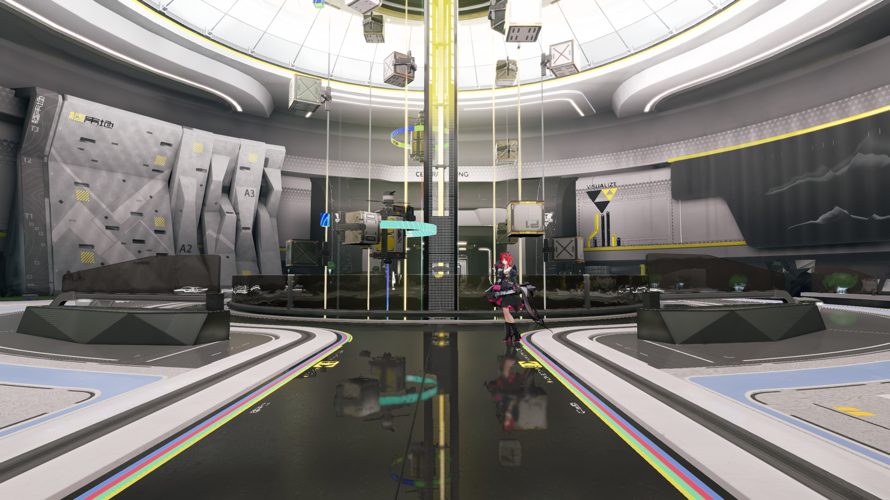
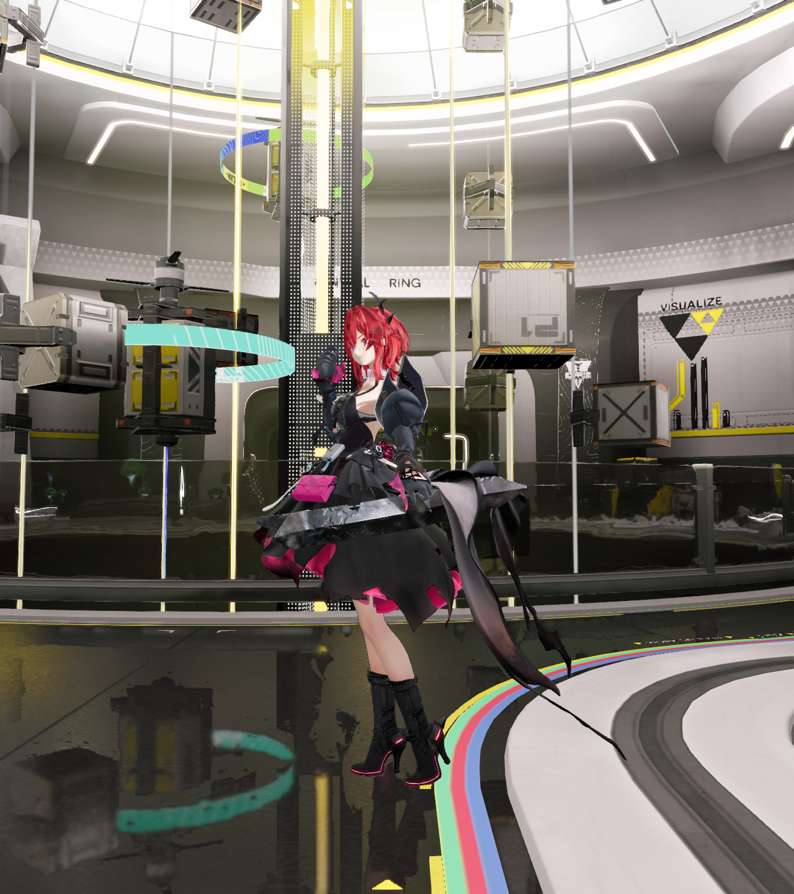
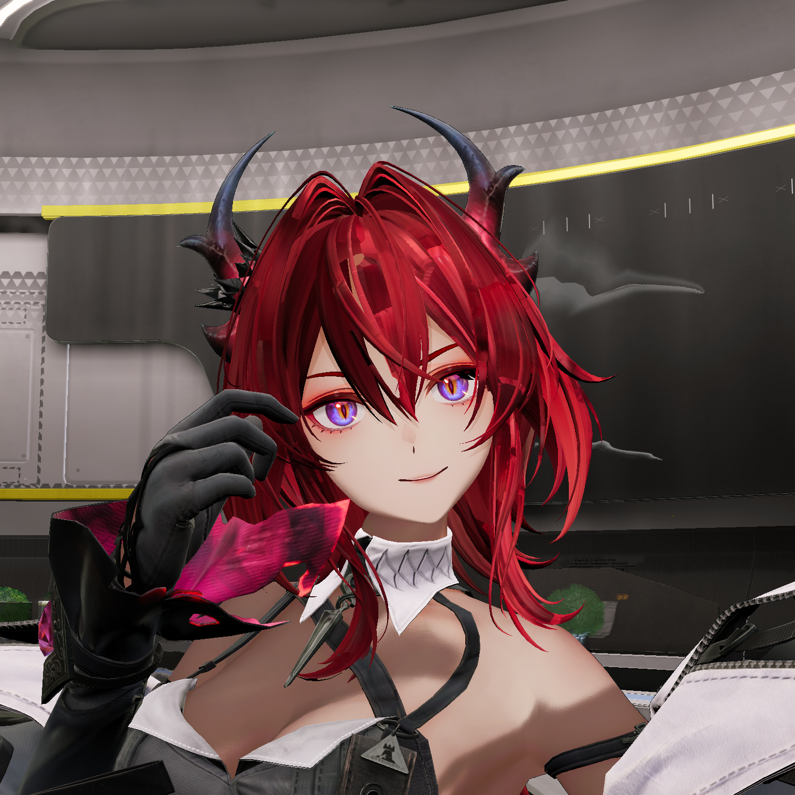

# 角色照明联合验证

日期：2026-10-31，归属为 Q1 画质核验。
状态：输入与环境兼容通过，整体外观继续验收。
执行顺序见[开发总计划](../../plans/azure-engine-plan.md)。
完整场景入口见[联合验证](../recovery/full-scene-character.md)。

## 照明输入

候选采用原始正面参考的完整风格化照明配置。
场景数据使用现有 `nprLighting` 契约。
服饰的 `specularFloor` 保持为 0.55。
原始参考的入口及眼睛材质见[角色参考](../recovery/character-reference.md)。

完整环境的光源、调色表、反射及几何保持冻结输入。
角色模型、十三份材质及十三份元数据的摘要一致。
候选保留原待机动画及对象阴影。
近景相机位置为 `[-1.5148,2.04,-19]`。

实际采集清单核对十六项应用配置。
数据完整性检查还原候选声明的局部字段。
还原结果与完整场景来源结构相等。
具体输入和检查结果见[参数核对](evidence/2026-10-31/character-illumination-integration/illumination-verification.json)。

## 环境兼容

隐藏角色的控制与候选各采集十二帧。
两组采用同一程序、固定机位及六十分之一秒步长。
实际反射入口为默认线性算法。
十二组 PNG 文件均逐字节一致。

该检查证明两组隐藏画面的严格兼容。
原有环境恢复中的少量像素待项继续保留。
完整原生图像与性能条件分别验收。

近景上方区域还记录六处单字节差异。
该区域采用独立机位，结果单独保留。
原始帧、命令及摘要见[采集记录](evidence/2026-10-31/character-illumination-integration/illumination-full-summary.json)。

## 角色外观

近景的固定头发遮罩包含 6,581 个像素。
候选平均显示 RGB 为 `[181.3153,56.8716,68.9445]`。
最大通道达到 255 的像素为一个。
这些显示值用于定位照明响应。

候选的眼睛、发丝与服装继续按来源验收。
主灯方向、强度、曝光及调色具有独立输入。
跨场景颜色等价须同时满足这些条件。
候选保持诊断状态。

## 眼部固定区域

原始正面参考按图像坐标选取两处眼部矩形。
区域包含眼睛、眼睑及少量皮肤。
每处在高分辨率中包含 4,320 个像素。
这些区域用于诊断，正式可见性遮罩单独验收。

两处高分辨率区域与历史输出逐像素一致。
时间抗锯齿第 31 帧的平均字节误差为 1.0284 和 1.6296。
最大通道差值分别为 23 和 40。
位置、来源及摘要见[眼部核对](evidence/2026-10-31/character-illumination-integration/eye-comparison.json)。

该结果支持继续定位时间重建及联合显示条件。
专用眼睛表面输入和整体外观分别保留验收。

## 时间采样

统计采用同一份四倍分辨率参考。
参考在显示线性域内按 4×4 均值缩小。
时间统计采用第 24 至 31 帧及固定头发遮罩。
正式原生 HDR 门禁单独验收。

| 区域 | 平均绝对误差 | 时间标准差均值 | 区域像素 |
| --- | --- | --- | --- |
| 头顶 | 0.004978 | 0.001019 | 1,903 |
| 头发内部 | 0.004712 | 0.001064 | 4,025 |
| 细发边界 | 0.010111 | 0.003878 | 1,068 |
| 服装 | 0.001582 | 0.000655 | 60,486 |

全部列出的末八帧区域能量误差处于百分之二内。
细发边界及服装的时间波动仍需定位。
本次统计具有历史样本对照，结果见[采样报告](evidence/2026-10-31/character-illumination-integration/temporal-comparison.json)。
统计结果尚未构成通用时间重建公式错误的证明。

## 管线接口

无光照雾图层采用匹配的网格顶点程序。
计算蒙皮及顶点蒙皮分别选择已有程序。
程序模块由现有雾状态创建和释放。
管线及资源沿角色渲染器生命周期管理。

独立组合复现四条 Location 15 接口告警。
回归覆盖对象阴影与透明、加色及四样点组合。
索引与固定描述符分别验证独立线性颜色预期。

Debug 与 Release 各通过三十四项 GPU 组合。
最大线性误差为 0.002251，预算为 0.008。
固定与索引描述符的图像逐像素一致。

两配置各通过七项雾与对象阴影组件检查。
完整固定机位的两配置各采集三帧。
六帧均与对应的修复前候选逐字节一致。
Debug 运行通过验证层检查，卸载资源计数归零。

角色参考的三十二帧时间序列及高分辨率图严格一致。
该结果限定为本项管线修复的兼容检查。
历史角色参考的残余差异保持独立待项。
来源及结果见[回归摘要](evidence/2026-10-31/character-illumination-integration/summary.json)。

四组实际采集建立独立的程序与输入锁。
清单角色为 `engine_baseline`，用于辅助对照。
完整输入校验见[参考清单](evidence/2026-10-31/character-illumination-integration/reference-manifest.json)。
原生参考资格及正式外观门禁分别验收。

## 动态角色正面

完整环境中的动态角色完成三项正面采集。
分别为完整画面、照明候选及底色视图。
分辨率为 1536×1536，抗锯齿关闭。
原待机动画、模型和十三份材质保持冻结输入。

诊断机位由 210 个虹膜顶点的蒙皮结果推导。
CPU 取样时刻为六十分之一秒，仅用于相机构图。
实际动作及绘制由生产 Player 执行。
相机实际位置、镜头及对象阴影均完成核对。

机位及几何来源见[相机记录](evidence/2026-10-31/character-frontal-lighting/camera-candidate.json)。
三次运行正常退出，卸载资源计数归零。
1,516 份资产在采集后保持摘要一致。
共享程序及 246 份运行依赖通过摘要检查。

该机位可辨认紫蓝虹膜、竖瞳、纹理和高光。
底色视图保留相同纹理及覆盖图案。
照明候选改变了虹膜、皮肤和头发的颜色响应。
两处紫色诊断区域的平均字节差为 10.621 和 13.259。

区域分别包含 1,115 和 1,074 个颜色遮罩像素。
该遮罩用于诊断，正式原生可见性单独验收。
参数、区域及输出摘要见[正面核对](evidence/2026-10-31/character-frontal-lighting/visual-verification.json)。
照明候选保持诊断状态。

原完整机位中，每处虹膜几何约宽 2.06 和 2.82 像素。
正面诊断中，对应宽度约为 63.17 和 62.06 像素。
这些数值来自几何投影，包含受遮挡表面。
实际可见覆盖须结合头发和眼睑判断。

采集与像素尺度见[几何记录](evidence/2026-10-31/character-frontal-lighting/iris-pixel-footprint.json)。
该结果限定远景能表达的眼部细节规模。
近景头发的块状图案在底色视图中仍可见。
后续分别核对纹理坐标、层级采样及表面覆盖。

近景的预积分捕获雾状态为 `camera-mismatch`。
该机位用于材质诊断，原固定场景独立回归。
来源与状态见[结果记录](evidence/2026-10-31/character-frontal-lighting/result.json)。

## 剩余条件

整体外观、时间稳定性及原生区域继续验收。
持续性能、双设备与人工检查按 P8 执行。
Q1 保持执行中，完整结果由总计划统一登记。
