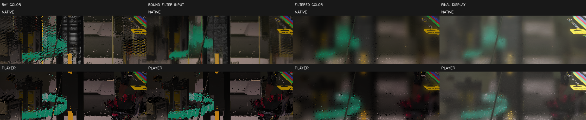
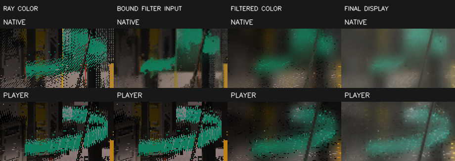

# Player 同帧反射链路归因

本轮完成 Player 的同帧捕获、阶段读回和消费见证。
显著颜色差异在实际过滤输入中已经存在。
关键锚点的采样、混合及输出量化均可复算。
整体画质验收仍按原门槛保持开放。

## 来源与预算

运行来源为 `fe5ba3b`，坐标沿用 `4676be7`。
原生参考复用 `8f3db21` 的第 3534 帧数据。
播放器和 895 个着色器均按留存摘要核对。
工程、关卡、机位、时间步和渲染参数保持冻结。

维护方回收了指定历史任务的一份临时捕获。
释放量为 427,388,446 字节，约 407.6 MiB。
两个旧输入租约采用先建立替代引用、再释放的顺序。
其余输入、几何资料和历史结果均保留。

新任务按 2,130,000,000 字节执行预算门禁。
共享队列 2264 完成一次实际 Player 捕获及回放。
队列 2265 用同一捕获补读存储缓冲和消费前 HDR。
两项执行均成功，后者耗时约 7.6 秒。

完整捕获为 2,063,466,199 字节。
单任务、受管池及卷预留门槛均沿用现行规则。
此次执行采用必要数据导出，生产实现保持原样。

## 帧身份与绑定

两帧输出与 fe5ba3b 的 NVIDIA 控制帧逐像素一致。
捕获内部的显示资源 154 与第 2 帧 PNG 的 RGB 摘要一致。
该捕获的帧编号为一。
图像为 2560×1440，反射附件为 1280×720。

| 阶段 | 原生参考 | 当前 Player |
| --- | --- | --- |
| 射线 | 8702 | 21062 |
| 实际空间过滤 | 8811 | 21123 |
| 过滤输出资源 | 15925 | 10034 |
| 地面消费事件 | 8912 | 21372 |
| 消费颜色格式 | R11G11B10_FLOAT | R32G32B32A32_FLOAT |
| 地面 HDR 格式 | R11G11B10_FLOAT | R16G16B16A16_FLOAT |

实际射线程序摘要以 `9b77643b` 开头。
实际过滤程序摘要以 `7e305dcf` 开头。
地面消费程序摘要以 `cd37e326` 开头。
实际过滤输出与消费时读取的完整附件摘要一致。

显示坐标采用左上角原点。
原生附件按高度翻转行序，Player 按原始行序读取。
显示锚点 `[2x+1,2y+1]` 对应附件四邻。
四邻权重依次为 `9/16、3/16、3/16、1/16`。

## 调度覆盖

实际工作列表位于绑定一，资源为 9875。
它在工具反射中归入存储写资源类别。
源程序通过 `StructuredBuffer<uint>` 读取该缓冲。
本轮按实际描述符补读，追踪前后字节一致。

实际调度为 `[14400,1,1]`，局部尺寸为 `[8,8,1]`。
工作列表覆盖 160×90 个唯一图块。
四个锚点均位于实际提交的图块内。
该覆盖证明调度完整，像素仍按遮罩及射线条件筛选。

## 同址阶段结果

配对条件为前向深度差至多 2 cm，且两端射线均命中。
中央地面保留 19,281 点，青色环带保留 6,478 点。
下表为同位置亮度的皮尔逊相关系数。
这些指标用于阶段归因，不替代正式区域 SSIM。

| 区域 | 射线颜色 | 实际过滤输入 | 过滤输出 | 消费 HDR | 最终显示 |
| --- | ---: | ---: | ---: | ---: | ---: |
| 中央地面 | 0.54004 | 0.56539 | 0.70103 | 0.65974 | 0.68859 |
| 青色环带 | 0.52577 | 0.47942 | 0.64498 | 0.58703 | 0.58149 |

Player 的射线颜色与实际过滤基础层在两区逐点相同。
原生对应变化点分别为 18,352 和 6,380。
过滤输出的空间对应关系在两区均有改善。
现有数据支持优先核对过滤前的颜色及置信度来源。

原生反射包含独立的时间合成阶段。
8732 更新可信度，8741 更新颜色历史。
该公共计算已有原生字节级重建证据。
来源见[反射时间过滤](../../../reflection-temporal.md)。

当前投影组合依次执行准备、射线、金字塔及空间过滤。
该路径的组合源码随验证归档保存。
历史来源、射线位置及反射时间合成是后续核验方向。
本轮数据尚未给出通过整场景门槛的修复候选。

对照图上排为原生，下排为 Player。
前三列为压缩反射颜色，末列为显示颜色。
颜色仅在同列两端之间比较。
图像展示完整区域，数值统计使用上述配对条件。

## 消费见证

锚点为显示坐标 `[1265,1137]`。
两端接收面深度约为 4.80358 m。
原生实际反射采样约为 `[1.836914,1.371094,0.499023]`。
该点原生及 Player 的实际采样置信度均为一。

| Player 节点 | 实际 RGB |
| --- | --- |
| 四邻采样 | [0.15468630, 0.13444248, 0.08876930] |
| 入射光混合后 | [0.15468630, 0.13444248, 0.08876930] |
| 材质响应 | [0.28344363, 0.28344363, 0.28344363] |
| 反射贡献 | [0.04384485, 0.03810686, 0.02516109] |
| 输出颜色 | [0.09650165, 0.08321020, 0.06960148] |
| 实际半精度 HDR | [0.09649658, 0.08319092, 0.06958008] |

四邻直接读回与着色器跟踪中的四份输入逐值一致。
插值、入射光混合和材质响应在 0.000001 内复算一致。
输出转为半精度后，与实际 HDR 纹理逐值一致。
该点的消费运算保留了输入反射颜色。

在混合节点只代入原生入射颜色，保留 Player 响应。
该节点结果约为 `[0.573318,0.433731,0.185885]`。
相对原生未量化输出，RGB 平均绝对误差减少 98.87%。
这项替代仅用于归因，属于未渲染验证的诊断上界。

本轮完整跟踪一个 Player 消费调用，共 8,738 步。
四个锚点均保存实际四邻、消费前及消费后 HDR。
Vulkan 像素历史的颜色字段含不可用占位值。
这些字段保留原始记录，并明确标为不可用于颜色验证。

## 区域差异与解释范围

中央地面的颜色输入具有明显欠亮。
青色环带的亮度接近门槛，空间结构差异仍较大。
显示坐标 `[1231,1071]` 的 Player 四邻置信度约为 0.79020。
原生对应理论四邻置信度约为 0.99779。

两区的亮度与结构需要分别核对。
上述置信度差异来自实际消费输入，仍需追溯生产来源。
已淘汰的跨层级置信度插值候选保持淘汰状态。
本轮不据此推广新的统一增益或过滤参数。

原生 3534 参考不含当前联合场景中的角色。
接收面深度配对不能证明反射物内容相同。
全区差异同时包含内容差异及实现差异。
具体缺陷还需核对实际命中对象与历史颜色地址。

原生参考与两帧运行的历史状态也不同。
本轮未建立相同的反射历史收敛状态。

关键锚点的射线颜色在既有分项环境中同样偏暗。
其旧分项与当前联合场景 RGB 均为 `[0.080078125,0.072265625,0.068359375]`。
这证明该点差异在角色联合采集前的分项中已经存在。
该控制仅适用于此点，数据见验证归档。

原生四邻理论插值的红通道差量仍为 0.00048828125。
原生完整显示摘要与既有参考 PNG 的差异也保留。
本轮沿用实际原生采样值，消费见证限定于对应调用。
后续检查优先处理影响整体效果的来源差异。

## 原验收结果

SSIM 门槛为 0.95，关键区域亮度误差至多 10%。
新增超差为零，原始冻结四帧按逐像素一致验收。
以下为此次实际输出对原生参考的结果。

| 帧索引 | 区域 | SSIM | 亮度中位误差 |
| --- | --- | ---: | ---: |
| 0 | 中央地面 | 0.82921 | 16.06% |
| 1 | 中央地面 | 0.82962 | 15.75% |
| 0 | 青色环带 | 0.75287 | 7.96% |
| 1 | 青色环带 | 0.75460 | 7.99% |

相对 fe5ba3b 控制帧，全图及邻区逐像素一致。
因此，相对该控制的新增超差为零。
原生参考的整体画质门槛继续保留未通过状态。
冻结四帧引用相同二进制的既有结果及原跨驱动限制。

## 独立复算

[结构化收据](qualification.json)记录来源、绑定、采样及门槛。
[验证归档](validation.zip)保存原始缓冲、阶段数组和复算程序。
解压后运行 `python verify.py`，需要 NumPy 与 OpenCV。
复算不依赖 GPU、私有捕获或项目资产。

检查覆盖两个几何筛选、十项阶段统计及四组四邻。
它还核对工作列表、实际混合、响应及半精度输出。
四份关键区域图像指标独立复算。
完整捕获及完整历史颜色留存于受管任务目录。

## 命中与取色证据

[反射命中与历史取色](../reflection-hit-history-address/README.md)记录四个锚点的绘制、深度和取色地址。
