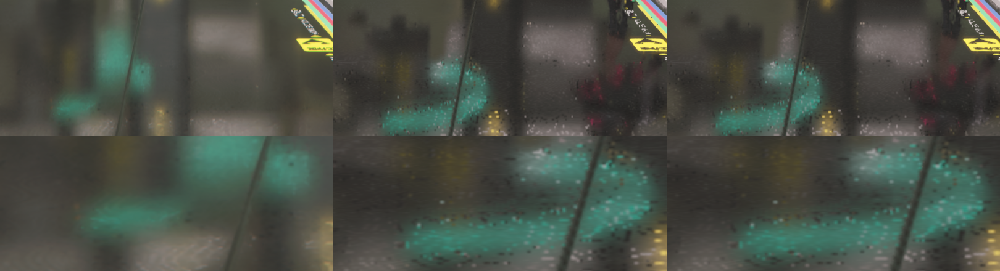
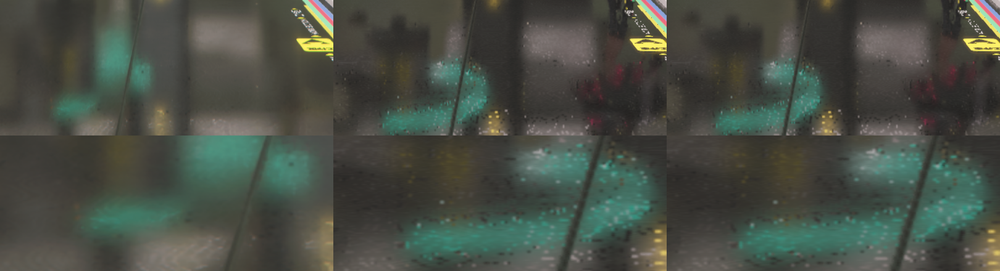

# 反射置信度层级插值归因

本单元基线为 `ba471af147a1151c0287c58e1293f72df0ae7175`。
结论为淘汰置信度跨层级插值候选。
该候选单独用于现有联合场景时，未通过区域验收。
本单元覆盖固定机位的双设备两帧配对。

## 单变量与消费链

投影反射先提交射线颜色、足迹和置信度。
金字塔生成器分别输出颜色与置信度层级。
`ProjectedScreenReflectionGpu.cpp` 将足迹通道一传给过滤器。
`ReflectionSpatialFilter.cpp` 将对应索引写入第四参数行。

候选仅调整投影路径的置信度层级插值。
置信度在相邻整数层级间按足迹小数部分插值。
颜色过滤足迹、射线步数、相位和历史来源均使用控制组输入。
字节量化、深度引导及显示设置沿用相同参数。

控制组按留存编译参数重建。
二进制摘要与实际绑定的控制着色器逐字节一致。
候选及控制二进制均通过 SPIR-V 校验。
源码、差异和编译收据位于验证归档内。

## 输入与设备

实际工程为 `history-actor.azureproject`。
工程、场景、原生参考图及源码摘要见 [qualification.json](qualification.json)。
四次采集均使用 2560×1440、60 fps 和固定时间步。
每次输出两帧，抗锯齿配置值为一。

机位为 `[-0.266043, 2.26206, -24.9053]`。
观察目标为 `[-0.261116, 2.32175, -23.9071]`。
镜头、向上方向和渲染参数逐项与留存机位核对。
区域坐标及完整参数保存在结构化收据中。

NVIDIA 设备为 RTX 4060 Laptop，驱动为 595.79。
Vulkan 驱动值为 `2496905216`。
Intel 设备为 RaptorLake-S Mobile Graphics Controller。
其 Vulkan 驱动值为 `1661340`。

NVIDIA 控制组两帧均与同驱动存档逐像素一致。
Intel 控制组与存档分别有 46 和 14 处差异。
所有指标均使用本次实际控制组进行配对。
四次采集的验证错误与退出资源残留均为零。

## 区域结果

下表取第二帧，第一帧和邻区结果见结构化收据。
亮度误差为区域中位相对误差。
新增超差按参考图的最大 RGB 通道差大于一计数。
通过条件为 SSIM 至少 0.95、亮度误差至多 10%、新增超差为零。

| 设备 | 区域 | 控制 SSIM | 候选 SSIM | 控制亮度误差 | 候选亮度误差 | 新增超差 |
| --- | --- | ---: | ---: | ---: | ---: | ---: |
| NVIDIA | 中央地面 | 0.82962 | 0.83132 | 15.75% | 15.70% | 180 |
| NVIDIA | 青色环带 | 0.75460 | 0.75469 | 7.99% | 8.10% | 10 |
| Intel | 中央地面 | 0.82912 | 0.83092 | 16.09% | 16.02% | 173 |
| Intel | 青色环带 | 0.75420 | 0.75433 | 8.09% | 8.14% | 14 |

第二帧全图新增超差分别为 9,334 和 9,462。
天花板、左门、右墙和左侧地面均有新增超差。
中央地面的拉普拉斯幅度下降均不足 0.16%。
以上结果支持淘汰该插值候选，继续归因其他输入或阶段。

对照图按原生参考、实际控制、候选排列。
上排为中央地面，下排为青色环带。





## 冻结与交付范围

候选未进入生产源码。
采集结束后，播放器及 895 个留存着色器的指纹全部核对一致。
留存构建目录封存指纹也已核对一致。
本单元交付可复核的淘汰证据。

已有同驱动冻结四帧的逐像素一致结果按原来源保留。
原始冻结图的跨驱动差异仍为开放项。
该结果及播放器指纹见 [冻结画面证据](../../2026-11-16/projected-history-layer-frozen/qualification.json)。
地面整体画质仍按原 SSIM、亮度及冻结门禁验收。

## 调度与预算

任务预留为 64 MiB，归档前实际占用为 7,295,614 字节。
验证归档大小为 1,782,351 字节。
构建和双设备采集均经过共享队列。
队列中断、编译参数修正和成功批次均见 `resourceJobs`。

成功构建批次核对控制二进制及候选校验结果。
双设备 GPU 批次编号为 2228，用时约 592.8 秒。
四次采集均开启 Vulkan 同步验证。
本单元未追加正式性能或长跑验收。

## 独立复算

[validation.zip](validation.zip) 保存源码、命令、设备与采集清单。
归档同时保存两区的精确参考、控制和候选像素。
区域复算无需加载实际工程或启动 GPU。
在具备 NumPy、OpenCV 和 Pillow 的 Python 中执行下列代码。

```python
from pathlib import Path
from zipfile import ZipFile

folder = Path(
    "D:/Projects/FYP-worktrees/nr-quality/Project/AzureRender/"
    "docs/acceptance/nr/evidence/2026-11-19/reflection-confidence-lod"
)
scope = {"__name__": "confidence_evidence_verify"}
with ZipFile(folder / "validation.zip") as archive:
    exec(compile(archive.read("verify.py"), "verify.py", "exec"), scope)
scope["verify"](folder)
```

复算核对归档和成员摘要。
随后核对八组目标区域的 SSIM、亮度和新增超差。
完整帧差量的供体地址及摘要保存在每帧收据中。
