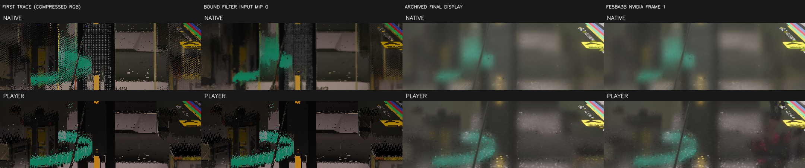
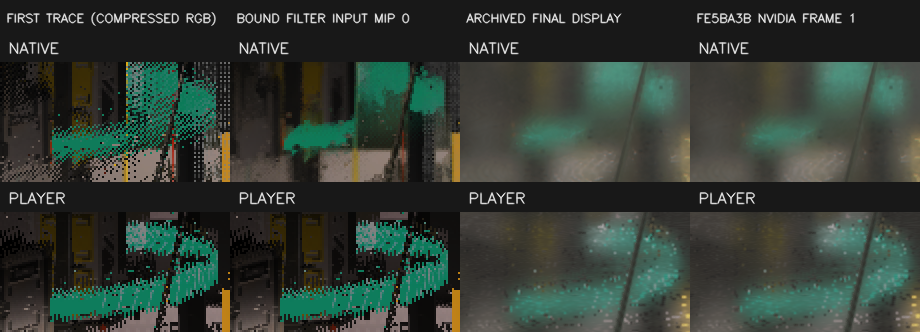

# 地面反射阶段归因

本单元以 `fe5ba3b` 为工作树基线。
工作范围为固定机位存档的只读归因。
生产源码、播放器和着色器均保持原样。
本轮没有提交 GPU 采集或构建任务。

## 结论与范围

存档分项链路的射线颜色已经存在空间差异。
实际绑定的过滤输入中，差异继续存在。
最终画面的偏差具有相同位置的输入侧证据。
消费阶段的额外影响仍需完整数据核实。

阶段读回来自较早的分项采集。
它与当前基线的最终画面并非逐像素一致。
因此，本单元交付归因证据及精确缺口。
当前联合场景的最终归因和画质验收保持开放。

## 坐标与实际绑定

过滤附件为 1280×720，最终画面为 2560×1440。
以下附件坐标均采用左上角为原点的显示方向。
原生附件按 `y_storage = 719 - y_display` 翻转。
Player 附件按原始行序读取。

| 阶段 | 原生 | Player |
| --- | --- | --- |
| 首次射线颜色 | 事件 8702 | 事件 21668 |
| 过滤器实际输入 | 事件 8811，资源 16552，层级零 | 事件 21729，资源 9454，层级零 |
| 过滤器实际输出 | 资源 15925，完整附件 | 资源 9490，4,940 个实际读回样本 |
| 最终消费置信度 | 事件 8912，资源 15777，仅有绑定记录 | 同位置完整消费链未保存 |
| 最终画面 | 原生第 3534 帧 | 分项采集第 2 帧 |

实际输出样本网格为 `[3 + 17k, 7 + 11j]`。
中央地面有 128 个存档点，青色环带有 35 个。
按两端射线均命中且前向深度差至多 2 cm 筛选。
有效点分别为 100 和 32 个。

最终显示锚点采用 `[2x + 1, 2y + 1]`。
该锚点用于关联阶段位置。
完整消费方程还需周围四个过滤采样及材质参数。
本单元不将单点过滤值视为完整显示贡献。

射线及过滤输入保持压缩 RGB 表示。
过滤输出按 `c / (1 + max(c))` 映射后配对。
最终画面使用 PNG 的显示色值。
各阶段分别比较两端，亮度不跨表示直接相除。

## 阶段结果

下表为相同有效网格上的亮度相关系数。
该指标描述存档采样的空间对应关系。
它不等同于区域 SSIM，也不代替验收门槛。
完整 RGB、深度及所有坐标保存在验证归档。

| 阶段 | 中央地面 | 青色环带 |
| --- | ---: | ---: |
| 首次射线颜色 | 0.68335 | 0.58508 |
| 实际过滤输入层级零 | 0.71756 | 0.59164 |
| 实际过滤输出 | 0.70136 | 0.51981 |
| 最终画面显示锚点 | 0.70550 | 0.51361 |

过滤输出与最终画面的两端亮度差也按位置配对。
其相关系数分别为 0.87391 和 0.88807。
这支持输入差异延续至最终画面的判断。
它不能量化最终材质消费的独立误差占比。

中央地面的实际输入亮度中位数为 0.15795、0.10941。
青色环带分别为 0.15673、0.12154。
中央地面的欠亮更明显，环带的空间对应更差。
因此，统一亮度增益不足以解释两区的不同缺陷。

原生的首次射线输出与实际过滤输入存在变化。
中央地面密集配对点中有 18,109 / 19,043 点变化。
青色环带有 6,379 / 6,477 点变化。
Player 对应两区的层级零颜色变化点均为零。

这些结果限定了原生中间处理的待查区间。
存档未逐事件保存 8702 至 8811 间的颜色写入。
因此，具体写入者及其因果贡献仍待定位。
实际绑定输入已独立保存，阶段比较使用该输入。

## 同位置见证

见证按最终亮度绝对差排序选择。
每区保留前两点及第三个核查点。
中央地面的第三点取环带以外的最大差异位置。
环带的第三点沿用分区排序。

| 显示坐标 | 附件坐标 | 阶段 | 原生亮度 | Player 亮度 |
| --- | --- | --- | ---: | ---: |
| [1265,1137] | [632,568] | 首次射线 | 0.54256 | 0.07364 |
| [1265,1137] | [632,568] | 实际过滤输入 | 0.52204 | 0.07364 |
| [1265,1137] | [632,568] | 实际过滤输出 | 0.52325 | 0.07364 |
| [1265,1137] | [632,568] | 最终显示锚点 | 0.52413 | 0.24728 |
| [1537,1137] | [768,568] | 首次射线 | 0.19358 | 0.00000 |
| [1537,1137] | [768,568] | 实际过滤输入 | 0.20369 | 0.00000 |
| [1537,1137] | [768,568] | 实际过滤输出 | 0.20183 | 0.00000 |
| [1537,1137] | [768,568] | 最终显示锚点 | 0.30243 | 0.18483 |

[632,568] 的两端深度约为 4.80358 m。
该点两端射线置信度均为一，过滤层级均为零。
其偏差在跨层级置信度插值之前已经存在。
全部见证的精确数值见 [qualification.json](qualification.json)。

中央地面对照按首次射线、实际输入、最终画面排列。
最右列为当前基线的 NVIDIA 第 2 帧。
上排为原生，下排为 Player。
前两列展示压缩 RGB，显示色彩分别保持各自表示。

## 当前基线的证据缺口

阶段链使用的 Player 射线着色器摘要以 `f5ec047b` 开头。
当前基线配对采集的控制摘要以 `9b77643b` 开头。
两组画面采用相同区域和机位契约。
当前基线的阶段内容仍须同帧核实。

| 区域 | 当前设备及帧索引 | 分项最终图与当前控制图的差异像素 |
| --- | --- | ---: |
| 中央地面 | NVIDIA，0 / 1 | 32,245 / 23,531 |
| 中央地面 | Intel，0 / 1 | 59,332 / 55,184 |
| 青色环带 | NVIDIA，0 / 1 | 4,773 / 451 |
| 青色环带 | Intel，0 / 1 | 14,385 / 12,645 |

当前基线缺少同帧的射线、过滤和消费读回。
原生资源 15777 在最终消费时的字节未保存。
Player 的稀疏输出也缺少锚点周围完整四采样。
材质、探针及 BRDF 的同址消费贡献尚未闭合。

本轮没有证据充分且满足门槛的修复候选。
下一项有效证据应覆盖上述同帧消费链。
新增 GPU 批次由总协调依据本结果安排。
已淘汰的置信度插值候选继续保持淘汰状态。

原验收保持 SSIM 至少 0.95、亮度误差至多 10%。
新增超差为零，冻结四帧逐像素一致。
本单元不修改任何验收条件。

## 独立复算

[验证归档](validation.zip)含源摘要、采样数组及复算程序。
解压至独立目录后运行 `python verify.py`。
程序需要 NumPy，不依赖 GPU、私有采集或项目资产。
验证覆盖摘要、几何筛选、阶段指标及六条见证链。

`analyze_stage_lineage.py` 保存原始提取步骤。
该步骤需要原存档路径及 OpenCV。
`sources.json` 记录逐文件摘要和实际绑定资源。
精确输入、输出及归档摘要位于结构化收据。
完整结果见 [qualification.json](qualification.json)。
