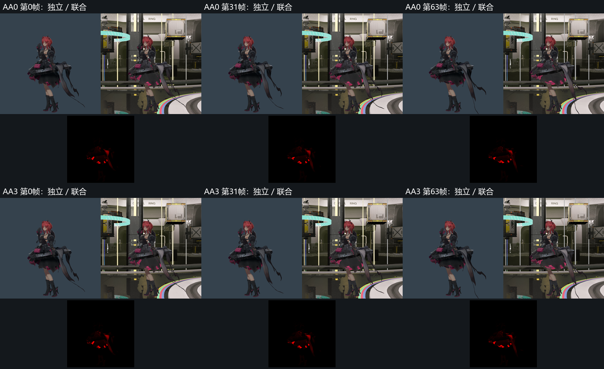

# 全身动态照明对照

日期：2026-11-01。
状态：采集与差异定位完成，联合画质未通过。
范围见[全身核验计划](../../plans/2026-11-01-full-body-native-comparison.md)。

## 采集范围

完整场景与独立角色采用同一全身机位。
模型、十三份材质、角色灯组及动画输入一致。
独立入口保留其原有照明和显示设置。
完整入口保留场景辐照、探针、雾及调色。

两种入口分别采集无抗锯齿及时间重建序列。
四组序列各有 64 帧，分辨率为 1536×1536。
动画均推进 63 步，采样时间为 1.05 秒。
两个入口的最终动画状态逐字段一致。

本项沿用视图雾复用阶段的 Release 程序。
程序、着色器及编译输入均记录摘要。
本项只生成诊断数据，生产实现保持冻结。

## 全轮廓诊断

独立背景的固定颜色用于提取角色轮廓。
轮廓向内腐蚀六像素，保留原始掩码及差异图。
四个高度分区按首帧轮廓范围冻结。
所有 128 对图像按相同定义计算。

无抗锯齿序列的最低 SSIM 约为 0.75670。
分区中位亮度相对误差最高约为 130.25%。
时间重建序列的最低 SSIM 约为 0.75670。
对应最大中位亮度相对误差约为 128.25%。

上述轮廓包含透明材质及其背景混合。
这些数值用于发现差异和确定检查范围。
原始失败结果完整保留，正式有效区域另有资格要求。
静态 SSIM 及亮度门槛保持 0.95 和 10%。

## 不透明材质核对

材质区域由生产 Player 的无光照身份图生成。
几何、骨骼、动画及原二进制载荷保持一致。
透明、覆盖、头发卡片及效果几何保守遮挡对应像素。
每份材质的可见内部区域向内腐蚀六像素。

核对时点为第零、三十一及六十三帧。
每时点分别核对两种抗锯齿配置。
少于五十个内部像素的区域登记为覆盖不足。
头发卡片及透明外观继续保留专项验收。

首帧无抗锯齿配置的实际结果如下。
这组检查确认不透明衣料也存在明显差异。

| 材质 | SSIM | 中位亮度相对误差 |
| --- | --- | --- |
| 身体皮肤 | 0.999585 | 0.00% |
| 服饰一 | 0.972287 | 5.82% |
| 服饰二 | 0.769856 | 116.90% |
| 服饰四 | 0.974343 | 21.46% |
| 服饰五 | 0.865994 | 117.96% |
| 脸部 | 0.999819 | 0.00% |

服饰二包含裙摆及靴部，服饰五包含飘带。
完整六组材质结果保留各自的像素数及误差。
皮肤和脸部的结果只覆盖本项可见区域。
其他视角、动作及原生整区继续核验。

## 单变量诊断

三个额外项目分别移除雾、探针或辐照绑定。
其他场景输入及首帧采样时间保持一致。
这些项目用于定位贡献来源。
完整场景的原有绑定继续保留。

移除雾后，全轮廓 SSIM 约为 0.85966。
完整首帧的对应 SSIM 约为 0.85973。
雾开关的内部线性响应九十五分位约为 0.000835。
该结果不支持雾为本组主要差异来源。

移除探针后，全轮廓 SSIM 约为 0.87389。
移除辐照后，全轮廓 SSIM 约为 0.90413。
移除辐照后的全轮廓中位亮度误差约为 3.07%。
部分材质及局部区域仍未通过。

服饰二、五显式采用织物类型及场景显示换算。
它们的当前画像未声明 `nprDiffuse`。
场景的常量 NPR 环境选择仅供声明该响应的材质消费。
这两份衣料仍消费普通环境辐照及反射路径。

着色代码中的普通辐照合成及 NPR 替换顺序完成核对。
辐照开关对服饰二、五有明显响应。
服饰四仍受环境镜面贡献影响。
原生服饰输入与完整照明消费继续按来源核验。

## 证据与接续

实际采集共 323 帧，覆盖八组成功 GPU 进程。
所有成功进程正常退出，资源分配计数归零。
验证层错误、警告及同步冲突检查通过。
四份用户改动按原始摘要保留。

诊断夹具曾使用绝对挂载路径而被生产解析器拒绝。
有效夹具采用独立副本和相对挂载路径。
失败命令、输入及诊断日志一并保留。

图像及结构化结果见[证据索引](evidence/2026-11-01/full-body-native-comparison/manifest.json)。
角色头部及原生开关证据见[联合显示验证](joint-playable-display.md)。
场景 GI 覆盖及实际查询见[输入核验](native-material-input-audit.md)。

接续工作核对剩余服饰的原生照明输入和消费。
场景反射与 GI 继续保留独立门禁。
整体画质状态保持未通过。
