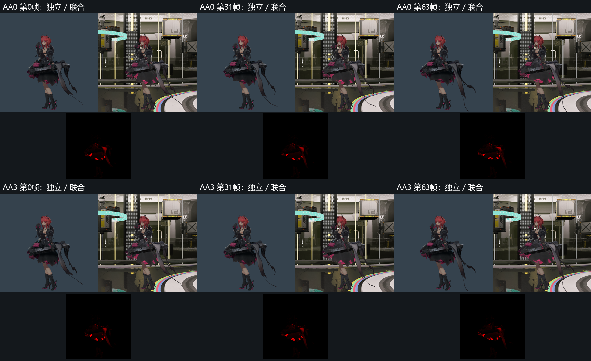

# 全身动态照明对照

日期：2026-11-01。
状态：采集与差异定位完成，联合画质未通过。
范围见[全身核验计划](../../plans/2026-11-01-full-body-native-comparison.md)。

## 动态角色网格

联合场景使用含十段动画的角色资产。以原生绘制 783 和 804 的索引和纹理坐标核对该资产，脸部 2,906 个三角形全部对应；身体有 5,610 个共同三角形，原生独有 69 个，现用资产独有 169 个。现用资产独有的三角形占身体静止网格面积的约 3.39%，高度集中在 1.15 至 1.32 米。

原生身体静止数据由绘制 1018 的实际顶点缓冲读取。3,249 对共同顶点中，3,247 对的位置距离不超过 0.00001 米。独有三角形涉及 62 个原生顶点，其中 31 个没有对应的现用纹理坐标，因此单独更换索引无法恢复这些面。

独立网格候选保留共同三角形的索引和全部原顶点属性，按原生缓冲补齐所需静止顶点、纹理坐标和骨骼权重。骨架、动画及其他网格保留原有内容。候选已通过序列化和来源校验，动态轮廓、接缝及画面按同机位、同动作时点和双设备验收。

[网格结果](evidence/2026-11-16/dynamic-body-topology/results.json)和[验证归档](evidence/2026-11-16/dynamic-body-topology/validation.zip)记录原生读回、三角形对应以及候选资产指纹。

绘制 783 的原生身体覆盖 136,029 个像素。按捕获的投影、骨骼矩阵和静止顶点重建时，原生覆盖掩码逐像素一致。身体原生权重的整数和为 65,534、65,535 或 65,536；按原始值除以 65,535 后参与蒙皮，候选网格在同一帧的几何覆盖中无缺失或额外像素。导入器按顶点权重和再归一化时，同一候选有两个覆盖像素缺失。

网格候选在十段动画的 70 个时点未产生新的退化三角形。这项检查使用独立网格候选；原生蒙皮数据的几何核对只覆盖固定捕获帧。实际播放器的双设备画面仍需确认动态轮廓、接缝、衣料遮挡和着色。[权重结果](evidence/2026-11-16/dynamic-body-native-weights/results.json)和[验证归档](evidence/2026-11-16/dynamic-body-native-weights/validation.zip)记录两项检查。

原生权重候选的身体图元保存 3,289 个顶点的 16 位整数权重。直接解析候选文件，按项目十段动画各采样七个时点：没有新增退化三角形，245 对静止位置重合的顶点在采样时点均保持接合。同一候选的原始整数权重与再次归一化的权重所产生的顶点位移差不超过 0.046 毫米。[候选资产结果](evidence/2026-11-16/dynamic-native-weight-asset/results.json)和[验证归档](evidence/2026-11-16/dynamic-native-weight-asset/validation.zip)记录资产、动作时点和核对脚本。

播放器候选包含[原始权重导入契约](../../runtime/asset-formats.md#格式能力)。动画姿态、节点透明度、形变目标及蒙皮批处理四项检查通过。[导入与构建记录](evidence/2026-11-16/dynamic-body-native-weights/importer-qualification.json)记录受检源码和可执行程序摘要。动态成片仍按同机位、同动作时点的双设备对照验收。

## 采集范围

面部正视、左右四分之三侧视、左右侧视及背部特写共六个机位。NVIDIA 与 Intel 均以 1280×720 采集，使用同一联合场景、资产和动画起点。[六机位采集记录](evidence/2026-11-16/character-six-view-inputs/qualification.json)保存相机参数、图像摘要和冻结回归结果。当前 NVIDIA 驱动下的四帧冻结回归逐像素一致；原始冻结图的 RGB 峰值差为 1、7、37、23。眼部、脸部和身体仍按区域对照验收。

完整场景与独立角色采用同一全身机位。
模型、十三份材质、角色灯组及动画输入一致。
独立入口保留其原有照明和显示设置。
完整入口保留场景辐照、探针、雾及调色。

两种入口分别采集无抗锯齿及时间重建序列。
四组序列各有 64 帧，分辨率为 1536×1536。
动画均推进 63 步，采样时间为 1.05 秒。
两个入口的最终动画状态逐字段一致。

本项沿用视图雾复用阶段的 Release 程序。
程序、着色器及编译输入均记录摘要。
本项只生成诊断数据，生产实现保持冻结。

## 全轮廓诊断

独立背景的固定颜色用于提取角色轮廓。
轮廓向内腐蚀六像素，保留原始掩码及差异图。
四个高度分区按首帧轮廓范围冻结。
所有 128 对图像按相同定义计算。

无抗锯齿序列的最低 SSIM 约为 0.75670。
分区中位亮度相对误差最高约为 130.25%。
时间重建序列的最低 SSIM 约为 0.75670。
对应最大中位亮度相对误差约为 128.25%。

上述轮廓包含透明材质及其背景混合。
这些数值用于发现差异和确定检查范围。
原始失败结果完整保留，正式有效区域另有资格要求。
静态 SSIM 及亮度门槛保持 0.95 和 10%。

## 不透明材质核对

材质区域由生产 Player 的无光照身份图生成。
几何、骨骼、动画及原二进制载荷保持一致。
透明、覆盖、头发卡片及效果几何保守遮挡对应像素。
每份材质的可见内部区域向内腐蚀六像素。

核对时点为第零、三十一及六十三帧。
每时点分别核对两种抗锯齿配置。
少于五十个内部像素的区域登记为覆盖不足。
头发卡片及透明外观继续保留专项验收。

首帧无抗锯齿配置的实际结果如下。
这组检查确认不透明衣料也存在明显差异。

| 材质 | SSIM | 中位亮度相对误差 |
| --- | --- | --- |
| 身体皮肤 | 0.999585 | 0.00% |
| 服饰一 | 0.972287 | 5.82% |
| 服饰二 | 0.769856 | 116.90% |
| 服饰四 | 0.974343 | 21.46% |
| 服饰五 | 0.865994 | 117.96% |
| 脸部 | 0.999819 | 0.00% |

服饰二包含裙摆及靴部，服饰五包含飘带。
完整六组材质结果保留各自的像素数及误差。
皮肤和脸部的结果只覆盖本项可见区域。
其他视角、动作及原生整区继续核验。

## 单变量诊断

三个额外项目分别移除雾、探针或辐照绑定。
其他场景输入及首帧采样时间保持一致。
这些项目用于定位贡献来源。
完整场景的原有绑定继续保留。

移除雾后，全轮廓 SSIM 约为 0.85966。
完整首帧的对应 SSIM 约为 0.85973。
雾开关的内部线性响应九十五分位约为 0.000835。
该结果不支持雾为本组主要差异来源。

移除探针后，全轮廓 SSIM 约为 0.87389。
移除辐照后，全轮廓 SSIM 约为 0.90413。
移除辐照后的全轮廓中位亮度误差约为 3.07%。
部分材质及局部区域仍未通过。

服饰二、五显式采用织物类型及场景显示换算。
它们的当前画像未声明 `nprDiffuse`。
场景的常量 NPR 环境选择仅供声明该响应的材质消费。
这两份衣料仍消费普通环境辐照及反射路径。

着色代码中的普通辐照合成及 NPR 替换顺序完成核对。
辐照开关对服饰二、五有明显响应。
服饰四仍受环境镜面贡献影响。
原生服饰输入与完整照明消费继续按来源核验。

## 证据与接续

实际采集共 323 帧，覆盖八组成功 GPU 进程。
所有成功进程正常退出，资源分配计数归零。
验证层错误、警告及同步冲突检查通过。
四份用户改动按原始摘要保留。

诊断夹具曾使用绝对挂载路径而被生产解析器拒绝。
有效夹具采用独立副本和相对挂载路径。
失败命令、输入及诊断日志一并保留。

图像及结构化结果见[证据索引](evidence/2026-11-01/full-body-native-comparison/manifest.json)。
角色头部及原生开关证据见[联合显示验证](joint-playable-display.md)。
场景 GI 覆盖及实际查询见[输入核验](native-material-input-audit.md)。

接续工作核对剩余服饰的原生照明输入和消费。
场景反射与 GI 继续保留独立门禁。
整体画质状态保持未通过。
