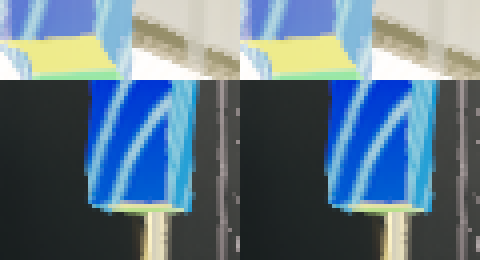

# GPU 缓冲驻留候选

## 实际分配

已有捕获含 795 个缓冲绑定及二十五处分配。
三十七个缓冲使用非设备本地主机内存。
主颜色片元的七个存储缓冲全部属于该类型。
其中阴影范围与对象记录占 2098064 字节。

该结果确认实际存储位置，带宽限制仍需独立指标。
分配器使用本地 VMA 3.4.0。
候选按用途偏好设备内存，并保留连贯映射要求。
纯传输缓冲保留主机优先策略。

## 候选检查

两配置各六项检查及 Intel 各五项 GPU 检查通过。
五类 GPU 读取用途的实际属性均为七。
该值包含设备本地、主机可见及主机连贯属性。
纯回读缓冲的实际属性为六，资源卸载计数归零。

原生前三帧符合冻结参考。
第四帧有十四个像素出现一字节差异。
候选四帧均与既有次级基线一致。
原零像素门槛未通过，候选保持隔离。

保存的旧程序通过同一输入的四帧控制。
该控制的 1729 份挂载文件及程序保持相同摘要。
两组清单的功能与材质参数一致。
差异的具体数值来源继续按实际缓冲内容定位。

## 生产恢复

生产分配器、构建清单及新增接口已返回受检内容。
两配置恢复后各五项检查通过。
各 663 项程序字节与原记录一致。
Release Player 代码段与保存的原程序一致。

Debug 首次恢复链接报告 `LNK1163`。
检查时对应增量链接缓存已经不存在。
续跑链接及所属检查通过，具体故障机制尚未确定。
用户原有改动的差异摘要保持一致。

## 性能条件

系统恢复交流供电，驱动上限约为 75W。
恢复默认 80W 的请求返回权限不足，设置保持原值。
本单元未启动整帧计时及正式性能采样。
原画质、帧预算及功率条件保持有效。

[结构化结果](evidence/2026-11-07/gpu-buffer-residency/results.json)和
[候选归档](evidence/2026-11-07/gpu-buffer-residency/candidate.zip)
保存实现、原始分配、完整核对、失败记录及恢复收据。
两个差异区域按四倍最近邻放大，左侧为旧程序控制。

