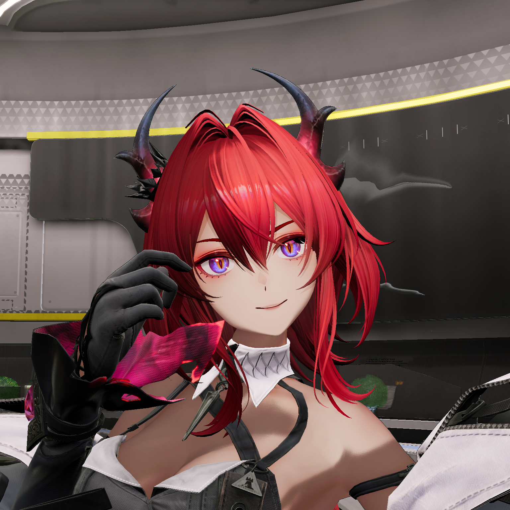
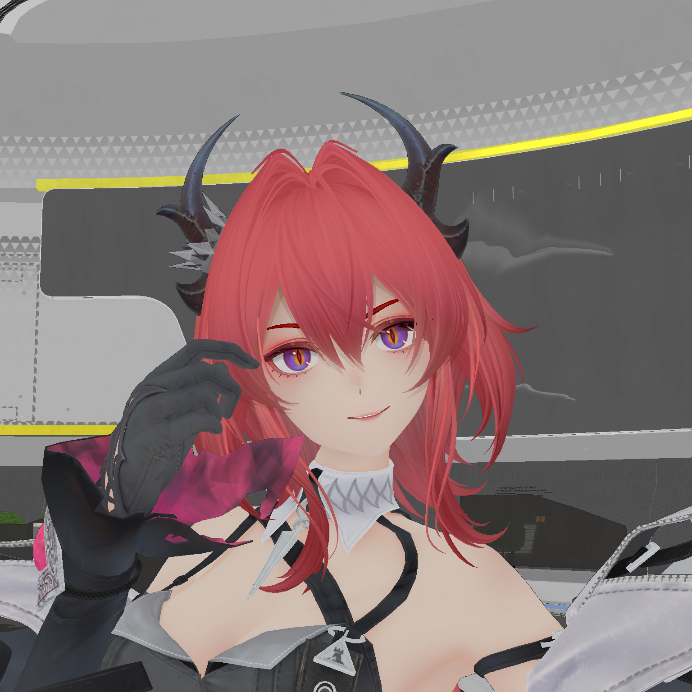
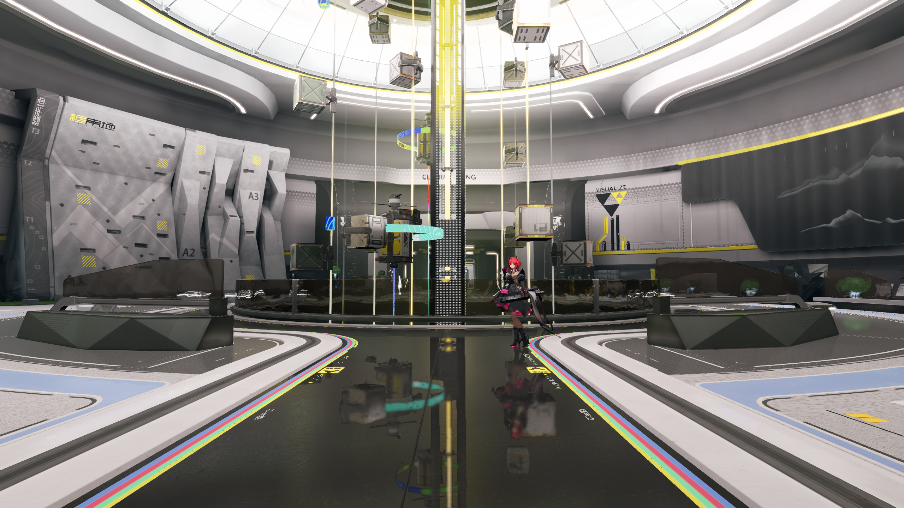

# 头发来源坐标验收

日期：2026-10-31，归属为 Q1 画质核验。
范围为动态角色头发的主纹理坐标。
执行顺序见[画质计划](../../plans/2026-10-31-projected-footprint-quality.md)。

## 来源关系

冻结参考为原始正面项目的 `outline-converted.glb`。
动态来源为完整场景的 `hero-restored-inputs-v7.glb`。
两端头发各有 11,564 个顶点及 43,044 个索引。
索引顺序逐元素相同，切线符号逐元素相同。

原始基础图与覆盖合成图的 RGB 逐像素相同。
零级共有 4,194,304 个像素，最大通道差为零。
覆盖 Alpha 具有独立来源和层级契约。
图像的垂直翻转对照具有非零颜色差异。

两端主坐标满足 `U_ref = U_dynamic`。
垂直坐标满足 `V_ref = 1 - V_dynamic`。
反射后的全部坐标逐元素相同。
该关系限定本项坐标朝向的来源差异。

数组与纹理核对见[几何输入](evidence/2026-10-31/hair-source-uv/hair-geometry-inputs.json)、[朝向关系](evidence/2026-10-31/hair-source-uv/hair-uv-orientation.json)及[纹理核对](evidence/2026-10-31/hair-source-uv/hair-texture-orientation.json)。

## 独立验证

单变量候选恢复头发主坐标，切线数据保持原输入。
实际采集沿用动态正面、环境和原待机动作。
材质、纹理、照明、曝光及着色程序保持冻结输入。
底色和完整画面分别提供图案及组合结果。

完整画面可见连续的发束颜色与高光分布。
发冠的块状图案随主坐标恢复而消失。
该观察限定为本项输入差异的定位结果。
完整原生画质及时间条件继续验收。

## 转换契约

来源坐标通过[离线恢复工具](../../development/source-mesh-uv.md)进入资产。
调用方使用既有稳定材质槽选择头发。
工具校验图元、顶点、索引及切线符号。
新坐标采用追加访问器，原二进制前缀保持完整。

恢复资产为 `hero-restored-inputs-v8.glb`。
九段动画、327 个节点及其他属性保持原输入。
生产命令生成的资产与独立候选逐字节一致。
运行时和着色器使用现行实现。

生成报告见[工具输出](evidence/2026-10-31/hair-source-uv/cli-restoration-final.json)。
动画、节点及前缀核对见[资产记录](evidence/2026-10-31/hair-source-uv/restoration-report.json)。

## 材质覆盖

十三份画像按同一源元素顺序完成主坐标盘点。
十二份具有相同索引顺序，十份主坐标逐元素相同。
虹膜主坐标的最大差为 `2.98e-8`。
数据见[材质盘点](evidence/2026-10-31/character-material-uv-audit/coordinate-inventory.json)。

身体的冻结参考与动态来源具有不同顶点规模。
第四号服饰的主坐标与切线采用独立原生配对。
该来源及完整着色范围见[服饰验收](cloth-native-integration.md)。
眉毛的主坐标相同，切线符号具有独立差异。

实际工具分别拒绝身体、第四号服饰及眉毛的源组合。
拒绝原因对应顶点数量或切线符号条件。
调用方文档保持完整，几何和纹理均未写入。
收据见[来源前置条件](evidence/2026-10-31/character-material-uv-audit/source-preconditions.json)。

## 检查状态

十一项专项测试覆盖数据恢复及非法输入。
四十二项既有角色转换与数学检查通过。

Release 完整场景采集十二帧，保留原待机动画。
隐藏角色的十二组 PNG 全部逐字节一致。
Debug 的三帧完整画面与 Release 对应帧逐字节一致。
验证层无告警，实际运行卸载资源计数归零。

正式工具资产的正面与独立候选逐字节一致。
两个 CTest 配置均通过专项及既有角色检查。
完整回归共采集五十二帧，原始帧按清单保留。
结果与范围见[回归摘要](evidence/2026-10-31/hair-source-uv/summary.json)。

完整入口锁定程序、项目及声明挂载输入。
该清单属于辅助引擎基准。
校验记录见[参考清单](evidence/2026-10-31/hair-source-uv/reference-manifest.json)。
原环境恢复中的严格像素待项仍由所属验收持有。

整体外观和正式性能条件分别验收。

