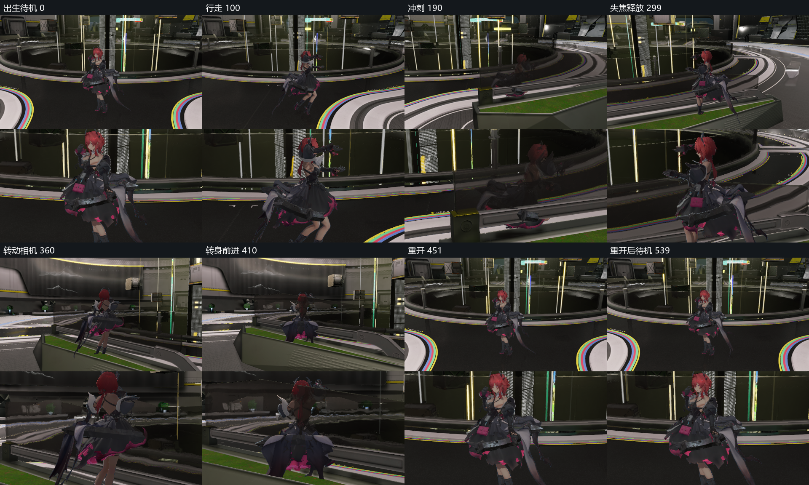
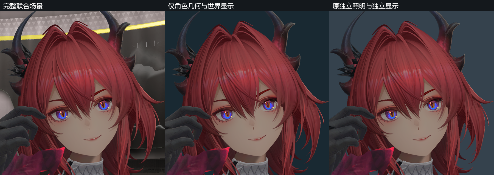

# 联合可玩场景显示验证

日期：2026-11-01。
状态：组合、操控及原生受影响检查通过。
全身动态画质与正式性能继续验收。
联合画质继续按[开发总计划](../../plans/azure-engine-plan.md)验收。

## 项目组合

完整场景包含 1671 个节点及 365 份资源。
角色使用十三份完整材质及原生动画模型。
十一份辐射材质采用四分之一倍率及线性显示。
两份乘法覆盖继承底层显示归属。

十盏角色参考灯通过关卡父子关系跟随角色。
场景保留原生调色、雾、泛光及屏幕空间反射。
控制、相机、脚本及碰撞沿用现有公共组件。
来源和执行范围见[组合计划](../../plans/2026-11-01-joint-playable-display.md)。

本项使用独立任务目录中的项目副本。
1642 份项目输入均记录摘要。
共享二进制资源按摘要核验，文本由任务副本持有。
原始项目及四份用户改动保持原有字节。

## 构建与输入

生产 Player 的全量项目资产校验通过。
离线检查耗时约为 736 秒。
两配置的程序、着色器及 988 份编译源码均核验一致。
公共机制证据按[显示变换验证](material-display-transform.md)的范围引用。

本项通过关卡与材质数据组合能力。
核心模块通过已有组件、资源及灯光契约接收内容。
场景身份、出生位置及角色灯组由项目数据声明。

## 操控与生命周期

Release、Debug 各回放 540 帧及十三项输入。
输入覆盖待机、行走、冲刺、停止、失焦及转动相机。
同关卡重开恢复出生位置、接地及待机状态。
退出后的缓冲与图像分配计数均归零。

实测行走速度约为每秒 1.2 米。
实测冲刺速度约为每秒三米。
稳定行走及冲刺分别使用第七、第八号动画片段。
两配置角色位置的最大差异约为 0.12 微米。

释放焦点后，角色水平输入及实际速度归零。
跟随相机的碰撞缩距及转向前进检查通过。
原生碰撞体等价性及完整场景阻挡按所属门禁验收。

Release 的完整检查约耗时 365 秒。
Debug 的完整检查约耗时 1374 秒。
上述时间包含加载、重开、采帧及检查。
固定六十分之一秒步长用于回放，持续帧率单独验收。

## 普通入口

工作目录为 `D:/Projects/FYP/Project/AzureRender`。

```powershell
& "build/ninja-msvc-release/AzurePlayer.exe" --project "build/runs/20261101-082926-joint-playable-display-c26c1b/project/playable.azureproject"
```

普通 Player 入口完成三帧实际采集。
该次运行使用项目配置，未传入诊断参数。
三帧均与回放入口的对应画面逐像素一致。
材质显示策略、照明及显示配置同时核对。

## 跨配置画面

全部 540 对图像完成摘要和数值诊断。
399 对文件逐字节相同，141 对文件存在差异。
单帧最多有 2860 个差异像素，约占 0.552%。
差异包含分散的场景几何边缘像素。

全序列最低结构相似性为 0.99976457。
画面中位亮度的最大相对误差约为 0.042%。
该诊断比较相同项目的两种构建配置。
原生参考资格和材质内部像素门槛分别按原规则核对。

结构相似性采用 sRGB 亮度及十一像素高斯窗口。
标准差为 1.5，统计排除五像素边界。
逐帧结果保留像素差异范围及最大线性误差。

## 原生着色响应

同机位近景分别核对 KK、脸部阴影、阴影及色带开关。
完整世界显示与独立显示控制分别采集。
每次切换核对相机、曝光、调色、雾及材质清单。
角色内部采用五个冻结区域，线性响应误差门槛为 `0.008`。
两处环境控制保留各自显示条件，单独记录响应。

环境左墙的全局阴影响应差约为 `0.143713`。
两侧环境分别使用场景调色与线性显示。
原始全矩形结果及角色区域判定分别保留。

| 开关 | 独立角色的最大响应 | 联合显示的最大响应 | 最大响应误差 |
| --- | --- | --- | --- |
| KK 高光 | 0.174199 | 0.174199 | 0.005343 |
| 脸部阴影 | 0.026776 | 0.026776 | 0.004635 |
| 色带 | 0.183183 | 0.183183 | 0.005464 |

全局阴影开关在五处角色区域中的响应为零。
角色主光使用独立方向与对象可见量。
该全局开关的结果只描述对应区域的实际响应。

对象阴影通过直接启停组件核对。
四处皮肤区域在采集前固定。
颈部、左胸及右肩具有非零阴影响应。
四处响应的最大线性误差约为 `0.006172`。

## 独立角色

几何控制保留世界照明及显示条件。
该控制仅有一个角色资源，环境几何及导入记录为空。
五处头部区域与完整联合场景逐像素一致。

原独立照明控制包含十二个节点及十盏角色灯。
照明及显示设置来自已冻结的独立角色项目。
两档曝光换算继续由四分之一材质倍率承担。
场景包含一个角色资源及原生对象阴影。

五处头部区域的中位亮度误差为零至 1.74%。
对应静态结构相似性最低为 0.99867419。
上述区域达到 10% 亮度及 0.95 相似性门槛。
这些结果按声明区域解释，完整可见片元另行验收。

## 证据与剩余条件





[跨配置诊断](evidence/2026-11-01/joint-playable-display/configuration-image-diagnostics.json)记录完整序列。
[原生着色响应](evidence/2026-11-01/joint-playable-display/native-character-effects.json)记录角色区域与环境控制。
[对象阴影响应](evidence/2026-11-01/joint-playable-display/object-shadow-summary.json)记录实际组件启停。
[证据清单](evidence/2026-11-01/joint-playable-display/manifest.json)记录项目输入及原始运行资料。

本项结果覆盖已声明的组合、操控及生命周期检查。
全身外观、运动边缘及投影阴影继续单独验收。
正式性能、双设备及人工操作按所属门禁执行。
联合画质状态保持未通过。
