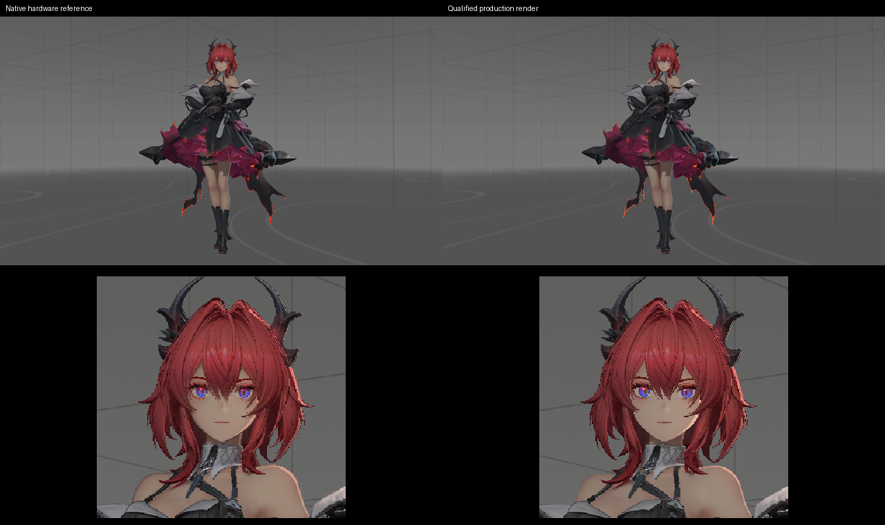

# 受光轮廓与参考输入

## 范围

日期：2026-11-05，归属为 Q1。
固定姿态的区域相似性检查通过。
完整头发的一字节检查仍有失败像素。
联合画质保持 `failed-user-review` 状态。

## 材质与几何

衣料和发片采用派生的受光表面。
[投影表面](../../runtime/outline-projection.md)负责几何扩张。
法线和颜色遵循[屏幕输入](screen-surface-normal.md)与[颜色遮罩](npr-view-mask.md)契约。
对象阴影使用[表面法线偏置](screen-normal-shadow.md)。

衣料描边的底色亮度为 0.5，饱和度为 1.5。
描边采用独立漫反射、轮廓光和源阴影颜色。
衣料本体保留参数图、法线、高光色带及反射。
固定参考使用原生绑定的六面反射贴图。

完整材质文档与内嵌派生材质的输出逐字节一致。
角色保持十四个显式材质槽。
派生图元继承原网格的坐标、蒙皮及形变访问器。
反向索引与材质引用由内容资产持有。

## 参考背景

原生背景通过捕获文件的独立重放生成。
角色的法线及颜色绘制均被裁剪到视锥外。
颜色对照保留背景颜色绘制。
重放中的原始颜色与源参考逐像素一致。

背景颜色由无光照图像平面提供。
平面在透明阶段绘制，使用匹配的镜头投影。
两种构建各有 2,310,900 个背景像素精确一致。
这些像素位于角色及近邻检查范围之外。

背景图像用于透明混合的颜色对照。
背景法线与深度按独立条件继续核验。
背景几何及快照顺序见[法线核验](outline-snapshot-order.md)。
联合场景使用所属几何、GI 与反射资源。

## 固定姿态检查

Debug 与 Release 各执行一次实际生产采集。
输出为 2560×1440，采用固定姿态和原生灯组。
两张完整图像逐字节相同。
材质、程序和纹理指纹随证据保存。

| 区域 | 像素数 | 结构相似度 | 中位亮度相对误差 |
| --- | ---: | ---: | ---: |
| 服饰一 | 45,988 | 0.96499 | 2.53% |
| 服饰二 | 118,661 | 0.96409 | 1.56% |
| 服饰五 | 17,990 | 0.99711 | 0.76% |
| 完整头发及后续阶段 | 20,361 | 0.98887 | 0.44% |
| 透明正面发片 | 725 | 0.96240 | 0.32% |
| 透明背面发片 | 236 | 0.99040 | 1.77% |

区域门槛为相似度至少 0.95，亮度误差至多 10%。
衣料区域沿用所属六像素内缩遮罩。
完整头发区域包含全部来源及后续绘制像素。
头发区域保持原始像素范围。

不透明归属中仍有 72 个像素超过一个色阶。
原始头发遮罩共 17,017 个像素，超差数为 215。
完整头发及后续阶段的超差数为 1,080。
相似性检查与严格字节检查分别保存结果。

所有成功进程均完成缓冲和图像卸载。
日志未出现 Vulkan 验证错误或同步冲突。
失败控制、生成脚本与输入清单保留在证据目录。

## 联合候选

首轮联合采集完成四帧。
受测墙面和顶棚区域与暖肤色控制逐字节一致。
角色暖色因子保持 `[0.98,0.93,0.89,1]`。
项目及场景文件保持所属输入。

动态资产保留 327 个节点和十段动画。
原有蒙皮、动画及几何载荷前缀逐字节一致。
四份派生材质通过内嵌图元组合。
Release 完成 192 帧、八秒的连续运动采集。
角色与物流节点共记录 2,112 次动画采样。
Debug 重开的四帧与 Release 逐字节一致。
两种构建均完成 540 帧可玩路线。

路线核对行走、疾跑、焦点释放及脚本重启。
相机遮挡、实际位移和最终站立状态均通过。
编辑器保存、目录移动及[独立发布](lit-surfaces-delivery.md)检查通过。
测量和输入见[运动收据](evidence/2026-11-05/lit-surfaces-motion/results.json)。

主候选采用完成交付检查的受光表面联合工程。
候选入口和状态由[开发总计划](../../plans/azure-engine-plan.md)持有。
测量及程序摘要见[验证收据](evidence/2026-11-05/lit-surfaces/results.json)。
