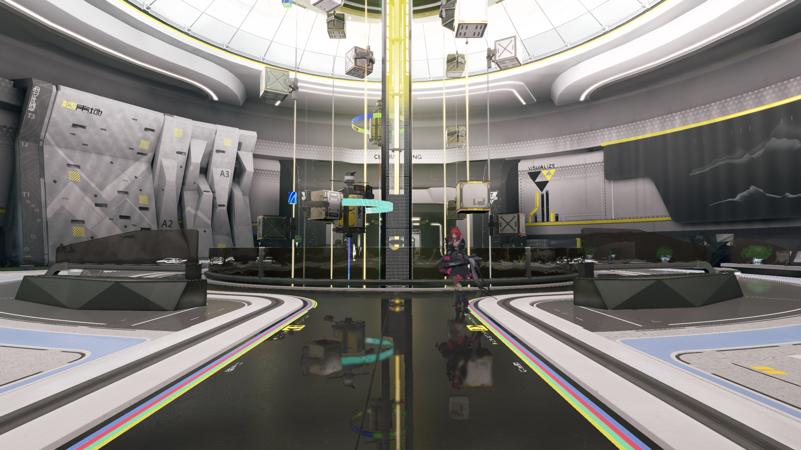

# 材质显示变换验证

日期：2026-11-01，归属为 Q1。
状态：公共机制及原生受影响检查通过。
联合画质继续按[开发总计划](../../plans/azure-engine-plan.md)验收。

## 显示输入

独立角色采用负二档曝光及线性显示。
联合场景采用零档曝光及原生调色表。
原生调色的五个受测区域亮度变化约为 16% 至 44%。
具体实验见[显示域核验](material-display-domain.md)。

材质倍率负责曝光基底的换算。
`displayTransform` 负责材质的显示策略。
角色候选的辐射材质采用四分之一倍率及线性显示。
场景材质消费所属视图的原生调色。

## 公共契约

画像版本二接收 `scene` 与 `linear`，缺省为 `scene`。
非法类型、未知值及版本一显式字段均触发加载诊断。
完整材质文档与内嵌画像共用该消费规则。
使用方式见[运行契约](../../runtime/material-display-transform.md)。

公共画像布局为十九，每项二十二行，共 352 字节。
主视图与编辑视图采用 `R8_UNORM` 显示覆盖附件。
乘法及加法覆盖继承底层显示归属。
普通透明、裁切及具名轮廓消费实际片元覆盖。

时间重建同时累计颜色与显示归属。
显示历史使用两份 `R16G16_SFLOAT` 图像。
累计值与显示值分别存储，颜色 Alpha 保持原有语义。
组合准入计入额外八字节，并检查 512 MiB 上限。

## 公共验证

两配置的 Editor、Player 及材质校验目标均已构建。
两配置各通过十二项相关检查。
两配置各完成五十三次公共材质采集。
十六类显示对照及固定描述符路径通过检查。

受测类型包含普通表面、皮肤、眼睛及头发。
合成检查覆盖透明、裁切、轮廓、乘法及加法。
四倍多重采样边缘最大线性误差约为 `0.00060`。
时间重建边缘最大线性误差约为 `0.00325`。

公共线性误差门槛为 `0.008`。
眼睛另有独立的公开像素参考。
缺省策略及固定描述符图像保持严格一致。
上述成功采集均检查正常退出及零资源卸载。

十八组相关回归完成三百二十八次 GPU 采集。
其他三种后端及超采样路径通过两配置检查。
公共矩阵的程序与实际消费着色器逐字节一致。
四份专用雾变体由对应的含雾数值对照验收。

主辅视图通过真实角色渲染器进行离屏采集。
两配置的内部像素与未调色参考一致。
普通背景保留调色表的独立控制。
尺寸调整、重建、时间历史及释放均进入检查。

## 原生范围

角色候选采用十三份完整材质及原生动画模型。
十一份辐射材质声明线性显示。
两份乘法覆盖继承底层显示归属。
项目数据持有材质绑定及显示策略。

当前候选保留场景调色、雾及泛光。
近景采用解析雾，捕获视图项记录机位不匹配。
全景采用匹配的捕获视图及解析雾。

五个角色内部区域的中位亮度误差为零至 1.74%。
隐藏角色的十二帧环境与冻结基准逐像素一致。
缺省角色近景与冻结基准逐像素一致。

最终程序完成六组、五十九帧原生采集。
近景、三十二帧时间序列及全景均检查正常退出。
全部原生实例的缓冲及图像计数归零。

完整局部外观、运动边缘与正式性能继续按原门禁验收。
五个矩形的数值结果只覆盖其声明的内部区域。
联合画质状态保持未通过。

## 原生区域对照

门槛为中位亮度误差至多 10%，静态 SSIM 至少 0.95。
范围为同机位的五个角色内部矩形。
SSIM 使用 sRGB 亮度及十一像素高斯窗口。
标准差为 1.5，统计排除五像素边界。

| 区域 | 中位亮度误差 | 静态 SSIM |
| --- | --- | --- |
| 发冠 | 0.0000% | 0.99983740 |
| 刘海 | 0.0446% | 0.99984331 |
| 脸颊 | 0.0000% | 0.99977308 |
| 下巴 | 0.0000% | 0.99975333 |
| 左眼 | 1.7355% | 0.99867410 |

## 画面与证据

[区域与环境对照](evidence/2026-11-01/material-display-transform/native-final-comparison.json)记录输入指纹及量化结果。
[证据清单](evidence/2026-11-01/material-display-transform/manifest.json)记录构建、失败检查及原始日志。
[有效着色器核验](evidence/2026-11-01/material-display-transform/shader-scope-revalidation.json)声明公共矩阵的复用范围。
