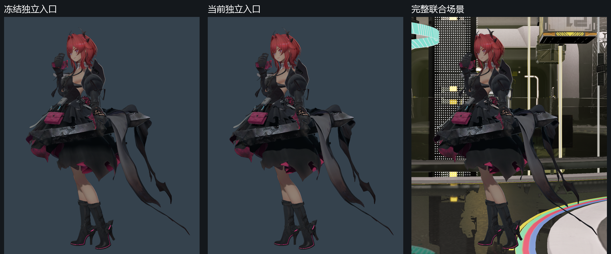

# 材质照明接收验证

日期：2026-11-01，归属为 Q1 服饰照明。
状态：公共机制与操控回归通过，严格环境兼容继续核对。
联合画质继续保持未通过。
公共输入见[材质照明接收](../../runtime/material-lighting-reception.md)。

## 输入与所有权

五份衣料通过完整材质文档声明环境来源。
全局环境强度为 0.5，显示倍率为 0.25。
普通照明的服饰二、三、五声明对象阴影。
服饰一、四由各自的 NPR 可见量契约持有阴影。

材质选择只作用于所属材质的环境贡献。
完整场景持有辐照、局部探针及屏幕空间反射。
环境表面继续消费场景来源。
角色模型、骨骼、动作及原生纹理载荷保持冻结。

公共配置由资产层解析并提供类型和范围。
角色渲染器消费相同的画像及主光接收组。
采集清单记录五份显式接收材质的实际身份。
项目内容持有具体材质槽和来源参数。

## 失败依据

完整世界与独立入口具有不同的环境输入。
独立入口消费强度 0.5 的全局环境。
完整世界消费强度 0.25、场景辐照及探针。
普通衣料的差异依据见[全身对照](full-body-native-comparison.md)。

环境输入匹配控制保留了完整场景几何。
该控制与关闭级联阴影的独立入口核对。
六份不透明内部区域均通过既有静态门槛。
结果支持普通服饰的主光自阴影缺少对应来源。

原独立入口的级联阴影属于角色主光。
完整场景的级联阴影属于环境表面主光。
对象来源采用角色接收组主光及其独立投影图集。
不同主光的阴影各自持有所属消费者。

探针适配另有两次生产 GPU 失败检查。
单独切换漫反射来源时，反射输出曾变为零。
该控制的最大线性误差为 0.25。
原失败图像、程序和着色器摘要完整保留。

## 公共验证

Debug 与 Release 均完成 Player、编辑器及材质校验器构建。
两配置各通过十七项受影响 CPU 检查。
检查覆盖完整文档、图保存、非法值及类型边界。
两个构建共同冻结 989 份编译输入。

两配置各通过八十四次实际 GPU 采集。
通用表面和织物共同验证独立用法。
索引描述符与固定描述符的对应图像逐像素一致。
运行检查覆盖验证层、脚本、呈现及资源卸载。

闭式数值的最大线性误差约为 0.003144。
预算保持 0.008。
两种材质及两条描述符路径均验证探针适配控制。
只切换漫反射来源时，反射图像逐像素一致。

对象来源覆盖亮区、遮挡、组件关闭及完整文档。
额外的表面主光验证接收组和阴影所有权。
亮区与缺省共享主光控制逐像素一致。
完整文档与内嵌画像的遮挡结果逐像素一致。

## 视觉与接续

全身核对采用冻结的材质身份区域。
静态 SSIM 门槛为 0.95。
关键区域中位亮度相对误差目标至多为 10%。
匹配输入对照与原冻结独立对照分别保留。

当前公共机制结果仅证明声明输入的实际消费。
完整原生服饰、透明合成及运动稳定性继续验收。
角色近景与完整操控按当前范围通过回归。
场景反射、GI 及正式性能保持所属门禁。

两配置各完成七组相关回归。
相关回归合计采集 510 帧，覆盖 308 次成功 GPU 进程。
两配置各通过 540 帧及十三项完整操控检查。
本轮机制、相关回归及原生采集合计完成 2040 帧。

## 环境重复性检查

隐藏角色的十二帧采集保留完整环境输入。
首次采集有七帧未达到逐像素兼容要求。
各帧涉及九至十五个像素，最大字节差为五。
首次结果按零差异门槛登记为失败。

相同程序及输入的重复采集也存在三帧差异。
重复结果与冻结基准存在六帧差异。
这些结果说明当前仍有非确定像素来源。
两次运行报告和采集清单的差异均为耗时统计。
命令录制、时间历史及实际绘制顺序继续隔离核对。

对象阴影回归采用按进程划分的结构化日志。
共享文件的追加区间通过执行前后字节范围确认。
历史诊断与当前进程的运行结果分别保留。
对象阴影八项及 NPR 照明七项的实际复测通过。

## 着色程序隔离

同一程序与输入另行采集四组着色程序控制。
每组十二帧，覆盖单程序替换及完整材质程序替换。
四十八帧均与冻结环境参考逐像素一致。
各控制组的两次重复结果也完全一致。

默认材质与显式光照策略分别使用编译程序族。
两配置的 213 个默认程序均与冻结摘要逐字节一致。
独立策略具有 96 个编译变体。
两配置各通过十七项 CPU 及八十四次公共 GPU 检查。

实际完整场景的隐藏角色控制已采集十二帧。
十二帧与冻结参考的 PNG 摘要全部一致。
原有失败及单变量诊断保留独立修订证据。
近景、全身区域及操控按下述范围完成复核。

## 原生序列与兼容

四组全身序列各有 64 帧，覆盖两种抗锯齿配置。
原模型、动作及六份可测不透明区域保持冻结。
每组按第零、三十一及六十三帧核对。
匹配输入对照的三十六个区域均通过既有门槛。

匹配对照的最低 SSIM 为 0.996992。
最高中位亮度相对误差为 3.13%。
原冻结独立对照的服饰二、五仍有失败项。
下表为无抗锯齿首帧的完整结果。

| 区域 | 匹配对照 SSIM | 匹配亮度误差 | 原冻结对照 SSIM | 原冻结亮度误差 |
| --- | ---: | ---: | ---: | ---: |
| 身体皮肤 | 0.999585 | 0.00% | 0.999585 | 0.00% |
| 服饰一 | 0.997787 | 2.58% | 0.997787 | 2.58% |
| 服饰二 | 0.999719 | 0.22% | 0.954538 | 17.08% |
| 服饰四 | 0.999482 | 0.48% | 0.999482 | 0.48% |
| 服饰五 | 0.999876 | 0.09% | 0.933957 | 4.97% |
| 脸部 | 0.999819 | 0.00% | 0.999819 | 0.00% |

匹配对照证明世界装配对相同输入的消费一致性。
原冻结对照继续暴露对象图集与级联阴影的形状差异。
该结果保留为原生服饰及自阴影的接续依据。
完整原生画面资格和整体验收保持未通过。

近景五个冻结区域均通过原有静态门槛。
最低 SSIM 为 0.998674。
最高中位亮度相对误差为 1.74%。
隐藏环境十二帧及缺省近景逐像素兼容。

两配置各通过 540 帧及十三项完整输入回归。
行走、奔跑、焦点恢复、相机和重启通过行为核验。
十四组相关回归完成 510 帧及 308 次 GPU 进程检查。
成功进程均核对运行诊断及资源卸载归零。

图像、原始失败、构建输入及实际命令见[证据索引](evidence/2026-11-01/material-lighting-reception/manifest.json)。
正式性能、跨设备及完整原生区域按所属门禁继续执行。

## 目录边界

程序类别按着色器文件名中的积分标记判断。
父目录名称参与资源定位，文件名决定程序类别。
目录移动的失败控制保留实际 Player 错误及输入。
修订通过两配置各十七项 CPU 检查。

两配置各完成四次实际目录边界采集。
隐藏环境十二帧及缺省近景一帧保持逐像素兼容。
该修订仅涉及程序分类及其回归检查。
完整回归与边界修订各有独立构建收据。

公共机制的两轮检查合计采集 2061 帧。
成功 GPU 进程合计为 496 次。
原生服饰及完整联合画质保持未通过。
