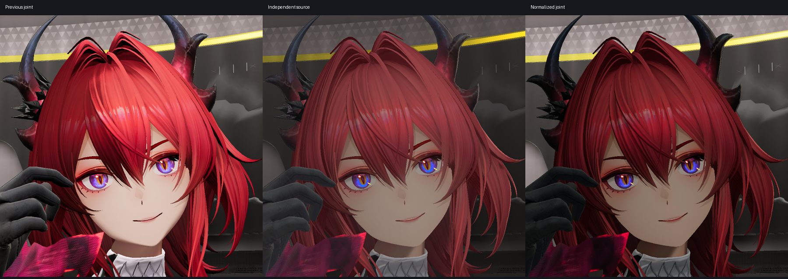

# 材质辐亮度验证

日期：2026-11-01，归属为 Q1。
状态：公共机制及原生对照通过，最终显示外观未通过。
联合画质保留用户复核的未通过状态。
前置数据见[照明分项](joint-lighting-components.md)。

## 契约与实现

源角色参考采用负二档曝光，完整场景采用零档曝光。
项目根据两档曝光差，声明四分之一的材质线性倍率。
源主光、环境响应和风格化照明参数分别保留来源。
运行契约见[材质辐亮度](../../runtime/material-radiance.md)。

倍率作用于完成照明响应的出射辐亮度。
眼睛直接颜色、专用自发光及 KK 高光均包含在内。
乘法覆盖保持无量纲系数，要求倍率为一。
具名轮廓颜色消费所属材质的倍率。

公共画像布局版本为十八，每项二十一行。
倍率位于 `rows[19].w`，物理尺寸为 336 字节。
完整材质文档及内嵌画像共用生产加载器。
核心机制通过通用参数消费项目数据。

## 公共检查

Release 和 Debug 均完成编辑器、Player 及材质工具构建。
每种配置实际执行十一项受影响检查，全部通过。
其中一项使用 GPU，两种配置和采集按顺序执行。
测试数量由输出核对，空跑记录单独保留。

加载检查覆盖缺省、一、零、四分之一及十六。
非法版本、布尔、非有限值和越界均被拒绝。
生产项目校验拒绝原始数值 `16.0000001`。
该检查在转换至单精度浮点数之前执行。

两种配置分别完成三十六次 GPU 采集。
每种配置核对十类材质的独立曝光对照。
所有对照的最大线性误差均为零。
既有预算为 `0.008`，验证继续使用该预算。

| 范围 | 实际结果 |
| --- | --- |
| 普通无照明、PBR、皮肤及完整材质文档 | 曝光与倍率对照逐像素一致 |
| 专用眼睛及头发 KK | 曝光与倍率对照逐像素一致 |
| 透明覆盖、乘法覆盖及具名轮廓 | 曝光与倍率对照逐像素一致 |
| 普通表面与缩放表面同屏 | 普通表面控制逐像素一致 |
| 无照明零值与单位值 | 零值为黑，单位值逐像素兼容 |
| 皮肤、文档、眼睛及头发的描述符路径 | 四组固定路径逐像素一致 |

眼睛还使用冻结的公开像素参考独立验证。
两配置的最大线性误差均约为 `0.001470`。
每次运行正常退出，资源卸载计数归零。
脚本错误、呈现错误及 Vulkan 校验错误均为空。

相关回归共九组检查、二百零二次 GPU 采集。
两配置分别覆盖纹理层十六例、眼睛十五例。
头发各二十五例，坐标扰动各十八例。
Release 还完成全部五十四例 NPR 照明检查。

构建及完整源码摘要见[构建收据](evidence/2026-11-01/material-radiance-normalization/frozen-build.json)。
公共矩阵见 [Release](evidence/2026-11-01/material-radiance-normalization/gpu-final-release/summary.json) 与 [Debug](evidence/2026-11-01/material-radiance-normalization/gpu-verified-debug/summary.json)。
相关检查的命令和范围见[回归收据](evidence/2026-11-01/material-radiance-normalization/related-gpu-summary.json)。

## 失败记录

未实现字段时，生产加载器按预期拒绝输入。
首轮 GPU 对照发现无照明快速路径遗漏倍率。
对应修复覆盖该提前返回路径，并通过完整矩阵。
原始失败图像和日志保留在本机任务目录。

首次构建脚本的测试筛选表达式未被 CTest 接受。
两份空跑日志按失败验证保留。
有效检查使用兼容表达式，并核对实际执行数量。
相关检查的成功结果来自后续真实运行。

一次 Debug 采集的标准输出缺少卸载尾部。
同次结构化日志记录了正常卸载及零存活资源。
验证入口为每次运行保存独立的结构化收据。
该记录与标准输出失败一起保留。

一次 Release NPR 采集出现相同的标准输出缺失。
该次结构化日志也记录了正常卸载及零存活资源。
完整 NPR 矩阵通过独立结构化收据重新执行。
图像预期、错误检查和资源释放条件保持原有门槛。

原生首次统计把环境矩形纳入角色曝光等价检查。
环境材质使用单位倍率，视图曝光具有两档差值。
角色换算检查使用五个角色内部矩形。
环境兼容使用独立的十二帧隐藏角色对照。

## 原生联合核对

原生项目保留完整环境、V8 模型及九段动画。
十三份材质分别记录原件与归一输入的摘要。
十一份辐射材质采用四分之一倍率。
两份乘法覆盖材质采用单位倍率。

独立文本及元数据副本持有候选配置。
图形载荷通过硬链接共享，只读使用。
七组原生采集共六十帧，均正常退出并完成资源卸载。
采集包含固定姿态、近景、时间序列及全景。
隐藏角色的环境十二帧逐像素兼容。
缺省材质的角色近景也逐像素兼容。

无雾、无调色对照的五个角色内部区域逐像素一致。
范围包括发冠、刘海、脸颊、下巴及左眼。
环境保持单位倍率，按其实际视图曝光记录。
完整环境兼容另由隐藏角色序列核对。

场景显示设置下，五个区域仍超出亮度门槛。
发冠及刘海的中位亮度误差约为 43.87%、34.68%。
脸颊及下巴约为 16.24%、16.78%，左眼约为 36.07%。
这些结果超过既有的 10% 门槛。

量化源图像经原生调色表计算，可估计最终显示结果。
发冠、刘海及脸部的中位量残差约为 0.05% 至 0.39%。
左眼有效像素的对应残差约为 3.84%。
这些数值支持调色表为主要显示差异来源的推断。

上述推断仍包含量化、雾及泛光的边界。
眼睛估计排除了 272 个零值或裁切像素。
实际 HDR 读回与单变量调色采集属于接续验证。
原生时间序列与全景保留实际图像及逐帧摘要。

实际输入见[项目收据](evidence/2026-11-01/material-radiance-normalization/native-inputs.json)。
采集及释放范围见[运行收据](evidence/2026-11-01/material-radiance-normalization/native-capture-summary.json)。
亮度、严格兼容及范围见[图像核对](evidence/2026-11-01/material-radiance-normalization/native-comparison.json)。
调色推断的输入与量化边界见[调色重算](evidence/2026-11-01/material-radiance-normalization/native-grade-audit.json)。



公共倍率检查仅证明受测机制的输出与单位契约。
角色阴影、头发、皮肤、反射及 GI 继续按原门禁验收。
最终目标及执行状态由[开发总计划](../../plans/azure-engine-plan.md)持有。

本机任务目录如下。

```text
build/runs/20261101-021345-material-radiance-normalization-1e6231/
```
