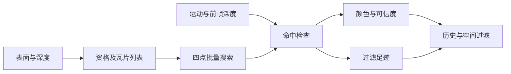

# 原版反射射线来源

日期为 2026-10-29，阶段为 NR5-R8-R1。
官方来源为 3534 帧的原始 RDC。
输入绑定、程序及立即数已完成核验。
完整顺序参考见[算术顺序验证](native-ray-arithmetic-order.md)。

生产内核接入继续按专项计划实施。

## 生产顺序

事件 8691 按表面和深度生成反射资格及瓦片列表。
事件 8702 通过该列表派发八乘八线程组。
输出分辨率为 1280×720。
来源程序包含 331 条执行指令。

射线搜索每批检查四个相邻位置。
实际搜索指令读取深度第零级。
绑定的深度资源包含七级，其他步骤按实际用途读取。
原版层级资源与射线采样规则分别核对。

输入同时包含前帧颜色、深度及运动信息。
射线命中后进行屏幕边缘和前帧深度检查。
输出包含压缩颜色、可信度和双通道表面数据。
表面绿通道提供由射线足迹计算的归一化过滤层级。



## 纹理角色

资源号仅与所属事件及绑定共同解释。
事件 8644 写入同一张 R8 纹理时，内容为环境遮蔽边缘数据。
后续反射分类和过滤会复用该纹理。
追踪完整使用记录时，应核对每次实际生产者。

原版过滤读取表面数据的绿通道作为层级系数。
该值结合粗糙度、命中距离和投影足迹计算。
原版过滤生产与材质粗糙度估计分别维护来源。
公共过滤接口按选定通道消费该系数。

## 重建结果

寄存器重建按二进制立即数保留原始位值。
整数运算、比较掩码及浮点计算分别表达。
零输出对照通过预期失败验证检查器可发现错误。
直接编译控制的结果如下。

| 输出 | 比较字节数 | 差异字节数 |
| --- | --- | --- |
| 压缩颜色 | 3,686,400 | 1 |
| 双通道表面数据 | 3,686,400 | 9,312 |
| 可信度 | 921,600 | 0 |

表面差异全部位于过滤层级通道。
共 9,273 个像素有差异，最大为十六个 UNORM16 单位。
直接编译控制保留上述未通过结果。
主渲染器使用已验收的现行实现。

原版生产接入及完整场景等价继续实施。

压缩载荷及稀疏差异可还原两份完整输出。
归档时逐项核对还原结果与原始字节指纹。
数值、绑定、程序及限制见[结构化清单](evidence/2026-10-29/native-ray-source/summary.json)。

在引擎目录执行载荷检查：

```powershell
python docs/acceptance/nr/evidence/2026-10-29/native-ray-source/verify_payloads.py
```

该检查确认三份载荷及稀疏差异的字节指纹。
该直接编译控制的 `kernelByteEquivalence` 保持为假。

## 调试边界

瓦片列表由 GPU 原子追加生成。
列表顺序可在重放与线程调试之间变化。
相同组索引并不保证选中同一个屏幕像素。
逐线程比较需冻结列表或核对线程实际读取的瓦片身份。
