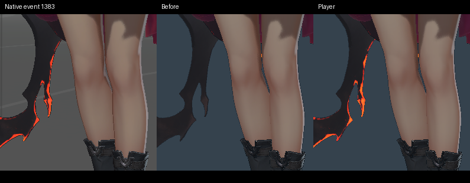

# 不透明表面覆盖验收

日期：2026-11-03，归属为 Q1 与 Q2。
公共覆盖阶段及本轮联合动态检查通过。
完整角色、场景画质及正式交付继续验收。

## 公共机制

分层表面通过显式配置进入不透明覆盖阶段。
主颜色及反射快照在不透明表面之后累加覆盖。
后续透明薄片正确衰减这份贡献。
底层几何持有深度、法线、覆盖及显示变换。

阴影由底层投射，覆盖索引保持资产顺序。
实际录制核验主视图及快照各提交一次。
管线使用 RGB 写入掩码，其他附件保持底层数据。
交换链重建和卸载检查管线、图像及缓冲的释放。

## 自动检查

| 范围 | Release | Debug |
| --- | ---: | ---: |
| 加载、保存、录制及管线策略 | 4 项通过 | 4 项通过 |
| 文档、图编辑、替换、导入及裁剪 | 6 项通过 | 6 项通过 |
| 覆盖、检视标记及平面反射 | 16 帧通过 | 16 帧通过 |
| 多重采样覆盖及反射 | 16 帧通过 | 16 帧通过 |
| 缺省图层、雾、透明深度及工具 | 54 帧通过 | 54 帧通过 |
| 覆盖的全局场景雾 | 2 帧通过 | 2 帧通过 |

176 帧机制检查保留实际命令和输入摘要。
平面反射位置按独立镜像几何计算。
检视标记按顶点颜色及线性合成公式核对。
两条描述符路径的对应图像逐像素一致。

全局场景雾的四帧控制均逐像素一致。
对照采用同位置、同贡献的显式加法雾配置。
关闭反射的环境回退及黑色命中分别持有控制。
线性误差门槛保持 0.008。

缺省路径引用对应来源及程序的受影响证据。
覆盖的最终构建单独完成录制及实际绘制检查。
523 份着色程序与所属来源保持字节一致。
渲染器 API 为九，材质布局为二十一。

## 联合动态

完整候选保留相机、角色缩放及展示站位。
八秒录像包含 192 帧、十一组动画实例。
477 次固定推进及最终动画状态与来源一致。
四帧项目重开的 PNG 逐字节一致。

四个时刻的左墙、顶棚及右墙控制逐像素一致。
指定地面矩形保留覆盖进入倒影的实际差异。
源模型、骨骼、形变及原始动画通过转换工具保留。
候选入口及录像记录于本轮来源清单。

固定姿态的阴影归属核验保持图像逐像素一致。
服饰二完整区域的 SSIM 为 0.931108。
该区域继续保留低于 0.95 的失败状态。
角色、场景反射及间接照明继续执行总计划。

运行规则见[不透明表面覆盖](../../runtime/opaque-surface-overlays.md)。
本轮来源及检查见[证据清单](evidence/2026-11-03/opaque-surface-overlays/manifest.json)。

## 裙摆发光的混色衰减

原生事件 910 读取服饰五的第二组纹理坐标。
固定姿态中，770 个缺失亮红色的参考像素均属于这次不透明绘制。
该材质先形成发光，再参加角色灯的颜色混合。
底层表面与独立发光层分别承担目标灯色和发光衰减。

公开夹具使用青色混色灯照射加法表面，核对最终线性颜色。
固定与索引描述符两条路径的输出逐像素一致。
两种构建配置分别通过六项图层、反射、遮挡和材质回归。
固定姿态的裙边平均通道误差为 13.92 个色阶。
坐标 `[1163, 1022]` 的原生颜色为 `[255, 80, 32]`，当前为 `[255, 87, 32]`。

联合录像包含 192 个不同的实际输出帧。独立进程重开的前四帧与录像源 PNG 逐字节一致。
四个固定时刻的顶棚、左墙及右墙控制区域与同条件输入逐像素一致。
角色完整外观及场景反射继续按各自的参考验收。数值和录像摘要见[实测结果](evidence/2026-11-04/cloth-emission/results.json)。
