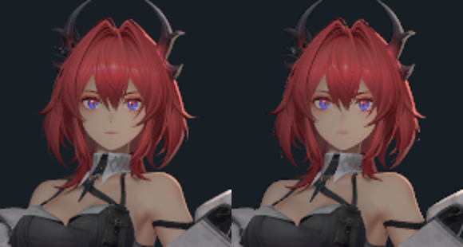

# 角色参考入口与近景采样

日期：2026-11-02，归属为 Q1。
状态：原始入口及动态近景完成采集，整体画质未通过。
阶段源码为 `f9affb1`，渲染器 API 为八。

## 原始参考

用户双角色截图对应保留的正面参考批次。
该批次为 `20261024-074605-native-material-aa-reference-9eb92d`。
当前 Release 程序按相同入口重新采集两组输出。
两次进程均正常退出，资源卸载计数归零。

左侧由 5120×2880 单帧在线性显示域面积平均得到。
右侧为 1280×720 时间抗锯齿第三十二帧。
两侧沿用相同的裁剪矩形和缩放方法。
原始 PNG 与用户 JPEG 分别保存来源资格。

| 原始 PNG 对照 | 精确像素比例 | 平均通道差 | 最大通道差 |
| --- | ---: | ---: | ---: |
| 高分辨率原图 | 99.880710% | 0.000589 | 16 |
| 时间抗锯齿末帧 | 96.353950% | 0.059854 | 234 |
| 双角色裁剪图 | 79.520022% | 0.305962 | 89 |

通道差范围为零至二百五十五。
当前程序能够产生该参考入口的外观。
严格 PNG 兼容及边缘残差继续按原门禁验收。
来源条件见[角色参考入口](../recovery/character-reference.md)。

原始嵌套清单保存旧电脑的绝对挂载路径。
生产解析器对该清单给出相对路径要求的诊断。
配套的根目录清单持有相对挂载及完整内容依赖。
本次采集使用该根目录入口，输入原件按摘要保留。

## 联合角色输入

| 输入 | 原始双图入口 | 动态联合近景 |
| --- | --- | --- |
| 模型 | 静态 `outline-converted.glb` | `hero-restored-inputs-v8.glb` |
| 姿态 | 捕获姿态 | 九段动画中的零号片段 |
| 采样 | 四倍面积平均或三十二帧时间累计 | 无抗锯齿及六十四帧时间累计 |
| 画幅 | 5120×2880、1280×720 | 1536×1536 |
| 曝光 | −2 EV | 视图 0 EV，角色倍率 0.25 |
| 显示 | 线性显示 | 角色线性显示，环境采用场景调色 |
| 覆盖 | 捕获基础图透明度 | 具有原生裁剪输入的完整文档 |

同一仓库包含多个有效入口及其输入组合。
模型、姿态、采样、灯光和显示共同决定最终画面。
每次渲染均需记录所用入口及实际程序摘要。
原始入口与动态入口的整张图片具有不同的比较资格。

## 动态近景

世界与匹配独立入口分别采集一帧原始近景。
两组另各采集六十四帧时间抗锯齿序列。
原模型、十三份材质、机位及动画输入保持一致。
完整序列推进六十三步，最终动画状态相同。

五个冻结内部矩形覆盖发冠、刘海、脸颊、下巴和左眼。
原始近景的最低 SSIM 约为 0.998674。
最高中位亮度相对误差约为 1.74%。
这些结果只证明所属内部区域的输入消费。

时间序列按零、三十一及六十三帧核对。
十五个内部矩形均通过 0.95 和 10% 的既有门槛。
最低 SSIM 约为 0.998674，最高亮度误差约为 1.74%。
完整头发边界、阴影和原生整区分别继续验收。

## 头发覆盖范围

头发的原生裁剪图具有独立尺寸、层级和采样器。
最大两级的放大覆盖等价性属于既有待验条件。
当前接续验证按[独立裁剪图计划](../../plans/2026-11-02-independent-coverage.md)执行。
皮肤、眼睛、KK 高光和场景 GI 保留各自门禁。

实际命令、程序、输入及图像摘要见[证据索引](evidence/2026-11-02/portrait-input-recovery/manifest.json)。
执行顺序与最终目标见[开发总计划](../../plans/azure-engine-plan.md)。
