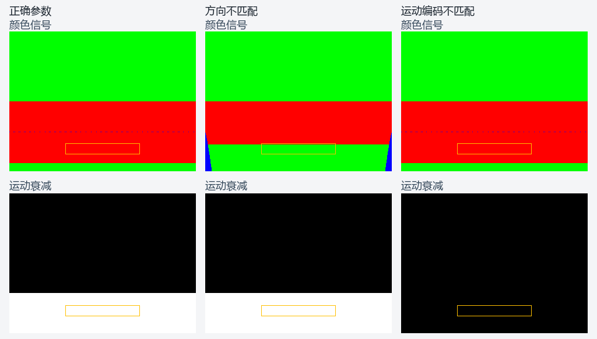

# 投影射线相机适配验证

日期：2026-10-31。归属为 NR5-R8-R5 的输入准备。
相机及运动约定已通过公共验证，表面准备继续实施。
范围见[专项计划](../../plans/2026-10-31-projected-camera-adapter.md)。

## 相机契约

`projectedReflectionView` 消费实际采样投影及相机正交基。
它构造反向设备深度及具名的当前、前帧变换。
当前与前帧的视场、偏移、近远平面分别计算。
输入使用零近一远的透视投影。

CPU 检查覆盖近远深度、相机位置和世界坐标往返。
屏幕横纵坐标按独立的投影公式核对。
前帧使用独立位置、滚转、视场及近远平面。
正交投影、非有限参数和非法枚举均被拒绝。

参数布局为三十个四分量向量，共 480 字节。
视图声明 `MirroredViewY` 或 `VulkanUpperLeft`。
运动声明 `FourthRoot` 或 `LinearUv`。
接口和输入规则见[投影射线说明](../../runtime/projected-reflection-ray.md)。

## 独立镜面

夹具使用倾斜地面及上下分色的墙面。
场景由相机射线与平面求交独立生成。
源尺寸为 640×480，射线尺寸为 320×240。
计算通过公共 RHI 和投影射线接口执行。

固定区域包含 2,432 个像素。
区域要求预期红墙命中及单位静态运动衰减。
两项门槛均预先设置为区域像素的百分之七十五。
Debug 与 Release 的结果如下。

| 案例 | 红墙命中 | 单位衰减命中 | 预期结果 |
| --- | --- | --- | --- |
| 正向参数 | 2,432 | 2,432 | 通过 |
| 宽边缘衰减 | 2,432 | 2,432 | 通过 |
| 静态历史 | 2,432 | 2,432 | 通过 |
| 非有限运动 | 2,432 | 2,432 | 通过 |
| 方向不匹配 | 256 | 256 | 失败控制通过 |
| 运动编码不匹配 | 2,432 | 0 | 失败控制通过 |

非有限线性运动在 GPU 中转为零位移。
静态历史核对前帧深度和世界位置的接收路径。
两个错误控制分别命中方向和运动衰减门槛。
全部案例的验证层及资源计数均为零。

`edgeFade` 按命中点到最近屏幕边缘的归一化距离计算。
宽度 0.1 和 0.5 的颜色与足迹逐字节一致。
增大宽度后，可信度逐像素保持不增，且出现下降。
该检查直接核对参数打包及 GPU 图像响应。

图像来自完整 GPU 读回，颜色按最大分量编码解码。
橙框标记固定的验收区域。
该图展示独立夹具的颜色信号及运动衰减。
主场景合成按所属任务验收。

图像来源及原始字节指纹见[绘图回执](evidence/2026-10-31/projected-camera-adapter/controls.json)。
复现脚本为同目录的 `render_controls.py`。

## 完整来源回归

公共程序的默认方向和编码通过冻结来源检查。
Debug 与 Release 分别运行正序及逆序活动瓦片。
颜色、足迹及可信度共 8,294,400 字节均逐字节一致。
来源布局的独立控制路径也全部一致。

同提交的 17×9 第二任务继续通过。
公共与来源路径各自的十项合成及非法输入案例通过。
共享存储图像夹具的上传、同步及释放保持通过状态。
两种配置各通过十八项受影响检查。

## 编译与接续

公共程序通过 Vulkan 1.1 的 `spirv-val` 检查。
CMake 产物与独立编译工具的输出逐字节一致。
生成的构建图包含 DXC 及实际相邻编译动态库。
输入、程序、可执行文件及输出记录 SHA-256。

详细结果见[结构化回执](evidence/2026-10-31/projected-camera-adapter/summary.json)。
后续继续准备引擎表面的投影深度和法线输入。
主场景装配持有快照、历史提交及取消重试身份。
正式图像、连续序列和持续性能保持既有门槛。
