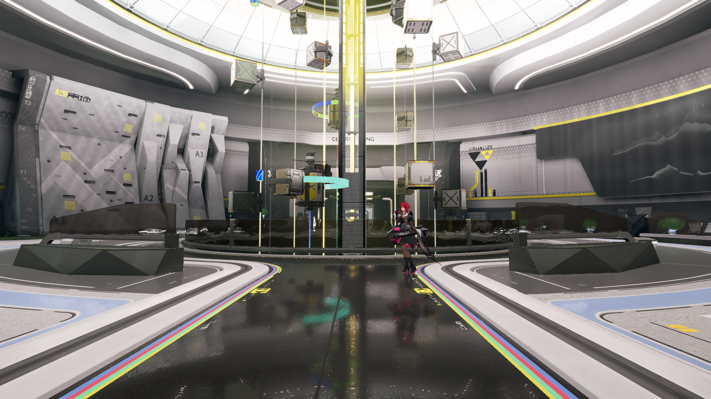

# 主场景投影历史验证

日期为 2026-10-31，范围为 NR5-R8 的场景历史装配。
本页验证历史输入、生命周期及受影响回归。
投影过滤清晰度、正式 SSIM 和持续性能继续验收。
实施依据见[场景计划](../../plans/2026-10-31-projected-main-history.md)。

## 输入与状态

单样点视图采用共享运动或场景持有的独立运动目标。
前帧颜色借用不透明快照，前帧深度由公共组合持有。
历史视图保存实际采样投影、姿态及归一化抖动。
线性运动的 UV 校正等于当前抖动减已提交的前帧抖动。

记录候选在成功提交后发布资源槽位及输入身份。
取消记录保持已提交的采样视图和抖动。
缺失反射提交、视图来源切换及相同槽位采用当前帧生产。
四样点的历史准备报告 `multisample-motion-unavailable`。

实际历史输入由 `screenReflectionHistoryInputSubmission` 标识。
当前采样校正由 `screenReflectionMotionUvOffset` 记录。
生产名称分别为 `projected-current-frame` 和 `projected-history`。
最近发布的提交与实际读取的前帧分别记录。

## 同步与所有权

资源图声明当前快照、前帧颜色及运动的采样用途。
直接记录发布相同的颜色与运动可见性。
快照附件复用采用已有的外部读取依赖。
公共准备组件在独立槽位中同步深度的读取和覆写。

运动目标、帧缓冲和历史元数据由场景渲染器回收。
共享运动继续由所属视图持有。
主颜色与反射颜色的生产顺序保持明确。
算法和资源切换沿视图重建及退休规则应用。

## 状态与物理检查

有效格式的夹具在冻结实现上触发缺失历史准备的红测。
双配置均通过扩展的场景生命周期检查。
两类材质绑定组合四种设备或运动配置。
低于场景布局最低能力的设备触发加载拒绝并完成回收。

检查覆盖提交、取消、同槽位、缺失反射帧及视图来源切换。
共享时间采样核对独立计算的两分量 UV 偏移。
取消后的偏移继续引用实际已提交的采样抖动。
直接记录的检查使用空设备适配器。

真实 Player 在同一进程中采集三个移动来源帧。
两个端点的反射中心误差均约为 2.79 像素。
横向位移约为 55.399 像素，满足原有位置和能量门槛。
本轮检查使用既有颜色、面积和信号阈值。

## 自动回归

| 检查 | Debug | Release |
| --- | --- | --- |
| 受影响 CPU 检查 | 二十一项通过 | 二十一项通过 |
| 公共 GPU 检查 | 十四项通过 | 十四项通过 |
| 最终场景生命周期检查 | 通过 | 通过 |
| 实际投影场景 | 二十二条路径通过 | 二十二条路径通过 |
| 既有线性反射扩展 | 四十四条路径通过 | 四十四条路径通过 |
| Player 与编辑宿主 | 构建通过 | 构建通过 |

Debug 的实际场景运行完成验证层检查。
全部实际运行按各自日志核对退出和资源卸载。
两种描述符装配、两类抗锯齿及运动来源均进入检查。
构建和运行的来源指纹保存在[结构化清单](evidence/2026-10-31/projected-main-history/summary.json)。

共二百二十六对小场景 PNG 逐字节一致。
其中包含三十八对投影及四十八对线性双配置图像。
冻结线性对照共九十六对，投影首帧对照共四十四对。
投影历史的后续帧分别采用所属帧的独立物理检查。

公共接口、程序和默认算术保持相同来源指纹。
投影程序为 93,872 字节，双配置指纹相同。
完整原版缓冲及二百份默认读回引用同来源的[公共验证](projected-history-motion.md)。
本轮继续独立核对场景装配及图像结果。

## 完整场景

| 入口及算法 | 帧数 | 实际生产 | 输入提交 |
| --- | ---: | --- | ---: |
| 完整环境，线性 | 3 | linear-temporal | 2 |
| 完整环境与角色，线性 | 3 | linear-temporal | 2 |
| 完整环境，投影 | 3 | projected-history | 2 |
| 完整环境与角色，投影 | 3 | projected-history | 2 |

四次 Release 采集均使用 2560×1440 和固定六十赫兹时间。
默认线性入口的六张图与各自完整场景基准字节一致。
两份投影场景保持全部环境节点、调色及原捕获机位。
角色联合入口核对固定位置和原待机动画。

程序正常退出，资源卸载计数均为零。
实际完整场景的验证层关闭状态按日志记录。
三帧前缀用于功能和受影响回归。
完整动态周期、持续帧率及双设备仍按正式条件验收。

## 画质范围

投影候选的地面倒影呈现宽足迹过滤。
当前帧与历史帧均进入该现象的核对范围。
粗糙度来源、过滤尺度及原作清晰度继续由 NR5 验收。
本页的功能回归与正式画质门槛分别记录。

冻结程序的完整场景首帧与本轮首帧字节一致。
对照使用相同项目、机位及投影程序。
其结果分别限定历史装配和过滤画质的验证范围。

用户参考画面的默认入口见[完整场景恢复](../recovery/full-scene-visual.md)。
完整环境与角色的默认画面见[联合验证](../recovery/full-scene-character.md)。
严格环境像素兼容及持续预算保持原有待验状态。
后续画质改进持续保护默认入口和已有物理检查。
