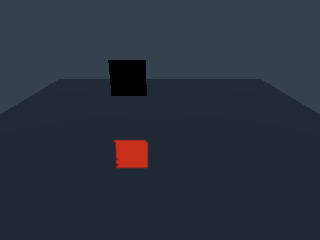
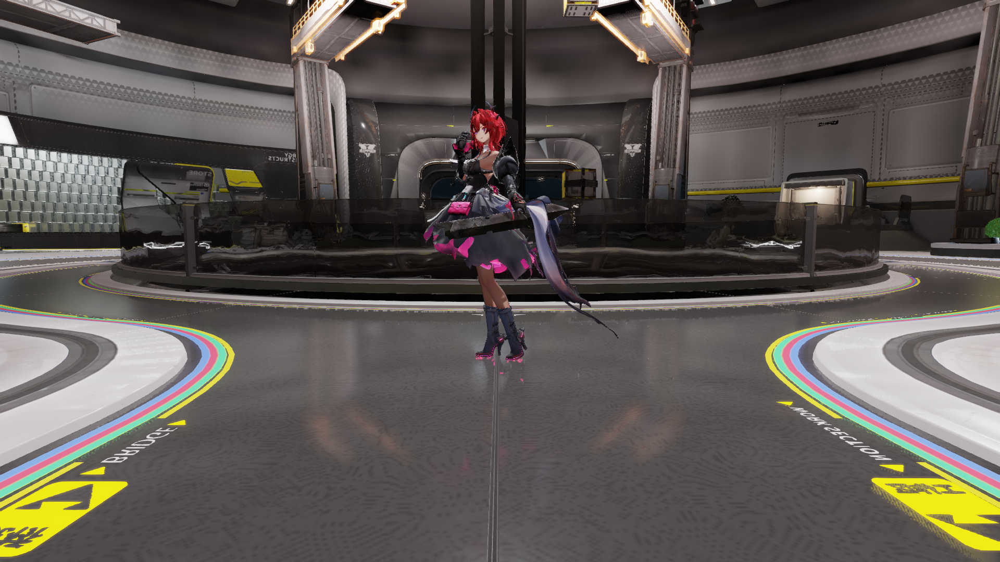

# 主场景投影反射验证

日期：2026-10-31。
范围属于 NR5-R8-R7 的当前帧冻结候选。

现行历史装配见[历史验证](projected-main-history.md)。
实施入口见[主场景计划](../../plans/2026-10-31-projected-main-scene.md)。
公共算法见[组合契约](../../runtime/projected-screen-reflection.md)。

## 设置与场景装配

反射子版本二提供 `linear` 和 `projected` 算法。
子版本一按线性算法读取。
非法版本、名称及字段在目标变化前拒绝。
文档保存和重开保持算法及全部参数。

场景在视图装配时选择公共反射组合。
投影生产消费所属帧的表面和颜色快照。
相机参数采用实际采样投影。
输出经现有存储图像绑定进入材质合成。

本页冻结候选使用本帧颜色及恒定零运动场。
历史接入负责成功提交身份和采样抖动差。
设备格式、预算及投影条件按契约选择回退。
清单记录请求算法、实际生产及回退原因。

资源图和直接记录共用生产函数。
两种材质绑定分别验证分帧资源和关闭。
取消重录以及失败回收沿用公共组件契约。
算法切换通过视图重建应用资源变化。

直接记录使用空设备适配器核对派发和资源计数。
格式缺失、正交投影及算法切换均有回退检查。
实际 Player 的 GPU 捕获使用资源图路径。

## 红测与图像依据

算法接口红测触发缺失成员的编译失败。
冻结 Player 读取版本二时返回版本拒绝。
同一 Player 的默认关闭案例正常运行。
该对照保存程序、动态库及完整着色输出指纹。

独立镜面使用几何投影计算预期反射位置。
正向检查同时约束红色能量、面积及位置误差。
隐藏来源和高粗糙度案例检查信号抑制。
完整着色案例核对来源颜色和接收区域。

运动案例在同一进程中采集三个固定步长帧。
两端反射位置分别对照独立几何投影。
时间抗锯齿和四样点各有对应关闭基线。
材质绑定之间按既有通道误差上限二检查。

## 自动验证

两种配置各通过二十二条投影场景路径。
测试覆盖移动来源、粗糙度及两类抗锯齿。
反射中心误差约为 2.200 至 2.792 像素。
门槛为九像素，其他颜色和能量门槛保持有效。

两种配置各通过四十四条既有线性扩展路径。
十张线性图像与冻结程序逐字节一致。
双配置三十八张投影图像及四十八张线性图像一致。
Debug 全部场景验证层及卸载资源计数检查通过。

共享时间设置检查覆盖现行渲染版本二十。
版本十八的时间模式和版本十九的多样点模式保持兼容。
未来版本、非法数值和覆盖设置分别检查。

完整原生项目完成 Release 两帧 1080p 采集。
过程用时 152.238 秒，退出及资源释放检查通过。
投影输出为 960×540，图像预算为 54,947,176 字节。
本次使用当前帧生产，历史有效状态为假。

两种配置各通过三十四项受影响检查。
原版冻结输入的三份输出逐字节一致。
投影程序的 91,480 字节及其来源指纹保持一致。
构建、输入和日志见[结构化清单](evidence/2026-10-31/projected-main-scene/summary.json)。

## 验收边界

本页验证真实 Player 的当前帧投影生产。
原版冻结输入等价按公共射线来源验证。
完整场景静态等价及连续序列按所属任务验收。
正式 SSIM、持续性能及双设备交付仍由原阶段持有。
