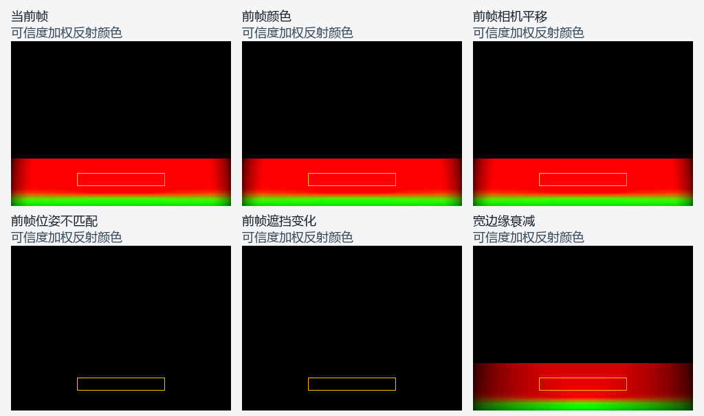

# 投影反射公共组合验证

日期：2026-10-31。归属为 NR5-R8-R6。
范围见[专项计划](../../plans/2026-10-31-projected-reflection-composition.md)。
接口和资源顺序见[公共组合](../../runtime/projected-screen-reflection.md)。

## 公共契约

缺失组合接口的首次编译按预期失败。
CPU 验证预算、格式、参数、历史槽位及图像别名。
非法记录先于描述符和命令变化而拒绝。
子组件构造失败及完整对象关闭均回收资源。

独立 GPU 镜面真实取消一次完整录制。
随后直接重录并提交，覆盖分帧资源和参数。
验证层、缓冲及图像计数均为零。
相机、表面和来源的既有门槛保持有效。

## 完整组合对照

一条路径调用公共组合对象。
另一条路径逐个装配已验证的公共组件。
两条路径使用相同几何、参数和原始输入。
分别读回颜色、足迹、可信度及最终浮点过滤结果。

每配置对照八项案例，共 15,360,000 字节。
四类输出均逐字节一致。
当前模式还核对一像素零运动与全尺寸零场的等价性。
历史模式在同一提交中先生产前帧，再消费独立槽位。

| 案例 | 原始命中 | 过滤命中 | 预期结果 |
| --- | --- | --- | --- |
| 当前帧 | 2,432 | 2,432 | 通过 |
| 宽边缘衰减 | 2,432 | 2,432 | 通过 |
| 静态历史 | 2,432 | 2,432 | 通过 |
| 非有限运动 | 2,432 | 2,432 | 通过 |
| 前帧颜色变化 | 2,432 | 2,432 | 通过 |
| 前帧相机平移 | 2,432 | 2,432 | 通过 |
| 前帧位姿不匹配 | 0 | 0 | 失败控制通过 |
| 前帧遮挡变化 | 0 | 0 | 失败控制通过 |

固定区域和百分之七十五的门槛预先定义。
前帧颜色案例将当前颜色设为蓝色，前帧保留红墙。
平移案例使用五单位的横向位移及逐像素 UV 运动。
错误位姿和遮挡分别验证变换及前帧深度的真实消费。

前四项使用既有镜面的尺寸和尺度。
后四项使用十分之一几何尺度，核对深度拒绝门槛。
全部过滤像素要求有限、非负，可信度位于 `[0,1]`。
这些检查属于公共计算输出，主场景合成另行验收。

图像使用完整浮点读回，颜色乘以可信度后显示。
橙框表示固定验收区域，零可信度在图中呈黑色。
图像来源及显示规则见[绘图回执](evidence/2026-10-31/projected-reflection-composition/controls.json)。

## 过滤通道控制

独立错误注入将足迹选择从 G 通道接到 R 通道。
原始命中仍为 2,432，最终过滤命中降为零。
预定的镜面门槛直接拒绝该输出。
正确通道恢复后按同一门槛执行双配置回归。

该控制验证组合中的过滤输入及通道选择。
边缘宽度变化还核对完整图像的可信度响应。
颜色及足迹保持一致，可信度逐像素不增。
运动和几何拒绝均通过实际 GPU 读回判断。

## 来源与接续

构建和运行记录源码、程序及可执行文件指纹。
完整日志及结果见[结构化回执](evidence/2026-10-31/projected-reflection-composition/summary.json)。
主场景继续装配类型化选择、快照和成功提交身份。
正式画面、连续序列及持续性能保持既有验收条件。
