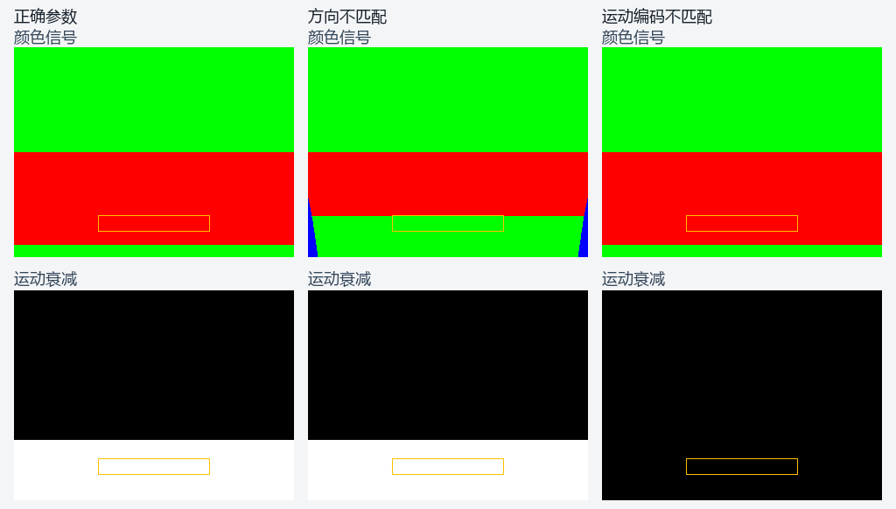

# 投影反射表面准备验证

日期：2026-10-31。归属为 NR5-R8-R5。
范围见[专项计划](../../plans/2026-10-31-projected-surface-preparation.md)。
接口规则见[表面准备](../../runtime/projected-reflection-preparation.md)。

## 契约与失败控制

缺失公共头文件的首次编译按预期失败。
公共对象随后通过所有权、预算、别名及范围检查。
非法记录在描述符更新及命令变化前拒绝。
取消后的同槽位重录按公共接口验证。

GPU 红测使用写零的计算程序。
首个像素的深度、法线和可信度均未达到独立参考。
正式转换使用同一夹具及原有精度门槛。
编译及失败日志保存在结构化回执中。

## 独立转换

GPU 每次读回深度、法线、掩码及初始可信度。
深度按双精度 CPU 投影公式核对。
法线解码后与独立输入方向做点积核对。
可信度按粗糙度函数核对，允许一单位归一化舍入。

| 源尺寸 | 除数 | 输出尺寸 | 主要范围 |
| --- | --- | --- | --- |
| 35×19 | 1 | 35×19 | 完整及奇数尺寸 |
| 35×19 | 2 | 17×9 | 半尺寸整数选样 |
| 1×19 | 2 | 1×9 | 单列 |
| 35×1 | 2 | 17×1 | 单行 |
| 1×1 | 2 | 1×1 | 最小尺寸 |

每组执行两个槽位和两次连续覆盖。
两个槽位使用不同深度系数和粗糙度上限。
强度覆盖零、四分之一、零点八及一。
每配置共核对 3,380 个像素参考。

表面覆盖六个轴向法线和两个斜向法线。
非法案例包含零、负、背景及非有限深度。
另含法线编码越界、粗糙度异常及投影范围外表面。
真实命令取消后重录，验证层及资源计数均为零。

## 镜面组合

独立镜面将全尺寸公共表面送入准备接口。
射线直接消费生成的深度、法线、掩码和瓦片。
准备接口同时初始化可信度并提供足迹目标。
场景和固定区域沿用[相机夹具](projected-camera-adapter.md)的几何门槛。

正向、宽边缘、静态历史及非有限运动均通过。
固定区域的红墙和单位运动衰减均命中 2,432 像素。
错误坐标方向和错误运动编码仍触发预定失败。
边缘宽度的完整颜色及足迹保持逐字节一致。

图像来自 Release 的完整 GPU 读回。
颜色解码及固定区域沿用相机夹具的绘图规则。
来源及程序指纹见[绘图回执](evidence/2026-10-31/projected-surface-preparation/controls.json)。

## 回归与接续

受影响检查覆盖来源参考、相机、射线及深度金字塔。
还包含公共表面、信号金字塔、重投影和空间过滤。

两种配置各通过二十六项受影响检查。
正逆瓦片的三份来源输出共 8,294,400 字节一致。
既有镜面的十八份完整读回与相机阶段逐字节一致。
源码、程序、可执行文件和日志记录 SHA-256。

详细结果见[结构化回执](evidence/2026-10-31/projected-surface-preparation/summary.json)。

主场景接续当前快照、足迹层级和前帧身份装配。
正式画面、连续序列及持续性能保持所属验收条件。
