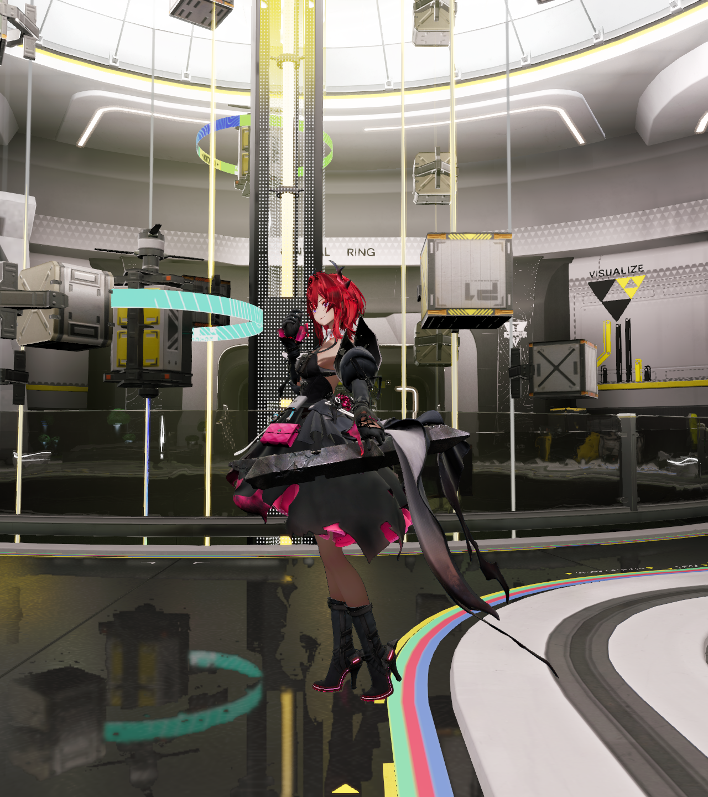
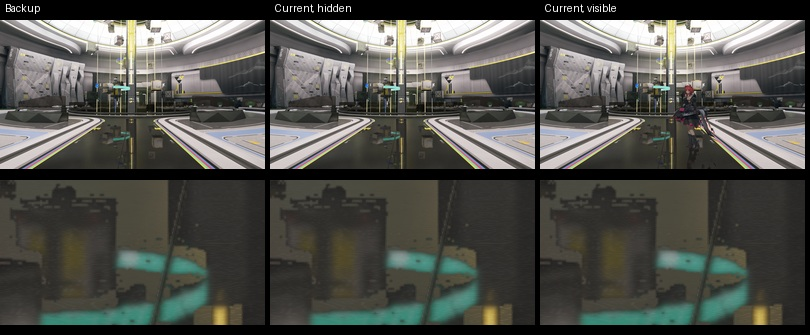
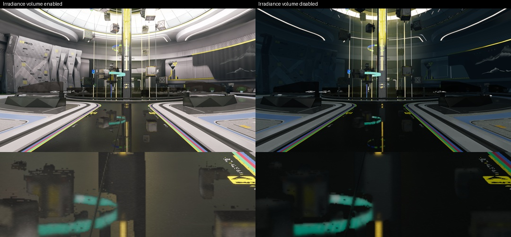

# 场景材质与角色画质诊断

日期：2026-10-31。
状态：分项采集完成，整体画质继续验收。
范围为完整物流场景、地面反射及原生角色。
执行顺序见[核验计划](../../plans/2026-10-31-projected-footprint-quality.md)。

## 场景入口与来源

用户提供的 PNG 与投影角色候选逐像素一致。
图像尺寸为 2560×1440，候选帧序号为二。
默认线性时间反射入口具有独立的完整画面。
两种入口的运行范围见[历史装配](projected-main-history.md)。

本轮保留完整场景、十三份角色材质及九段动画。
模型、纹理及生产着色代码使用冻结输入。
默认画质入口见[完整场景显示](../../tutorials/restored-native-scene.md)。

## 反射过滤

Vulkan 实际帧的射线事件为 `21668`。
空间过滤事件为 `21729`。
两端实际参数的最大过滤层级均为六。
原始帧与导出输入具有独立的长度及摘要记录。

地面区域采用显示坐标 `[1060,1100,1460,1360]`。
对应半分辨率区域共有 26,000 个样本。
有效表面且反射置信度大于零的样本为 24,590 个。
该区域包含少量其他材质，统计按有效样本给出。

| 实际输入 | 中位数 | 九十分位 |
| --- | --- | --- |
| 浮点粗糙度 | 0.117205 | 0.127550 |
| 归一化过滤层级 | 0.399863 | 0.457604 |
| 解码后的过滤层级 | 2.399176 | 2.745626 |
| 层级对应的采样尺度 | 5.275018 | 6.706807 |
| 反射置信度 | 1 | 1 |

粗糙度取自 `RGBA32F` 原始输入的 B 通道。
足迹取自 `RG16_UNORM` 的 G 通道。
空间过滤按选定层级执行 4×4 核。
这些数据支持地面宽过滤的可见诊断。

独立条纹核对可见来源、低粗糙度细节及变化趋势。
低粗糙度两例的投影倒影对比度均为一。
粗糙度 0.3 的对比度约为 0.154。
整体世界平移及绕 Y 轴旋转对照也通过。

当前证据尚未确认通用投影公式错误。
过滤观感与原生完整画面的验收继续进行。
实际粗糙度以原始读回为准。
带显示变换的隔离图用于可视诊断。

## 角色近景

实际采集完整画面、底色、着色法线及对象阴影。
四项均为 Release Player 的 1280×1440 单帧。
原待机动画、模型和十三份材质共同进入近景。
相机位置为 `[-1.5148,2.04,-19]`。

底色可见头发、皮肤、服装和配件纹理。
完整画面中的头发暗条及衣料高光继续核对。
对象阴影显示腿部和部分衣料的遮挡。
该分项与材质本身的遮蔽量分别验收。

完整风格化照明候选及时间采样见[照明联合验证](character-illumination-integration.md)。
该候选通过隐藏环境兼容，整体角色外观继续验收。

近景采用新的相机位置和长宽比。
捕获雾的实际状态为 `camera-mismatch`。
该视角用于材质定位，原固定机位独立复核。
完整场景的同屏检查见[角色组合](../recovery/full-scene-character.md)。

## 检查与接续

四项完整近景均正常退出，卸载资源计数归零。
实际帧回放没有记录调试消息。
十九份来源记录及二百一十一份着色产物指纹一致。
四份既有用户文件的内容指纹保持一致。

材质外观、时间稳定性及原生完整区域继续验收。
投影过滤与角色照明分别建立独立预期。
确认稳定失败后实施所属模块修复。
固定场景、默认线性入口和公共数值门槛共同回归。

本轮完整命令、诊断脚本及原始来源见[结构化记录](evidence/2026-10-31/scene-material-quality/summary.json)。

## 备份机位的固定箱体对照

联合场景使用备份机位、固定箱体及每秒六十帧的时间步长。
两组关卡只切换角色可见性，各采集十二帧。对照源为重装前的原始 PNG 序列。
中央地面矩形为 `[1010, 990, 1550, 1170]`，每帧含 97,200 个像素。

| 区域 | 隐藏角色时逐帧相同像素比例下限 | 十二帧最大通道差 |
| --- | ---: | ---: |
| 中央地面 | 99.8971% | 1 |
| 青色环带倒影 | 99.6376% | 1 |
| 顶棚 | 99.9910% | 1 |
| 右墙与左侧地面 | 100% | 0 |
| 左侧门板 | 99.9996% | 9 |

第十二帧显示角色后，中央矩形的 81.63% 像素保持相同，包含角色的腿部及其倒影。
青色环带矩形中有 99.90% 的像素相差至多一个色阶。
动态箱体的相位和待机动画时基另行记录。间接照明的独立贡献和整幅逐字节一致性继续验收。
逐帧摘要见[固定姿态对照](evidence/2026-11-04/floor-fixed-controls/results.json)。

## 辐照体的地面贡献

机位、时间步长、反射探针、屏幕空间反射及箱体姿态取自固定箱体对照。
每组采集十二帧，关卡文件逐字段核验，组内唯一变量为辐照体的启用状态。
隐藏角色时，第十二帧中央地面的 97,200 个像素均响应间接照明，输出 RGB 通道平均绝对差为 46.37 个色阶。
显示角色时，同一区域有 83,804 个像素响应，平均绝对差为 38.18 个色阶。
右墙的 128,800 个像素在两组中均响应，平均绝对差为 64.50 个色阶。
这些数值描述最终显示图像。辐照体针对物理表面，角色色带的受光按角色材质单独核验。

逐帧数据、输入摘要及取样矩形见[辐照体对照记录](evidence/2026-11-04/floor-irradiance/results.json)。

## 当前联合辐照体

当前入口为 `qualified-lit-surfaces-joint-v4`。
辐照体启用强度为一，资源摘要与备份一致。
Player 使用 `cd8d95d` 对应的受检构建。
单帧固定步长对照只切换辐照体启用状态。

中央地面的 97,200 个像素中有 83,794 个响应。
该区域的 RGB 平均绝对差为 38.05 个色阶。
右墙 128,800 个像素全部响应，平均绝对差为 64.50。
左侧地面 67,900 个像素全部响应，平均绝对差为 73.80。

关闭组耗时 113.66 秒，卸载资源计数归零。
相机、反射算法及层级与启用组相同。
本项证明实际消费，最终能量和外观仍按原门槛验收。
输入、原始记录及图像见[当前对照](evidence/2026-11-05/current-joint-irradiance/results.json)。

## 原生地面画面对照

原生参考为第 3534 帧回放的 `ResourceId::406`，分辨率为 2560×1440。联合场景使用同一捕获机位，沿用固定地面矩形。表中为第一个采集时点，结构相似度门槛为 0.95。

| 联合场景条件 | 整帧结构相似度 | 中央地面结构相似度 | 青色环带结构相似度 |
| --- | ---: | ---: | ---: |
| 辐照体启用 | 0.7906 | 0.7255 | 0.6693 |
| 辐照体关闭 | 0.3893 | 0.3561 | 0.3026 |
| 辐照体启用，区域中位亮度对齐 | 0.7895 | 0.7179 | 0.6596 |

启用辐照体时，中央地面和青色环带的中位亮度相对误差分别为 10.05% 和 5.04%。中位亮度对齐用于区分亮度与局部结构，正式门槛按实际画面判定。

屏幕反射配对使用同一程序、机位和场景输入。环境和联合角色关卡分别采集三个时点。关卡字段核验确认唯一行为变量为 `screenSpaceReflection.algorithm`。

环境场景的中央地面在线性与投影路径上的结构相似度分别为 0.8049 和 0.8422 至 0.8430，联合角色场景分别为 0.7889 至 0.7890 和 0.8289 至 0.8296。青色环带的六次投影对照均进入 0.7529 至 0.7546。

地面反射的完整质量继续验收。原生与 Player 的实际反射深度、粗糙度和过滤层级按同位置分项核对。

[场景结果](evidence/2026-11-16/joint-scene-native-floor/results.json)和[验证归档](evidence/2026-11-16/joint-scene-native-floor/validation.zip)保存矩形、采集指纹、逐帧指标及复算入口。

## 投影反射射线步数

原生第 3534 帧中，8702 号调度的长射线预算为 32 步。联合角色关卡和 Vulkan 附件记录的预算均为 128 步。原生反射附件按行翻转映射到显示坐标。用 8811 号事件的深度核验映射后，中央地面 23,832 个位置的前向深度相差至多 2 毫米。

用 Vulkan 的深度、法线、表面遮罩、初始置信度和工作列表复算射线搜索。128 步对照在中央地面和青色环带与 Player 实际输出的命中一致率分别为 99.09% 和 98.83%。以下一致率以原生实际置信度输出为参照。

| 区域 | 128 步搜索 | 32 步搜索 | 32 步仅 Player 命中 | 32 步仅原生命中 |
| --- | ---: | ---: | ---: | ---: |
| 中央地面 | 87.92% | 91.39% | 1,670 | 422 |
| 青色环带 | 95.41% | 96.46% | 236 | 8 |

复算覆盖几何搜索和屏幕边界，不含历史颜色、运动接受和时间合成。配对候选只修改投影计算程序的射线步数，按同一机位、关卡和固定时间采集两块显卡的实际画面。采用判断依据中央地面、青色环带与邻区的结构、亮度和像素误差；正式验收包含冻结四帧 RGB 零差。

[候选记录](evidence/2026-11-16/projected-floor-ray-budget/results.json)和[验证归档](evidence/2026-11-16/projected-floor-ray-budget/validation.zip)保存冻结输入指纹、候选补丁和复算方法。

## 联合场景步数对照

联合角色场景以 2560×1440、每秒六十帧的固定步长采集。NVIDIA 与 Intel 各完成三对实际帧，原程序复编的 SPIR-V 摘要与受检程序一致。表中为同一设备的第三帧，参考为原生第 3534 帧。

| 设备与范围 | 对照结构相似度 | 32 步结构相似度 | 对照中位亮度误差 | 32 步中位亮度误差 |
| --- | ---: | ---: | ---: | ---: |
| NVIDIA 中央地面 | 0.8289 | 0.8320 | 15.78% | 16.42% |
| Intel 中央地面 | 0.8285 | 0.8317 | 16.04% | 16.57% |
| NVIDIA 青色环带 | 0.7546 | 0.7629 | 7.99% | 7.57% |
| Intel 青色环带 | 0.7542 | 0.7622 | 8.09% | 7.71% |

六对图像的中央地面亮度均低于原生参考，候选的亮度误差为 16.42% 至 19.02%。顶棚、左门、右墙和左侧地面均有新增超过一个色阶的像素。两块显卡的完整画面及两个地面区域均未通过 0.95 结构相似度门槛，候选未通过区域验收。冻结四帧继续作为正式采用条件。

[双设备配对结果](evidence/2026-11-16/projected-floor-ray-budget-player/results.json)和[验证归档](evidence/2026-11-16/projected-floor-ray-budget-player/validation.zip)包含原程序复编、唯一变化、逐帧指纹及邻区计数。地面反射的下一项核对使用实际历史取样坐标、深度和颜色。按同一世界位置区分射线终点与入射颜色的贡献。

## 原始反射颜色

按显示坐标与两厘米前向深度误差配对，共有 24,073 个中央地面位置和 6,900 个青色环带位置。两端均有命中的分别为 19,043 和 6,477 个。中央地面共同命中的压缩颜色中位亮度为原生 0.178、Player 0.106，青色环带为原生 0.184、Player 0.135。

以各自置信度加权后，共同命中处占中央地面原始反射亮度绝对误差的 78.15%，占青色环带的 87.64%。这些数字用于区分命中覆盖和命中处的颜色，范围止于过滤与合成前的半尺寸反射输出。

原生 8702 号调度直接读回当前深度、长搜索遮罩、初始置信度和法线粗糙度。以显示坐标核对，采样矩形内的深度和 8811 号调度保存的同一资源逐位一致。以两厘米前向深度误差配对后，中央地面、青色环带的法线方向中位差分别为 0.27° 和 0.25°，粗糙度中位差均小于 0.001。深度及材质输入相近的区域仍有较大的命中颜色差，下一项核对实际历史颜色取样位置。

[原始反射颜色记录](evidence/2026-11-16/projected-reflection-shared-hits/results.json)和[验证归档](evidence/2026-11-16/projected-reflection-shared-hits/validation.zip)保存输入指纹和同位置复算。
[实际射线输入](evidence/2026-11-16/projected-floor-actual-inputs/results.json)和[验证归档](evidence/2026-11-16/projected-floor-actual-inputs/validation.zip)保存原生附件裁切、坐标映射及核对结果。

## 上一帧反射输入

原生 8702 号调度读取 `R16G16B16A16_FLOAT` 上一帧颜色和 `R32_FLOAT` 上一帧深度，捕获内该调度之前没有对这两个资源写入的记录。离线复算沿用指纹校验通过的调度前附件；这两份附件在调度前后逐字节一致。

用上一帧相机反投影同一显示位置，比较原生与 Player 的世界坐标。中央地面 24,082／24,300 个位置、青色环带 6,900／6,900 个位置的间距在两厘米内。

中央地面和青色环带分别有 21,340 和 6,657 个原生反射位置写入了新颜色，且置信度大于零。按原浮点格式编码后，上一帧颜色包含所有这些写入值。调试跟踪中，已知取样位置的 HDR 源颜色和写入反射附件的值逐位对应。

颜色相同的候选纹素可以出现在多个位置，颜色匹配用于核对数据来源。两端的实际取样坐标及 Player 历史亮度按独立读回核对。见[原生历史输入记录](evidence/2026-11-16/projected-history-original-input/results.json)和[验证归档](evidence/2026-11-16/projected-history-original-input/validation.zip)。

## 原生反射取样坐标

原生 8702 号调度将上一帧取样坐标写到诊断附件。常量标记覆盖裁切区内 55,658 个置信度大于零的位置。插桩前后，反射颜色和置信度附件逐字节一致；还原后的足迹附件也逐字节一致。

中央地面、青色环带各有 20,003 和 6,258 个坐标可确定唯一的颜色纹素。取出上一帧原始颜色并编码后，两区全部复现了原生反射附件中的颜色。按这些坐标比较两端的上一帧深度，两区分别有 8,028 和 3,364 个世界位置相距不超过两厘米。

[原生取样记录](evidence/2026-11-16/projected-history-native-endpoints/results.json)及[读回归档](evidence/2026-11-16/projected-history-native-endpoints/validation.zip)保存实际坐标和指纹。两端的历史取样按下文的交叉取色核对。

## 原生反射的历史回移

从原生 8702 号调度的运动纹理反推重投影前的取样位置。
复算保留坐标量化区间内所有符合点采样规则的运动纹素。
中央地面和青色环带的 21,340 和 6,657 个有效坐标均有解。

| 原生区域 | 唯一运动纹素 | 中位回移上界（像素） | 最大回移上界（像素） |
| --- | ---: | ---: | ---: |
| 中央地面 | 19,394 | 小于 0.01 | 2.71 |
| 青色环带 | 6,053 | 1.68 | 2.23 |

像素数以 2560×1440 图像为尺度。
中央地面有 11,838 个坐标的回移可界定在半像素内，青色环带有 2,064 个。
结果用于分开核对环带和地面，并与实际 Player 取样路径配对。

[运动纹理复算](evidence/2026-11-16/projected-history-native-motion/results.json)和[验证归档](evidence/2026-11-16/projected-history-native-motion/validation.zip)保存取样坐标、输入指纹及复算程序。

## 原生回移的亮度对照

保持原生上一帧颜色，分别按实际取样坐标和回移前坐标取色。
样本须有唯一运动纹素，并能逐位复现原生反射颜色。
两端须均有命中，接收位置相距至多两厘米。

| 区域 | 配对样本 | 取消回移造成的亮度变动占现有误差 | 取消回移后的误差增幅 |
| --- | ---: | ---: | ---: |
| 中央地面 | 17,159 | 10.70% | 0.47% |
| 青色环带 | 5,741 | 12.97% | 2.81% |

亮度变动和误差均按两端较低置信度加权，范围为反射过滤前。
固定世界点经过原生相机投影时，中位位移约为 0.60 像素。
Player 已保存的运动裁切仅覆盖两区的 8 个和 9 个可配对源位置。
环带的完整回移比较以实际 Player 取样为准。

[亮度对照记录](evidence/2026-11-16/projected-history-native-motion-color/results.json)和[验证归档](evidence/2026-11-16/projected-history-native-motion-color/validation.zip)保存两端输入、相机对照及复算程序。

## 原生与 Player 的实际反射落点

原生 8702 号和 Player 21668 号调度均读回实际历史取样坐标。
Player 裁切区内 63,800 处的颜色和置信度与同事件存档逐字节一致。
足迹附件的指纹与存档一致，插桩结束后全部恢复。

在两个实际落点分别从两份原始历史颜色附件取样。
两种取色顺序各取一半，按两端较低置信度加权。
贡献占比以落点和源颜色的绝对贡献之和为分母。

| 区域 | 共同命中 | 交叉取色样本 | 落点距离中位数（像素） | 落点贡献 | 源颜色贡献 |
| --- | ---: | ---: | ---: | ---: | ---: |
| 中央地面 | 19,043 | 16,777 | 8.11 | 57.96% | 42.04% |
| 青色环带 | 6,477 | 5,714 | 6.64 | 65.25% | 34.75% |

共同命中处的世界距离中位数分别为 0.301 米和 0.111 米。
其中相距两厘米以内的样本分别为 301 和 216 个。
源颜色与落点的贡献只描述反射过滤前的配对范围。

### 射线采样相位对照

用原始 Player 深度及材质输入复算射线搜索。
当前设置的预测落点与读回坐标中位差约为 0.012 像素。
采用原生帧的采样种子和纵轴映射，步数固定为 32。
两区共同样本的取色均使用原生上一帧颜色。

| 区域 | 对照落点距离第 90 百分位（像素） | 原生相位落点距离第 90 百分位（像素） | 对照平均绝对误差 | 原生相位平均绝对误差 |
| --- | ---: | ---: | ---: | ---: |
| 中央地面 | 15.94 | 9.37 | 0.07285 | 0.06474 |
| 青色环带 | 56.89 | 15.47 | 0.07995 | 0.06262 |

相位候选按联合场景的双设备实拍验收。
验收覆盖两个目标区域、邻区及冻结原四帧。
证据范围见[实际落点记录](evidence/2026-11-16/projected-history-bilateral-endpoints/results.json)和[验证归档](evidence/2026-11-16/projected-history-bilateral-endpoints/validation.zip)。

## 历史取色的绘制范围

在两端的实际取样坐标分别读取两份上一帧颜色。
每次比较在同一显示纹素进行，两份深度反投影所得的世界位置相距至多两厘米。
取色偏暗量采用压缩亮度差与两端较低的反射置信度计算。

| 区域 | 中央字形绘制覆盖的偏暗量 | 货箱绘制覆盖的偏暗量 | 已核定绘制合计覆盖的偏暗量 |
| --- | ---: | ---: | ---: |
| 中央地面 | 57.1% 至 59.2% | 27.4% 至 32.2% | 88.0% 至 90.6% |
| 青色环带 | 36.7% 至 40.3% | 44.9% 至 45.6% | 86.9% 至 89.1% |

覆盖范围来自原生当前帧每项绘制前后发生变化的像素。
合计按并集计算；属于多项绘制的坐标分别计入单项。
中央字形为第 10480 次绘制，青色环带本体为第 5066 和 5078 次绘制。
青色环带本体范围内，两区的有符号亮度差中位数均在 0.001 以内。

对中央地面严重偏暗的中性色样本，逐点在原生纹理的两像素邻域内取最接近的颜色，最大通道误差的中位数为 0.014。
在不相交的 32 像素块分别拟合和验证整区统一偏移，四组区域的平均最大通道误差降幅为 1.8% 至 9.9%。
逐点邻域结果用于识别高频图案的局部变化。
绘制范围用于选择下一项附件核对，上一帧实际颜色的合成阶段由附件读回确认。

[同址取色记录](evidence/2026-11-16/projected-history-radiance-footprints/results.json)和[验证归档](evidence/2026-11-16/projected-history-radiance-footprints/validation.zip)保存配对条件、逐项绘制范围、邻域对照和样点图。

### 货箱表面的取色

两份上一帧深度按实际取色纹素的中心反投影。用联合场景的二十二个货箱网格识别表面。纳入局部取色比较的样本须落在同一个三角形内部，至平面的距离均不超过五毫米，两个纹理坐标的最大分量差不超过 0.002，并命中对应绘制的当前帧贡献范围。

| 取样路径 | 区域 | 符合条件的取色地址 | 压缩亮度偏暗超过 0.10 | 在原生八像素邻域内最小最大通道误差仍超过 0.02 |
| --- | --- | ---: | ---: | ---: |
| 原生落点 | 中央地面 | 1,962 | 69 | 14 |
| Player 落点 | 中央地面 | 1,538 | 60 | 21 |
| 原生落点 | 青色环带 | 695 | 13 | 0 |
| Player 落点 | 青色环带 | 668 | 6 | 0 |

表中的邻域下界允许每个地址独立选色。按不相交的 32 像素块拟合统一偏移，中央地面选择纵向 −1 至 −2 像素，青色环带选择 +1 至 +2 像素。取色阶段继续核对区域内的原生表面输出、Player 不透明颜色和对应光照。几何限定与邻域下界的验证范围见[表面取色记录](evidence/2026-11-16/projected-history-box-source/results.json)和[验证归档](evidence/2026-11-16/projected-history-box-source/validation.zip)。

### 货箱历史颜色的提交阶段

在原生货箱绘制 6587 和 6613 的五个取样坐标，回读 Player 初次写入不透明快照后的颜色与反射追踪绑定的上一帧颜色。五处四通道逐值一致。原生上一帧的压缩亮度高于原生当帧第 9002 次事件的亮度，四处差值为 0.09126 至 0.18407；原生当帧与 Player 快照在四处的绝对差值低于 0.05。

同址的原生与 Player 当帧法线夹角为 1.50° 至 19.81°。当帧附件用于定位提交阶段；两份上一帧的位置和纹理坐标以[表面取色记录](evidence/2026-11-16/projected-history-box-source/results.json)为准。采样结果支持继续核对原生历史颜色的写入和运动重投影，整体货箱材质及反射成片仍按区域指标验收。

[货箱阶段回读](evidence/2026-11-16/projected-history-box-player-stage/qualification.json)和[验证归档](evidence/2026-11-16/projected-history-box-player-stage/validation.zip)保存附件、逐点数值和输入指纹。

### 中央字形的取色复算

原生反射追踪读取第 8702 次事件绑定的上一帧颜色。Player 的第 21668 次事件读取由不透明颜色快照提交的历史颜色。在 74 个独立坐标上，Player 当帧快照与捕获的上一帧快照四通道一致。

27 个偏暗字形对照坐标中，有 26 个位于原生第 10480 次绘制的范围内。这些坐标在原生字形绘制后和 Player 主颜色后段均记录到大于 0.02 的压缩亮度增量。第 17734 次绘制是取色快照中最后一次同时写入颜色和表面信息的事件；主颜色后段属于当帧合成。候选验收须分别核对历史取色、主颜色和地面配对成片。

[历史颜色读回结果](evidence/2026-11-16/projected-history-color-lineage/results.json)和[验证归档](evidence/2026-11-16/projected-history-color-lineage/validation.zip)保存原生与 Player 的附件指纹、逐点结果及实际反射滤波输出样本。

按第 10480 次绘制的几何、原始纹理和采样配置复算像素颜色。
五个原生着色输出的最大线性误差为 0.000671。
用截帧相机把固定字形投到上一帧，横向位移约为 0.50 像素，纵向位移约为 −0.33 像素。

| Player 取样区域 | 单一三角形覆盖样本 | 原取色平均绝对亮度误差 | 复算合成后平均绝对亮度误差 | 复算合成后超过原生亮度 0.02 的样本 |
| --- | ---: | ---: | ---: | ---: |
| 中央地面 | 515 | 0.11897 | 0.04412 | 162 |
| 青色环带 | 129 | 0.11234 | 0.04082 | 39 |

样本在两种投影下均由单一字形三角形覆盖。
复算以实际 Player 上一帧颜色为背景，按原生字形的预乘透明度合成。
平均误差按两端较低的反射置信度加权；偏亮样本按有符号压缩亮度差计数。
当前复算覆盖取色阶段，上一帧材质时钟与成片结果以实际附件和画面验收为准。

[字形取色复算](evidence/2026-11-16/projected-history-glyph-composition/results.json)和[验证归档](evidence/2026-11-16/projected-history-glyph-composition/validation.zip)保存两种投影、多区域结果和复算程序。

### 历史取色的反射覆盖范围

以同一 Player 截帧的射线落点、置信度、深度和过滤参数为输入，分别估算字形及字形与货箱的取色覆盖。全分辨率像素按实际的四点取样和非零反射置信度计入。SSIM 上界把与受影响像素相交的窗口设为 1，其余窗口沿用截帧的结果。

| 取色覆盖 | 中央地面受影响像素 | 中央地面 SSIM 上界 | 青色环带受影响像素 | 青色环带 SSIM 上界 |
| --- | ---: | ---: | ---: | ---: |
| 字形合成复算 | 28,753 | 0.91871 | 10,394 | 0.90776 |
| 字形与货箱同址颜色 | 83,341 | 0.98954 | 27,466 | 1.00000 |

在字形与货箱的覆盖内直接填入参考像素时，两个区域的 SSIM 为 0.95230 和 0.98347。这组分数衡量位置覆盖；发光扩散、材质响应和反射合成以实际成片为准。联合场景继续按 SSIM 0.95、区域中位相对亮度误差 10%、新增超差像素为零及原始冻结四帧逐像素一致验收。

[覆盖复算](evidence/2026-11-16/projected-history-filter-calibration/regional.json)保存各区像素、模型范围与输入指纹。

### 反射过滤器输入核对

按 Vulkan 第 21729 次事件实际绑定的七级深度、足迹、点取样、颜色与置信度纹理，核对了 4,940 个过滤输出，其中 935 个走锐利取样分支。颜色误差第 95 百分位为 0.000222，置信度误差第 99 百分位为 0.00392。该设备的 RGB 打包在重建各级颜色时按可表示值向下截断，置信度在单级纹理内按线性取样。以实际第零级重建时，两项误差分别为 0.000293 和 0.00392。

[过滤核对结果](evidence/2026-11-16/projected-history-filter-calibration/comparison.json)和[验证归档](evidence/2026-11-16/projected-history-filter-calibration/validation.zip)保存各配置的误差、附件指纹和复算程序。回读文件已核对完整性；采集任务在收尾时触及产物空间上限。本项用于校准覆盖模型，联合场景仍需实机验收。

### 反射历史图层合成

Player 通过[反射历史图层](../../runtime/unlit-texture-layers.md#反射历史图层)读取指定透明表面。NVIDIA 和 Intel 分别执行九组两帧对照。首帧反射区域逐像素一致；第二帧的单层和双层合成与不透明物理颜色对照最多相差一个 RGB 色阶。普通透明、被遮挡及零透明度图层的反射区域逐像素一致。

[双设备合成结果](evidence/2026-11-16/projected-history-layer/qualification.json)和[验证归档](evidence/2026-11-16/projected-history-layer/qualification.zip)保存着色器指纹、夹具、设备及运行收据。完整场景需同时验证实际字形、相邻货箱及原始冻结图，保持地面和环带的区域验收条件。

### 原生反射历史的时间合成

原生反射的第 8702、8713、8723 次绘制与第 11195 次时间合成读取同一张上一帧 HDR 纹理。第 11195 次绘制同时读取当前完整场景颜色、深度、屏幕运动量和一张低分辨率标量图，经当前像素邻域与重投影取样写出下一张 RGBA16F 纹理。后续显示处理读取这张合成纹理。

74 个固定取色点以压缩亮度绝对误差核对 Player 的不透明快照与完整主绘制附件。以原生上一帧为参照，27 个字形落点的平均误差为 0.40439 和 0.05742，全部缩小；45 个货箱落点的平均误差为 0.12059 和 0.11667，其中 31 个扩大。该采样对照用于区分颜色提交阶段，时间合成、运动匹配和联合场景成片继续按各自门槛验收。

[时间合成回读](evidence/2026-11-16/projected-history-native-temporal-writer/qualification.json)和[验证归档](evidence/2026-11-16/projected-history-native-temporal-writer/validation.zip)保存原生附件绑定、着色指令、取色样本和采集收据。

合成指令的八点片元追踪确认，五个货箱落点的历史权重为 82.66% 至 90.00%，三个字形落点均约为 95.00%。五个货箱落点的合成结果均比同位置当前输入亮。记录的混合值与压缩亮度和色度空间中的线性插值一致，误差小于 0.000002。[合成权重结果](evidence/2026-11-16/projected-history-temporal-samples/qualification.json)及[验证归档](evidence/2026-11-16/projected-history-temporal-samples/validation.zip)保存当前输入、箝制后的历史样本、混合结果及附件回读。

### 联合场景字形提交

只读播放器读取实际联合场景，在启动时将中央字形的资源路径指向独立候选。候选保留三个 DDS 及各自的负一层级偏移，只增加反射历史图层提交声明。工程、场景和原资产目录的指纹保持一致。

NVIDIA 和 Intel 分别采集两帧。两块设备的首帧均与各自实际对照逐像素一致；第二帧开始记录字形对反射的贡献。Intel 的实际对照与留存对照分别有 46 和 18 个像素不同，区域指标使用本次的实际对照。

| 设备 | 区域 | 对照 SSIM | 候选 SSIM | 对照亮度误差 | 候选亮度误差 |
| --- | --- | ---: | ---: | ---: | ---: |
| NVIDIA | 中央地面 | 0.82962 | 0.82548 | 15.75% | 10.53% |
| NVIDIA | 青色环带 | 0.75460 | 0.74954 | 7.99% | 2.74% |
| Intel | 中央地面 | 0.82912 | 0.82499 | 16.09% | 10.69% |
| Intel | 青色环带 | 0.75420 | 0.74857 | 8.09% | 2.83% |

天花板、左门、右墙和左侧地面均有新增超过一个色阶的像素。字形单独提交未通过联合验收，仍需核对货箱等来源的历史颜色和完整反射输出。

[双设备字形结果](evidence/2026-11-16/projected-history-joint-glyph/qualification.json)和[验证归档](evidence/2026-11-16/projected-history-joint-glyph/validation.zip)保留采集收据、输入指纹、逐区域指标及可复原实际像素的差分。导入元数据缺失的初次试验单独归档。

### 播放器冻结画面

包含角色机位、量化蒙皮权重和透明反射历史图层的播放器，在 NVIDIA 595.79 下复跑默认场景的四帧。四帧与同驱动留存画面逐像素一致，退出时缓冲区与图像计数均为零。

| 帧 | 原始冻结图的 RGB 峰差 | 最大通道差超过一个色阶的像素 |
| --- | ---: | ---: |
| 0 | 1 | 0 |
| 1 | 7 | 3 |
| 2 | 37 | 4 |
| 3 | 23 | 4 |

[冻结画面复测](evidence/2026-11-16/projected-history-layer-frozen/qualification.json)和[验证归档](evidence/2026-11-16/projected-history-layer-frozen/validation.zip)记录两套对照、当前设备和每帧摘要。原始冻结图仍按逐像素一致验收。

### 反射射线采样相位

以实际 32 步射线作为同设备对照，仅替换采样相位，NVIDIA 和 Intel 各配对三帧。中央地面 SSIM 为 0.83137 至 0.83422，中位相对亮度误差为 16.57% 至 19.08%；青色环带 SSIM 为 0.76090 至 0.76405，亮度误差为 7.71% 至 7.95%。相位候选在天花板、门、墙及左侧地面均产生新增超差，未通过区域验收。

[采样相位结果](evidence/2026-11-16/projected-reflection-native-phase/qualification.json)和[验证归档](evidence/2026-11-16/projected-reflection-native-phase/validation.zip)保存逐帧指标、着色器差异和采集指纹。

当前运行入口统一见[完整场景显示](../../tutorials/restored-native-scene.md)。

### 联合场景的时间抗锯齿复测

同一联合场景启用原生分辨率的 HDR 时间抗锯齿，两块显卡均以原机位和固定时间输出两帧。第 2 帧中央地面的 SSIM 在 NVIDIA 和 Intel 上为 0.83560 和 0.83459，中位亮度误差为 16.03% 和 16.42%。青色环带的 SSIM 为 0.76403 和 0.76376。中央地面与青色环带继续按原门槛验收。该批采集保留投影反射的现有历史输入。[实际时间合成结果](evidence/2026-11-16/projected-history-actual-temporal-resolve/qualification.json)和[验证归档](evidence/2026-11-16/projected-history-actual-temporal-resolve/validation.zip)保存两帧指标、命令及设备记录。

### 已合成 HDR 反射历史

诊断程序在第 2 帧将已提交的第 1 帧 HDR 合成结果作为投影反射的历史颜色。NVIDIA 首帧与时间抗锯齿对照逐像素一致。Intel 首帧有 4 处差异，中央地面与青色环带内逐像素一致。

第 2 帧中央地面的中位亮度误差在 NVIDIA 和 Intel 上分别为 9.10% 和 9.20%，SSIM 为 0.84575 和 0.84481。青色环带的亮度误差为 4.18% 和 4.29%，SSIM 为 0.76728 和 0.76698。两设备均达到第 2 帧关键区域的亮度门槛，结构相似度和整帧新增超差仍待验收。[HDR 历史结果](evidence/2026-11-16/projected-history-resolved-hdr-source/qualification.json)及[验证归档](evidence/2026-11-16/projected-history-resolved-hdr-source/validation.zip)保存时间提交记录、实际双设备场景指标和源码。

### HDR 历史与射线步数

在已合成 HDR 历史的采集中，计算着色器使用原生的 32 步上限。第 2 帧中央地面的 SSIM 在 NVIDIA 和 Intel 上分别为 0.85238 和 0.85172，亮度误差为 9.35% 和 9.37%。青色环带的 SSIM 为 0.77846 和 0.77849，亮度误差为 2.70% 和 2.68%。两设备的结构相似度仍低于 0.95。首帧中央地面的亮度误差为 18.85% 和 19.08%。射线步数继续按历史有效状态分帧复测。[射线步数配对结果](evidence/2026-11-16/projected-history-resolved-hdr-native-steps/qualification.json)及[验证归档](evidence/2026-11-16/projected-history-resolved-hdr-native-steps/validation.zip)保存双设备完整区域指标。
