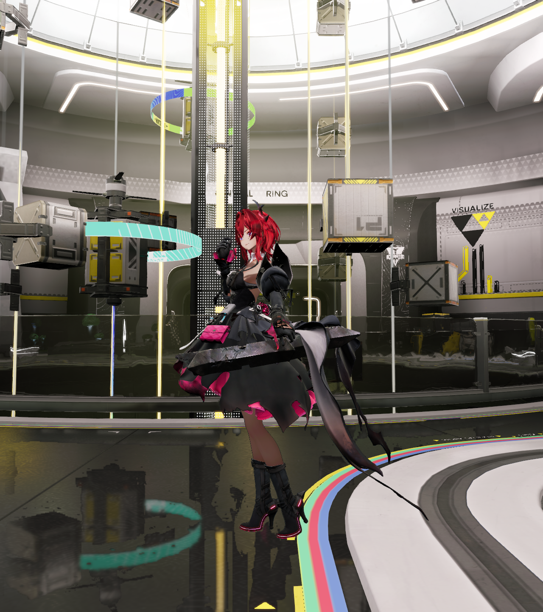

# 场景材质与角色画质诊断

日期：2026-10-31。
状态：分项采集完成，整体画质继续验收。
范围为完整物流场景、地面反射及原生角色。
执行顺序见[核验计划](../../plans/2026-10-31-projected-footprint-quality.md)。

## 场景入口与来源

用户提供的 PNG 与投影角色候选逐像素一致。
图像尺寸为 2560×1440，候选帧序号为二。
默认线性时间反射入口具有独立的完整画面。
两种入口的运行范围见[历史装配](projected-main-history.md)。

本轮保留完整场景、十三份角色材质及九段动画。
模型、纹理及生产着色代码使用冻结输入。
默认画质入口见[完整场景显示](../../tutorials/restored-native-scene.md)。

## 反射过滤

Vulkan 实际帧的射线事件为 `21668`。
空间过滤事件为 `21729`。
两端实际参数的最大过滤层级均为六。
原始帧与导出输入具有独立的长度及摘要记录。

地面区域采用显示坐标 `[1060,1100,1460,1360]`。
对应半分辨率区域共有 26,000 个样本。
有效表面且反射置信度大于零的样本为 24,590 个。
该区域包含少量其他材质，统计按有效样本给出。

| 实际输入 | 中位数 | 九十分位 |
| --- | --- | --- |
| 浮点粗糙度 | 0.117205 | 0.127550 |
| 归一化过滤层级 | 0.399863 | 0.457604 |
| 解码后的过滤层级 | 2.399176 | 2.745626 |
| 层级对应的采样尺度 | 5.275018 | 6.706807 |
| 反射置信度 | 1 | 1 |

粗糙度取自 `RGBA32F` 原始输入的 B 通道。
足迹取自 `RG16_UNORM` 的 G 通道。
空间过滤按选定层级执行 4×4 核。
这些数据支持地面宽过滤的可见诊断。

独立条纹核对可见来源、低粗糙度细节及变化趋势。
低粗糙度两例的投影倒影对比度均为一。
粗糙度 0.3 的对比度约为 0.154。
整体世界平移及绕 Y 轴旋转对照也通过。

当前证据尚未确认通用投影公式错误。
过滤观感与原生完整画面的验收继续进行。
实际粗糙度以原始读回为准。
带显示变换的隔离图用于可视诊断。

## 角色近景

实际采集完整画面、底色、着色法线及对象阴影。
四项均为 Release Player 的 1280×1440 单帧。
原待机动画、模型和十三份材质共同进入近景。
相机位置为 `[-1.5148,2.04,-19]`。

底色可见头发、皮肤、服装和配件纹理。
完整画面中的头发暗条及衣料高光继续核对。
对象阴影显示腿部和部分衣料的遮挡。
该分项与材质本身的遮蔽量分别验收。

近景采用新的相机位置和长宽比。
捕获雾的实际状态为 `camera-mismatch`。
该视角用于材质定位，原固定机位独立复核。
完整场景的同屏检查见[角色组合](../recovery/full-scene-character.md)。

## 检查与接续

四项完整近景均正常退出，卸载资源计数归零。
实际帧回放没有记录调试消息。
十九份来源记录及二百一十一份着色产物指纹一致。
四份既有用户文件的内容指纹保持一致。

材质外观、时间稳定性及原生完整区域继续验收。
投影过滤与角色照明分别建立独立预期。
确认稳定失败后实施所属模块修复。
固定场景、默认线性入口和公共数值门槛共同回归。

本轮完整命令、诊断脚本及原始来源见[结构化记录](evidence/2026-10-31/scene-material-quality/summary.json)。
