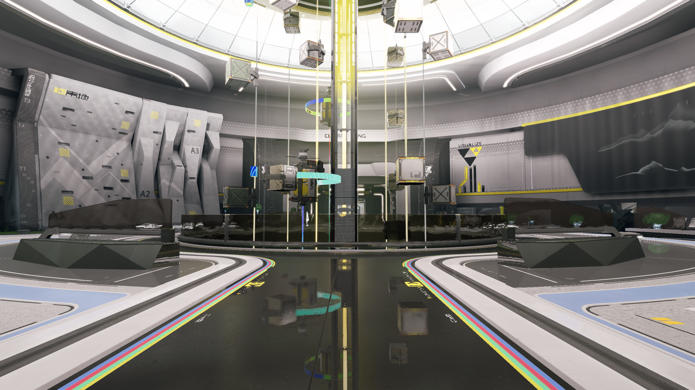
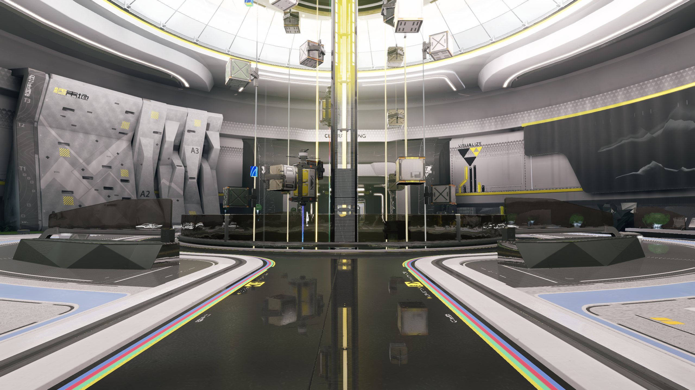
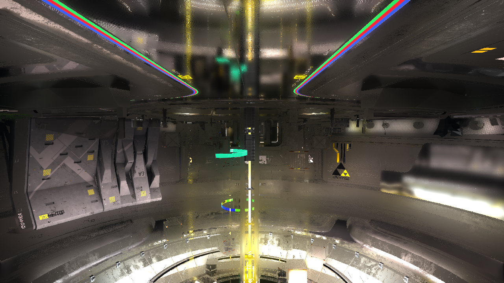

# 原生渲染阶段画面

本页保存完整场景、独立材质及中间纹理。
各项记录保留截图当时的状态。
图片保留原始分辨率及文件内容。
阶段状态以对应验收记录为准。
图片与来源指纹见[记录清单](evidence/visual-history.json)。

## 当前完整场景

最近的完整采集为 NR6-C15-S1，分辨率为 2560×1440。
本图呈现当前场景的最终合成结果。
公共反射生产、连续历史及整体画质继续验收。

## 记录规则

每个独立视觉阶段保留主场景截图。
角色材质和采样问题同时保留必要局部或隔离画面。
记录阶段、提交、配置、机位、来源和剩余问题。
诊断画面按实际结果标注，通过项分别关联验收。

按像素指纹识别重复画面，并引用已有记录。
截图归档进入本页目录，由 Git 管理。
完整运行、日志和原生帧保留在对应证据目录。
阶段提交时同步图片、说明和来源清单。
修复完成后追加新截图及结果。

## 阶段索引

| 阶段 | 图像类型 | 内容 | 状态 |
| --- | --- | --- | --- |
| NR7-L4L | 场景合成 | 中央字符与物流图层 | 分项通过，完整还原待验 |
| NR3-F1I | 场景合成 | 场景解析雾合成 | 分项通过，完整还原待验 |
| NR7-L4M | 材质隔离 | 物流彩色环带隔离 | 诊断中，颜色门禁未通过 |
| NR7-L4M | 场景合成 | 物流彩色环带接入 | 静态分项通过，动态与反射门禁待验 |
| NR6-C15-S1 | 场景合成及材质隔离 | 公共采样器接入 | 公共契约分项通过，完整还原待验 |
| NR5-R8-A | 反射中间纹理 | 原版反射过滤 | 原版过滤核字节一致，公共接入待验 |
| NR5-R8-B | 反射中间纹理 | 公共过滤器输出 | 公共过滤资源通过，生产接入待验 |

## 中央字符与物流图层

阶段：`NR7-L4L`。代码来源：`c015bd3`。
范围：完整主场景，Release，2560×1440。
机位：3534 捕获机位，索引描述符路径。
状态：分项通过，完整还原待验。

白色字符使用真实绘制与纹理。
完整场景平均字节误差为 13.211135。
环形光带、反射及整体门禁继续验收。

验收见[中央字符与物流图层](central-late-glyph.md)。

## 场景解析雾合成

阶段：`NR3-F1I`。代码来源：`59510a5`。
范围：完整主场景，Release，2560×1440。
机位：3534 捕获机位，索引描述符路径。
状态：分项通过，完整还原待验。

体积、高度层及光谱大气共同合成。
完整场景平均字节误差为 13.209242。
正式 SSIM、持续性能及 AA5/AA6 保持待验。

验收见[场景解析雾合成](scene-fog.md)。

## 物流彩色环带隔离

阶段：`NR7-L4M`。代码来源：`59510a5`。
范围：自发光隔离夹具，Release，2560×1440。
机位：3534 捕获机位，索引描述符路径。
状态：诊断中，颜色门禁未通过。

真实顶点输出恢复三个环带实例。
几何和纹理使用固定捕获相位。
跨色带采样存在超预算点，正在核对采样链路。

## 物流彩色环带接入

阶段：`NR7-L4M`。渲染代码来源：`59510a5`。
范围：完整主场景，Release，2560×1440。
机位：3534 捕获机位，索引描述符路径。
状态：静态分项通过，动态与反射门禁待验。

真实环带及其地面反射进入完整画面。
完整场景平均字节误差为 13.058428。
1080p 短测平均 GPU 范围为 46.025 毫秒。
16.67 毫秒目标及动态效果继续验收。

验收见[物流彩色环带](opaque-logistics-rings.md)。

## 用户提供的阶段画面

本次附件与解析雾阶段的原始截图像素一致。
该附件关联 `NR3-F1I` 记录，原始编码指纹单独保存。
后续阶段按记录规则继续补充。

## 公共采样器接入

阶段：`NR6-C15-S1`。代码基准：`f1d1701`。
完整主场景采用原版捕获机位。
左区使用最近邻放大，右区使用线性放大。
验收见[公共采样器](gltf-sampler-contract.md)。

| 失败诊断 | 分项通过 |
| --- | --- |
|  |  |

## 原版反射中间纹理

阶段：`NR5-R8-A`。代码基准：`44d6538`。
来源：官方 D3D11 捕获的反射内部通道。
1280×720 的重建输出与原版逐字节一致。
公共生产及主场景接入继续实施。

图像类型为反射中间纹理，分辨率为 1280×720。
粗糙表面采用分层模糊，原始纹理行顺序保持完整。
可信度和材质响应在后续场景合成中应用。
完整画面以本页的场景合成记录为准。

验收见[反射过滤来源](reflection-filter-source.md)。

## 公共过滤器反射中间纹理

阶段：`NR5-R8-B`。代码基准：`336ea53`。
来源：公共 GPU 过滤的实际浮点读回。
原版 3534 帧提供固定输入。
显示采用线性零至一钳制及八位向下取整。

图像类型为反射中间纹理，分辨率为 1280×720。
本图显示独立的反射辐射，可信度在本次输入中固定为一。
粗糙表面经过分层模糊，亮部按显示映射钳制。
场景合成的可信度、材质响应及清晰度分别验收。

验收见[公共反射过滤](reflection-spatial-filter.md)。
主场景生产、动态可信度及连续历史继续实施。

