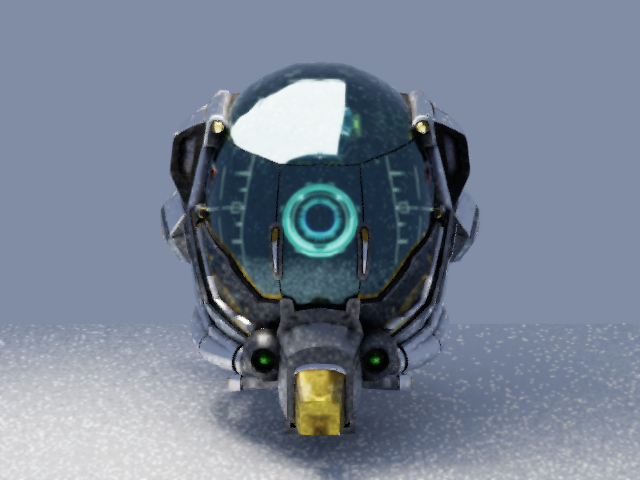
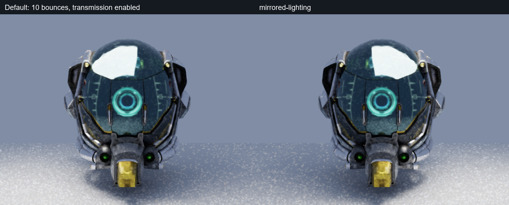
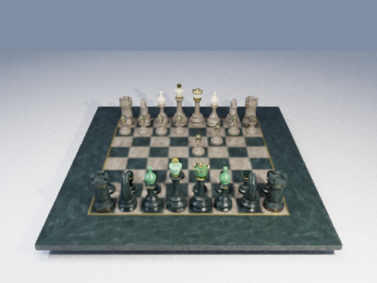
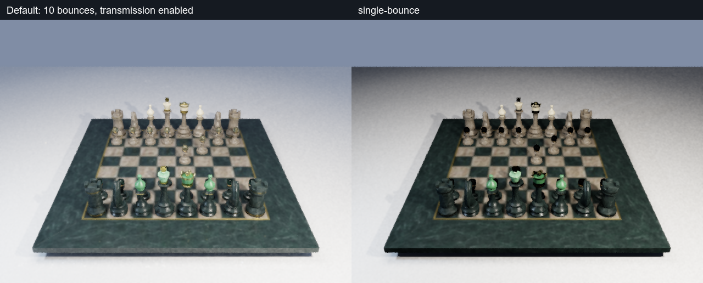
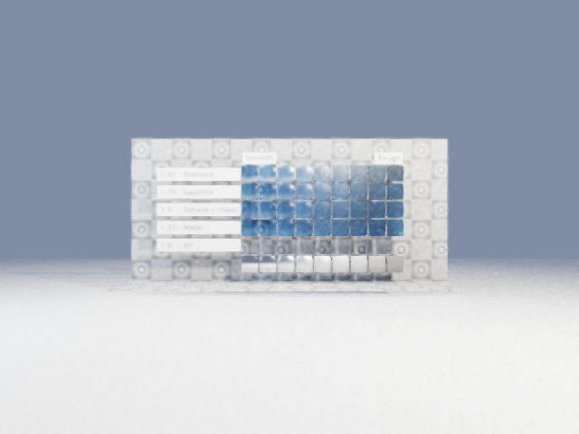
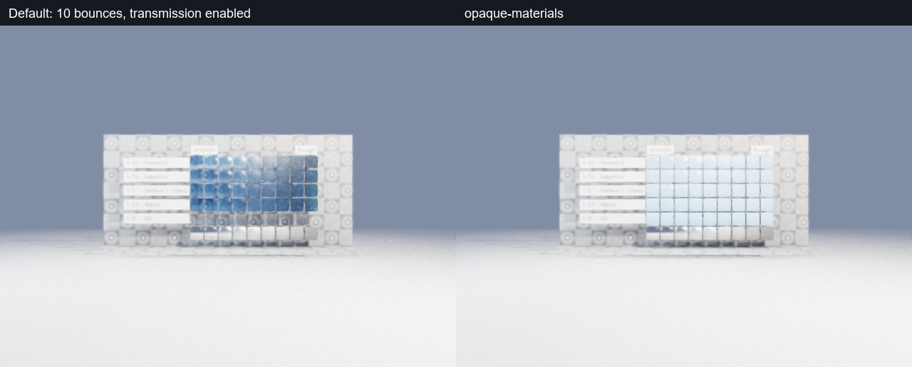

# 路径追踪补齐实施记录

日期：2026-10-15。

## PT0：公开素材与问题复现

三个公开模型下载完成，共 58 个文件，约 34 MB。
来源版本和逐文件 SHA-256 见公共素材清单。
模型、许可和作者说明保存在独立素材缓存。

纯金属直接光测试使用实际安装版 Player。
黑色环境、单次散射下，盒子区域平均像素值为 0。
用例按预期失败，复现缺少点光源镜面响应。
记录位于本轮任务目录的 `pt0-specular-red3`。

缓存：`D:/Project/AzureRenderDemos/PublicSources`。
本轮临时目录为 `build/runs/20261015-143411-pathtracing-public-demos-ba5c36`。

## PT1：直接光与反射

直接光与随机散射共用 GGX 和漫反射求值。
材质采样使用对应混合概率密度，覆盖两种反射分量。
黑色环境下纯金属响应测试通过。
盒子区域平均像素值为 73.00，修复前为 0。
Debug Player 构建和路径追踪契约测试通过。
证据为 `pt1-build.log` 与 `pt1-specular-green`。

## PT2：法线与材质输入

三角形快照传递顶点法线、切线和手性。
实例法线采用逆转置，切线保持正交并处理镜像缩放。
蒙皮姿态参与法线与切线变换。
路径追踪接入现有导入器处理后的法线贴图。
CPU 结构尺寸、法线传递和金属高光回归通过。
Debug Player 与路径追踪测试目标构建通过。

## PT3：面光源与环境采样

积分器对发光三角形进行面积采样。
环境照明使用亮度与立体角构建的累计分布。
直接采样与材质路径通过多重重要性采样组合。
环境旋转同时作用于采样方向与概率查询。
分布归一化和纯金属直接光回归通过。
Debug Player 与路径追踪测试目标构建通过。
完整公开场景的收敛比较由 PT7 汇总。

## PT4：玻璃与粗糙透射

导入器读取透射、折射率和体积衰减参数。
材质服务提供相同参数并保留保存契约。
积分器加入微表面折射、菲涅耳反射和全反射路径。
透射概率与对应概率密度共同参与吞吐量计算。
体积传播距离用于颜色吸收，折射率为一时保持直行。
嵌套介质和专门的焦散采样属于当前支持边界。
材质解释测试、Debug 构建和金属高光回归通过。
公开玻璃模型的画面验证由 PT7 汇总。

## PT5：预览降噪与诊断

空间预览降噪使用首交点法线与深度引导。
开关通过环境面板和设置服务保存。
原始采样缓冲保持独立，关闭开关即可显示原始画面。
随机种子进入设置，便于重复图像检查。
设置版本为 12，场景文档保留旧版本读取。
HUD 显示采样、散射次数和三角形规模。
设备存储范围、图集及几何规模保持显式校验。
Debug 编辑器、Player 和两个受影响测试通过。
GPU 双场景及模式切换通过，退出资源计数归零。

## PT6：公开素材演示

三个独立工程已生成，并通过真实编辑器回放。
材质编辑、材质绑定、灯光移动与撤销均通过。
每个工程完成保存和 GUI 重开。
初步画面通过 Debug Player 渲染并检查。

棋盘原始实例展开为 1,500,224 个三角形。
演示副本简化后为 640,616 个，保留全部棋子。
简化工具为 fast-simplification 0.2.0，许可为 MIT。
其处理记录和原始素材校验值随项目保存。
棋盘纹理上限为 512，头盔纹理上限为 1024。
最终画面和双设备发布由 PT7 验证。

首次导出的索引数量错误已修复。
修复后棋盘完整，后续 GUI 检查使用稳定素材。
记录见 `pt6-editor-stable/summary.json`。

## PT7：集中验证与交付

PT0 至 PT7 的实现和本轮集中检查已完成。
操作步骤见[公开光追演示](../../tutorials/public-pathtracing-demos.md)。
三个工程位于 `D:/Project/AzureRenderDemos/`。
安装入口为 `build/ux-2026-10-14/Engine/bin/AzureRender.exe`。

### 构建与回归

| 检查 | 实际结果 | 证据 |
| --- | --- | --- |
| Debug 与 Release 全目标构建 | 通过 | `checks/pt7-debug-delivery-build.log`、`checks/pt7-release-delivery-build.log` |
| Debug 非 GPU 回归 | 190 项批次及目录规模单项通过 | `checks/pt7-cpu.log`、`checks/pt7-scale-fixed.log` |
| Release 非 GPU 回归 | 完整批次 191 项通过 | `checks/pt7-release-cpu-full.log` |
| 资产、工程与材质定向复测 | 两配置各 11 项核齐 | 两份 `checks/*-assets-final.log` 及 `checks/*-asset-isolation.log` |
| Vulkan 模式切换与历史重置 | 室内、室外均通过，资源归零 | `pt7-modes.json` |
| 最终降噪着色器 | Debug 验证层开启，零诊断错误 | `pt7-final-validation.json` |
| 中文工程移动与缺失贴图 | 正常打开及明确拒绝均通过 | `pt7-project-boundaries.json` |

目录规模首轮超过 180 秒，失败日志已保留。
资产扫描复用固定的 UUID 校验表达式后通过。
复测耗时 152 秒，缓存查询第 95 百分位为 0.0171 毫秒。
关闭耗时为 12.89 毫秒，原有阈值保持有效。

两配置并行资产测试曾共用临时根目录。
测试现按运行分配独立目录，两配置复测通过。
玻璃发布曾因窗口最小化暂停，恢复窗口后完成。
这些失败及对应复测均纳入检查记录。

### 设备与独立发布

NVIDIA 使用 GeForce RTX 4060 Laptop GPU。
Intel 使用 RaptorLake-S Mobile Graphics Controller。
两设备均运行三个演示，并正常释放 GPU 资源。
Intel 使用本机驱动的绝对 DLL 路径清单。

正式发布和主图使用 Release，验证层关闭。
Debug 的收敛与模式切换检查开启验证层。
自动编辑回放调用真实编辑器生产服务。
本轮结果涵盖保存、重开、运行、停止和 GUI 发布。

三个发布目录均移动到含中文和空格的位置。
在原工程临时不可访问时，独立游戏入口正常运行。
随后在 Intel 上复核发布包，逐文件哈希均匹配。
素材许可、作者和来源信息随包保留。

| 演示 | 可直接运行的完整发布目录 |
| --- | --- |
| 金属头盔 | `D:/Project/AzureRenderDemos/Published/中文演示 DamagedHelmet/` |
| 完整棋盘 | `D:/Project/AzureRenderDemos/Published/中文演示 ABeautifulGame/` |
| 粗糙玻璃 | `D:/Project/AzureRenderDemos/Published/中文演示 TransmissionRoughnessTest/` |

各目录中的 `<模型名> Ray Tracing.exe` 为原生游戏入口。
目录中的 Runtime、资源和配置共同构成发布包。
发布和设备结果见 `pt7-delivery.json`、`pt7-packaged-intel.json`。

### 原始采样收敛

检查采用 320×240 原始输出，关闭降噪。
每个演示使用随机种子 0、1、2。
以同种子的 1024 采样图作为参考。
固定比较区域为 `[45,40,275,210]`。

| 演示 | 64 采样平均像素均方误差 | 256 采样平均像素均方误差 | 结果 |
| --- | --- | --- | --- |
| 头盔 | 0.01034569 | 0.00708487 | 通过 |
| 棋盘 | 0.00209495 | 0.00081057 | 通过 |
| 玻璃 | 0.00161710 | 0.00052700 | 通过 |

三组平均值均满足 256 采样误差低于 64 采样。
此结果衡量本轮相同积分器的采样收敛。
它不构成与外部物理参考渲染器的一致性证明。

### 实际画面与效果对照

主图均为本引擎 Release Player 的实际输出。
分辨率为 640×480，256 采样，10 次散射，曝光为零。
使用纯色环境、点光源与发光面，开启预览降噪。
`summary.json` 记录耗时、环境参数和来源指纹。
耗时统计包含进程启动、加载、采样和关闭。

头盔主图及左右灯光对照：

棋盘主图及多次散射对照：

玻璃主图及透射关闭对照：

证据目录同时保留原始主图和种子零的三档采样图。
其余种子的误差与检查结果保存在收敛摘要中。

### 支持边界

预览滤波抑制孤立亮点，原始累积结果保持独立。
空间滤波会平滑细节，高反射和粗糙透射仍有噪声。
嵌套介质、专门的焦散采样与硬件光线查询尚未实现。
本轮没有新增实体键鼠操作的人工确认。

P8 中已有的性能、实体操作和历史归因待项继续保留。
其状态与本轮路径追踪交付分别维护。

### 阶段提交

| 阶段 | 提交 |
| --- | --- |
| PT0 | `d9d5a3e` |
| PT1 | `fcd63c9` |
| PT2 | `e930294` |
| PT3 | `67bd0c0` |
| PT4 | `03c771c` |
| PT5 | `083bb1d` |
| PT6 | `fc3e2cb` |

PT7 的实现、证据和文档由本轮独立提交保存。
证据索引为 [summary.json](evidence/2026-10-15/summary.json)。
