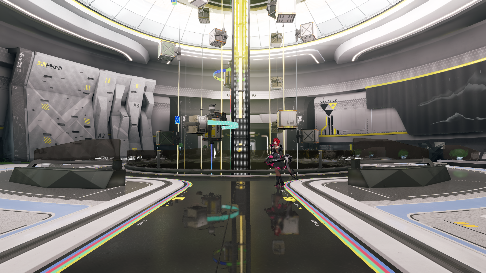

# 完整场景角色组合

日期：2026-10-31。
范围为完整物流环境与原生角色的固定机位组合。
状态：同屏内容及动画检查通过，材质与角色画质待验。

严格环境兼容继续复核。
环境基准见[画面恢复](full-scene-visual.md)。

## 内容与摆放

项目使用二十三组挂载及原生调色查找表。
环境的一千六百五十九个节点和原有设置保持完整。
角色采用共享模型、十三份材质及原动画图。
模型、纹理、骨架和动画输入保持来源字节。

联合项目包含三百六十五份资源及一千六百六十个节点。
隐藏与显示两个关卡仅改变角色可见性。
原捕获机位、照明、雾效和反射配置分别核对。
组合通过独立的场景资源及组件数据表达。

角色位置为 `[-1.5, 1.0349155254, -16]`。
地面高度由实际三角形查询，值为 `1.0324155254` 米。
角色朝向为绕 Y 轴 `172.1110815754` 度。
固定摆放的脚部预留 `0.0025` 米几何间距。

## 联合画面

Release Player 实际采集十二帧，分辨率为 2560×1440。
时间采用六十分之一秒固定步进。
角色使用原待机动画，末帧动画时间为 `0.1833333333` 秒。
线性时间反射及历史输入均处于有效状态。

完整物流装置、环带和角色同时进入画面。
地面呈现装置和角色倒影，脚部位于查询地面附近。
程序正常退出，脚本和展示错误数组为空。
卸载后缓冲与图像计数均为零。

本轮采用固定世界位置及动画播放。
角色操控继续由[可玩入口](../nr/main-character-integration.md)验收。
完整动作周期、持续性能及双设备按原阶段核对。
验证层在本轮 Release 运行中关闭。

## 画质核对

同屏内容与资源运行的检查具有明确范围。
完整材质、角色外观及动态稳定性继续验收。
当前重点为投影倒影的过滤及角色近景的暗部。
诊断顺序见[画质核验计划](../../plans/2026-10-31-projected-footprint-quality.md)。

## 环境对照

| 检查 | 实际结果 |
| --- | --- |
| 隐藏角色与本机完整环境 | 五对 PNG 字节一致 |
| 其余七帧 | 每帧九至十五个像素有差异 |
| 每帧相同像素比例下限 | 99.999593% |
| 最大通道差 | 5，通道范围为零至二百五十五 |
| 第十二帧 | 与完整环境 PNG 字节一致 |
| 相同隐藏候选的独立复测 | 十二对 PNG 全部字节一致 |
| 原场景、设置及节点 | 指纹与结构核对通过 |

隐藏角色的严格门槛要求十二帧全部字节一致。
该门槛保持未通过，失败记录完整归档。
共享头发类别的特化参数随组合资源变化。
其与稳定像素差异的因果关系仍待验证。

相关渲染修复构成严格检查的重试条件。
负责人及剩余条件见[环境复核](../p8/2026-10-31-environment.md)。
详细来源、命令和结果见[结构化清单](evidence/2026-10-31/full-scene-character/summary.json)。
启动步骤见[完整场景显示](../../tutorials/restored-native-scene.md)。
