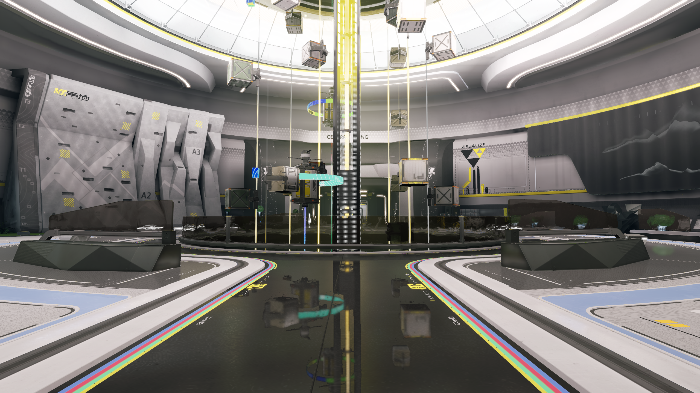

# 完整场景画面恢复

日期：2026-10-31。
本页核对重装前的完整物流场景及地面反射。
参照构图由用户提供的 JPEG 定位。
像素统计采用备份中的原始 PNG 序列。

## 项目入口

完整场景入口为以下文件。

```text
build/runs/20261029-045743-snapshot-shading-budget-8ee0b1/full-candidate/enclosure-sampler.azureproject
```

该项目具有二十三组挂载、三百六十四份网格资源。
场景包含一千六百五十九个节点。
它绑定原生调色查找表、物流图层及原捕获机位。
项目与关卡的 SHA-256 均与归档记录一致。

| 入口 | 内容及用途 |
| --- | --- |
| 完整物流场景 | 二十三组挂载，用于完整画面与反射回归 |
| 角色联合候选 | 六组挂载，用于角色材质、操控与组合验证 |

角色候选采用独立的机位和调色设置。
两类入口分别维护内容与画面基准。
完整画面使用本页入口，角色集成同时覆盖完整环境。
启动操作见[完整场景显示](../../tutorials/restored-native-scene.md)。

## 实际采集

当前 Release Player 按原项目配置采集十二帧。
分辨率为 2560×1440，使用原捕获机位。
完整传送装置、环带、标识和地面反射均进入画面。
程序正常退出，卸载后的缓冲与图像计数归零。

场景采用线性时间反射，历史输入处于有效状态。
当前帧、历史及材质合成均消费对应快照。
本次按原设置运行，项目和关卡原件保持相同指纹。
构建与输入来源见[结构化清单](evidence/2026-10-31/full-scene-visual/summary.json)。



## 像素核对

| 检查 | 结果 |
| --- | --- |
| 同机位、同尺寸和同帧序列 | 十二帧完成核对 |
| 完全相同像素的逐帧下限 | 99.987684% |
| 最大逐帧平均通道误差 | 0.000051，通道范围为零至二百五十五 |
| 全序列最大通道误差 | 9 |
| 第十二帧最大通道误差 | 2 |
| PNG 字节完全一致 | 零帧，严格门槛保持待验 |

本次确认完整内容和原有反射效果能够实际运行。
少量像素差异保留其原始结果与来源。
归因及严格归档兼容继续由 P8 核对。
持续性能、双设备与完整动态周期按原阶段验收。
