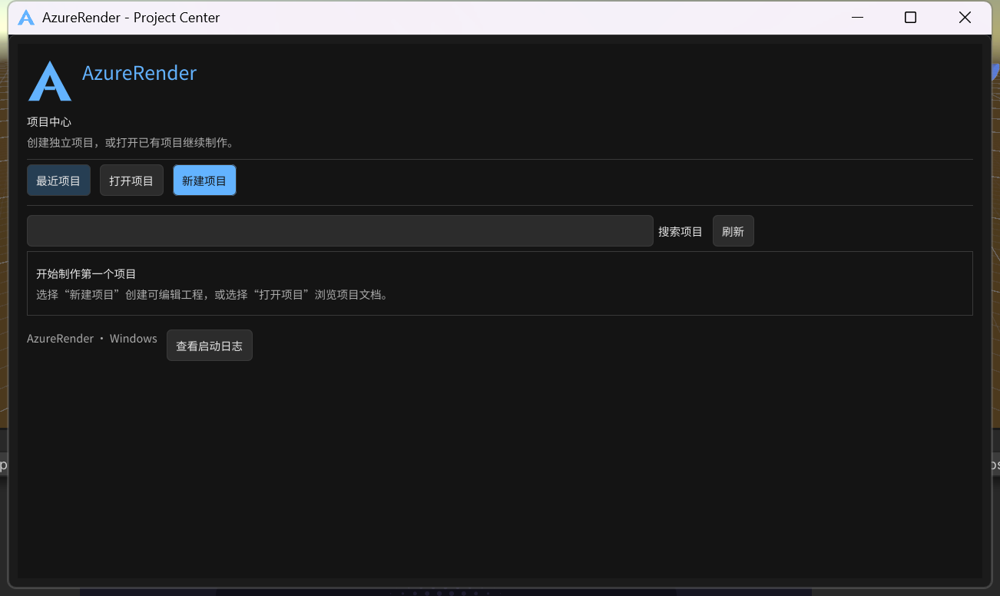
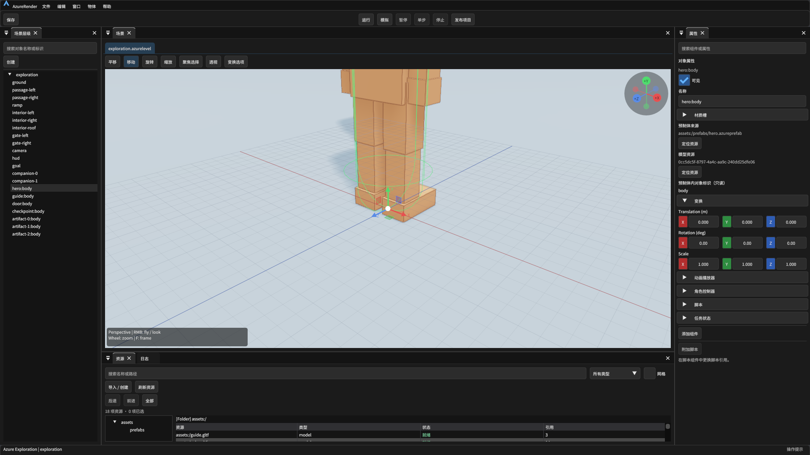
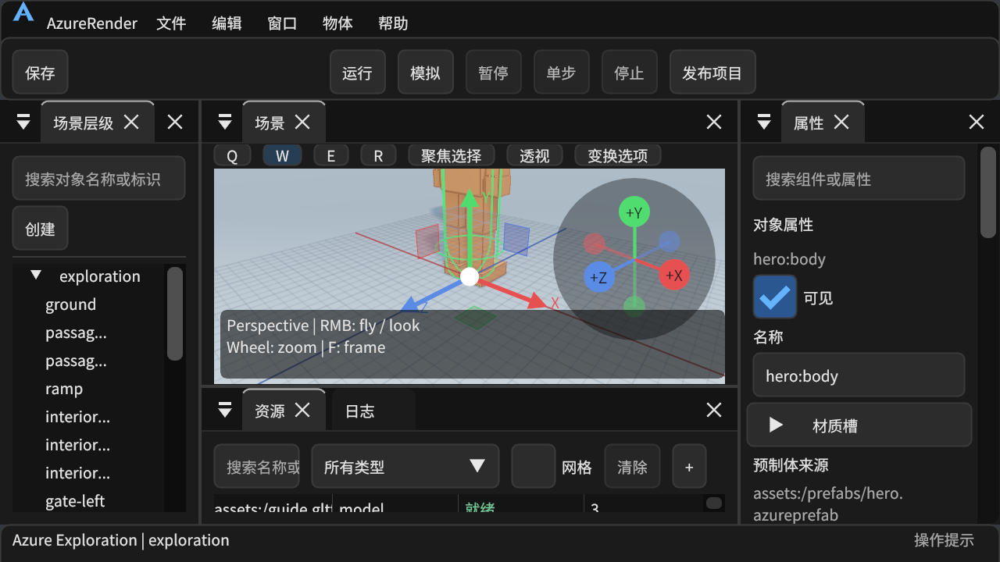

# 界面现代化交付记录

## 当前交付

VD1 至 VD5 已完成并分别提交。
VD6 为 Ready，可进入集中人工复核。
本轮可自动完成的实施与交付检查已通过。
人工体验复核对应 `VD6-HUMAN`。

启动入口位于引擎目录下：
`build/ux-2026-10-14/Engine/bin/AzureRender.exe`。
安装目录持续复用，用户项目放在独立目录。

公共主题、控件和品牌由 `AzureUi` 提供。
工作台负责菜单、工具栏和面板装配。
层级、属性和资源面板分别拥有界面状态。
项目、编辑和发布操作由既有业务服务执行。

具体操作见[界面说明](../../tutorials/editor-interface.md)。
模块边界见[实施计划](../../plans/2026-10-14-ui-modernization.md)。

## 自动验证

| 范围 | 结果与边界 |
| --- | --- |
| Debug 与 Release | 引擎及交付目标构建通过 |
| 非 GPU 回归 | 最终 188/188 通过，耗时 187.82 秒 |
| 项目交付 | GUI 创建、重开、编辑、保存和发布通过 |
| 独立运行 | 发布目录移动且原项目隐藏后，游戏运行通过 |
| 环境隔离 | 发布运行使用仅包含系统目录的 PATH |
| 异常恢复 | 项目移动、失效记录及版本不兼容通过 |
| 中文路径 | 项目目录及用户配置目录通过 |
| 工作区与面板 | 工作区十组缩放与面板八组布局通过 |
| 实体输入 | 中文输入法、拖拽手感和连续体验待人工复核 |

GUI 测试使用生产 ImGui 输入回放。
回放通过控件调用生产业务操作。
中文文本注入验证保存，不等同于输入法组合验证。
项目恢复测试保留失效记录并验证重新定位。

## 本阶段修复记录

1. 回放点击分为移动、按下和松开。
   停靠页签获得必要的悬停帧。
2. 资源筛选恢复按钮保持可见。
   紧凑模式在搜索工具条提供清除入口。
3. 紧凑资源区按实际控件高度分配空间。
   视口标题使用统一停靠样式。
4. Windows 程序声明长路径支持。
   缓存发布使用规范化的原生长路径。
5. 任务测试只复制可编辑项目内容。
   项目缓存由目标实例重建。
6. 契约清单引用公共 UI 的实际目录。

## 人工复核顺序

以下操作可集中完成一次。
请使用独立测试项目，保留现有制作项目。

1. 双击上述 `AzureRender.exe`。
   应显示品牌标志、项目中心和新建入口。
2. 在独立目录创建一个场景项目。
   用中文输入法输入名称，确认候选框和选字正常。
3. 创建两个对象，拖动改变父子关系。
   再拖到场景容器，确认能成为场景根对象。
4. 编辑对象名，测试撤销、重做与保存。
   输入文字期间，场景快捷键应保持隔离。
5. 切换资源、日志和属性面板。
   拖动停靠位置，关闭后重开，确认布局可恢复。
6. 调整窗口大小并使用常用系统缩放。
   确认按钮可点击，文字和工具条没有重叠。
7. 在项目中心重新打开该项目并继续编辑。
   记录操作中难找、含糊或不符合习惯的入口。

通过条件是操作可完成，且没有焦点误触和内容丢失。
主观体验问题请注明入口、动作和期望结果。
自动发布和移动运行结果见本页验证清单。

## 能力边界与证据

二维资源支持导入、校验与运行时显示。
独立二维可视化画布属于后续制作工具能力。
高 DPI 自动结果与实体输入体验分别记录。
长路径测试在已启用长路径策略的 Windows 上执行。

| 阶段 | 提交 | 内容 |
| --- | --- | --- |
| VD1 | `7f7d357` | 公共控件与设计参数 |
| VD2 | `13a73af` | 品牌启动页与项目中心 |
| VD3 | `6d1938a` | 工作台与视口布局 |
| VD4 | `44dbedb` | 层级、属性与资源面板 |
| VD5 | `bf48949` | 设置、制作与发布界面 |
| VD6 | 本记录所在提交 | 集中验证、缺陷修复与交付 |

本轮临时产物统一位于：
`build/runs/20261014-202124-ui-modernization-b337fa`。
交付摘要和必要截图归档在本目录。
完整日志按任务产物保留策略管理。

## 真实界面

