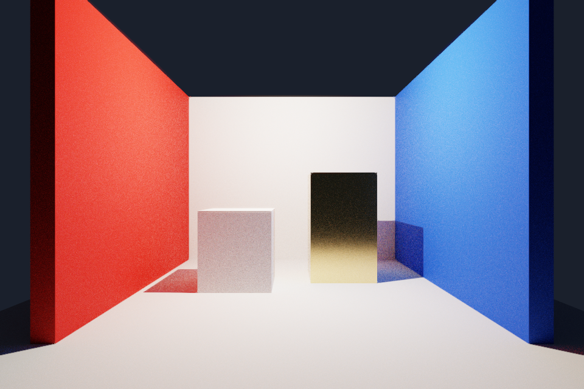

# 世界参照、相机与渲染实施记录

日期：2026-10-15。WC1 至 WC6 完成。
使用方法见[操作说明](../../tutorials/world-camera-rendering.md)。
本轮证据见[验证清单](evidence/2026-10-15/summary.json)。

## 已交付内容

| 阶段 | 能力 | 验证 |
| --- | --- | --- |
| WC1 | 固定世界网格与坐标轴 | 端点不随相机改变，视口截图检查通过 |
| WC2 | 世界方向天空与纯色背景 | 保存、撤销与图像比对通过 |
| WC3 | 编辑、游戏和最终渲染相机 | 组件选择、预览、模拟及运行恢复通过 |
| WC4 | 中英界面与持久语言偏好 | 双向切换、重启、项目中心及窄窗通过 |
| WC5 | 路径追踪与独立演示 | 两种场景、模式切换和双设备运行通过 |
| WC6 | 集中回归与交付修复 | 安装更新、编辑器发布和移动运行通过 |

## 自动检查结果

Debug 与 Release 全目标构建通过。
Debug 非 GPU 回归共 191 项，均取得通过结果。
首轮通过 189 项，另外两项经处理后单独通过。
场景格式断言使用当前版本，失败直接输出到日志。
目录规模测试在编译结束后用时 164.4 秒。
该测试的原有 180 秒限制保持有效。
Release 的 6 项受影响短测试全部通过。

天空图像检查使用空场景与固定观察参数。
相机平移前后，比较区域的最大像素差为 0。
旋转后的平均像素差为 5.19，产生可见方向变化。
纯色区域的通道标准差为 0。
数值见[天空检查](evidence/2026-10-15/sky.json)。

真实界面输入完成中英双向切换。
关闭重开后语言保持，项目中心读取相同偏好。
960 像素宽窗口恢复后，场景视口保持可用宽度。
机械臂与门场景验证模拟、暂停、单步和停止。
模拟保持编辑相机，停止恢复文档与编辑状态。

## 路径追踪与发布

路径追踪使用独立计算管线与三角形加速结构。
设置由 `render.settings` 操作校验与保存。
每个在途帧持有独立的几何和参数上传缓冲。
累积缓冲通过计算和片元阶段屏障排序。
相机、场景、灯光、天空与积分参数变化触发重置。
环境面板显示渲染器实际累积的采样数。

RTX 4060 Laptop 的 Debug 检查启用 Vulkan 校验。
室内与室外场景均达到 12 / 12 个采样。
模式往返切换与天空修改均成功。
检查无 Vulkan 校验错误，退出资源计数归零。
安装版 Release 在相同两种场景上通过功能检查。

Intel 集显也通过安装版的两种场景检查。
初次启动失败来自驱动清单的相对 DLL 路径。
任务目录中的绝对路径清单解决了加载问题。
系统驱动清单保持原样。
Intel 本次结果是 Release 功能检查，未启用校验层。

演示工程位于：
`D:/Project/AzureRenderDemos/PathTracingRoom/project.azureproject`。
内容使用独立项目目录，来源清单随项目保存。
项目完成相机预览、Play/Stop、保存和编辑器发布。
发布包包含 490 个有清单记录的文件。

完整发布目录移动到中文与空格路径后运行成功。
验证期间原始项目目录不可访问，结束后恢复。
项目命名的 EXE 启动路径追踪，进程正常退出。
结果见[移动发布验证](evidence/2026-10-15/package.json)。

## 交付修复与来源

空场景通过 `render/sky` 绘制背景。
三个渲染路径共用 `shaders/sky.glsl`。
独立预览视图生成自己的最终相机快照。
窄窗恢复按需调整分栏宽度，保留面板与标签归属。
默认环境使用显式资源配置与引擎资源定位。

项目中心的交换链修复位于 ImGui Vulkan 后端。
版本为 1.92.8 docking，保留原有 MIT 许可。
采用丢弃内容的渲染通道时，取得图像后转换布局。
无参数启动、窗口缩放和正常关闭均通过校验。

参考仓库为本地 gkNextEngine。
参考提交为 `4ba5b7cd106c282e7ed166ff853aeea87b392680`。
借鉴范围为采样累积、失效规则与模块职责。
演示使用本项目制作的布局与 CC0 几何素材。

## 使用边界

路径追踪当前采用几何法线。
法线贴图、透射、降噪和硬件光线查询待扩展。
SHARC 与 ReSTIR 属于后续研究范围。
复杂照明与小型自发光物体可能收敛较慢。
当前三角形上限为一百万，纹理图集预算为 128 MiB。
设备缓冲上限不足时报告具体错误。

界面内置词条支持中英切换。
项目内容、扩展文本与底层诊断保留原文。
本轮记录自动输入与图像检查结果。
实体键鼠手感和长时间性能沿用独立复核流程。

## 提交与产物

WC1：`86853a5`。WC2：`23f7974`。
WC3：`3e44de4`。WC4：`a5eb3d8`。
WC5：`0c2d02f`。WC6 使用独立阶段提交。

当前安装入口为：
`build/ux-2026-10-14/Engine/bin/AzureRender.exe`。
安装文件指纹和源码指纹见验证清单。
临时产物统一归于本轮 `build/runs` 任务目录。
归档仅保存必要日志、结构化结果与代表截图。
