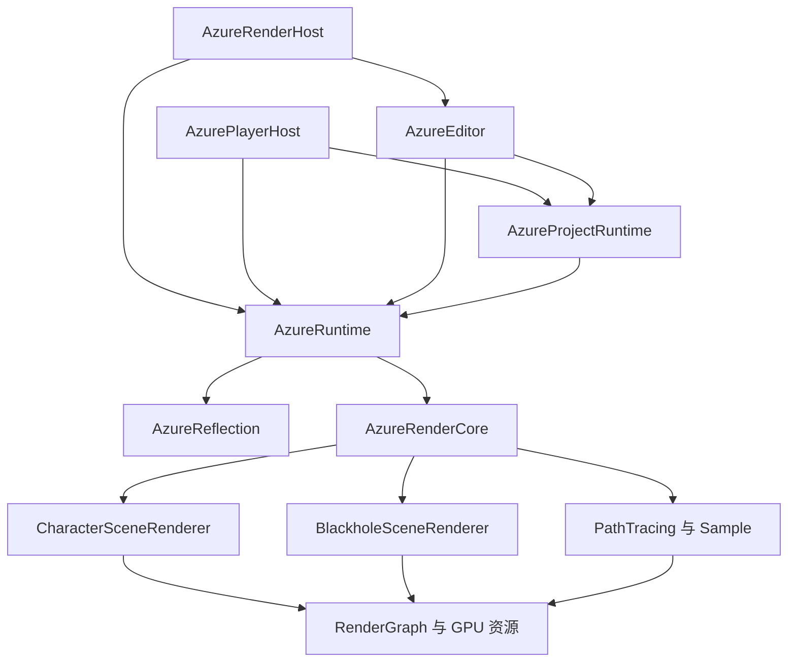

# 渲染能力接入审计与架构约束

日期：2026-10-22。源码基线：`5a01bc5`。
本轮范围为静态复核、既有证据阅读和计划整合。
未启动项目、构建、抓帧或转换资产。
本页为实施方案，任务状态由所属 NR 计划维护。

## 结论与证据边界

角色样例、编辑视口和 Player 共用角色渲染器。
普通网格场景也进入 `CharacterSceneRenderer`。
黑洞拥有专用渲染器，其边界符合现有扩展契约。
当前主要缺口在材质表达、内容接入和原生公式还原。

环形多层高光的完整还原仍未通过验收。
现有路径能计算双叶及二维色带，已有专项运行证据。
虚拟主灯、独立条纹和完整能量组合仍缺。
次级颜色修正只证明该颜色输入及候选绘制生效。

“环形”描述目标画面的高光形态。
算法身份以实际程序、绑定和公式为准。
传统 KK 与投影色带具有不同输入约定。
原生帧 10401 的事件 950 是本项复现依据。

静态路径成立、专项运行通过和主场景生效分别登记。
原生等价还需匹配相机、姿态、照明及后处理。
单帧覆盖的状态具有边界，动态与隐藏分支另行取证。
全部技术的目标保留，未知输入进入明确待项。

## 架构与调用链



图示表达主要依赖与包含关系。
两个宿主共享源文件，以 `AZURE_WITH_EDITOR` 区分装配。
Player 链接运行服务，编辑器依赖留在编辑宿主。
依据为 [CMakeLists.txt](../../CMakeLists.txt) 的目标声明。

| 入口 | 实际调用链 |
| --- | --- |
| 角色样例 | `main → parseCommandLine → buildRenderContext → BuiltinRendererCatalog` |
| 项目主视口 | `Project → SceneDocument → resolveRenderDescription → BuiltinRendererCatalog` |
| Play | `EditorSession::PlayState → runtime.snapshotScene → resolveRenderDescription` |
| Player | `player/main → ProjectRuntimeAssembly → resolveRenderDescription` |
| 公共渲染 | `CharacterSceneRenderer → loadGltfAsset → applyMaterialBindings → uploadMaterialTexture → packMaterialSurfaceProfile` |
| 公共绘制 | `createDescriptorSets → createGraphicsPipeline → updateFrame → registerPasses → drawPrimitive → 宿主后处理与提交` |

实际选择见 [BuiltinRendererCatalog.cpp](../../src/scenes/BuiltinRendererCatalog.cpp)。
宿主入口见 [AzureRenderApp.cpp](../../src/app/AzureRenderApp.cpp)。
Play 场景来源见 [EditorSession.cpp](../../src/editor/EditorSession.cpp)。
绘制实现见 [CharacterSceneRenderer.cpp](../../src/scenes/CharacterSceneRenderer.cpp)。

CMake 显式编译 `mesh.frag` 及快照、索引变体。
渲染器加载对应程序，并提交功能位和材质索引。
展示与场景照明共享程序，但合成策略有区别。
材质球、缩略图使用独立场景，需单独固定比较条件。

## 实际内容入口

中庭工作项目位于以下本机目录：

```text
build/runs/20261022-051129-character-logistics-restoration-0f2e71/joint-candidate/
```

`project.azureproject` 启动 `candidate:/scene.azurelevel`。
主关卡和 `playable-safe.azurelevel` 均引用 `hero-profile.glb`。
两者的材质槽覆盖数量均为零。
下表哈希为本轮只读重算的 SHA-256 前 16 位。

| 内容 | 哈希前缀 | 当前范围 |
| --- | --- | --- |
| `assets_private/laevat_skinned/laevat_repaired_v2.glb` | `4fbb2431d85d7301` | 样例基线；468 个关节，传统 KK 配置 |
| `content-character/hero-profile.glb` | `8642f0e738024a4e` | 主关卡；313 个关节，投影双叶配置 |
| `content-character/hero-hair-linear-212213.glb` | `a8a08d008eca0ec50` | 专项候选；脸部径向、服饰镜面及线性发色 |

主资产次级高光颜色仍为 `[0.672,0,0.004363678]`。
候选线性颜色约为 `[0.4091444675,0,0.0003377460]`。
候选通过专项检查，主场景晋升仍待执行。
两套骨架和加工结果须分别保存，像素比较使用同源资产。

## 渲染能力与断点

下表的确定性来自源码和既有收据。
真实画面等价均以所属专项的完整门禁为准。
“Debuffer Ramp”尚无确定源码对应名称。
色带按各自消费者区分，采样域与纹理类型分别记录。

| 技术 | 已有公共消费 | 缺口或待验证项 | 证据与确定性 |
| --- | --- | --- | --- |
| 环形多层发丝高光 | 传统 KK；投影双叶、二维色带 | 虚拟半角向量、条纹、对象增益及能量合成 | `projectedHairDirect`；公式缺口已确认 |
| 高光方向与动画 | 头部帧、对象基底、切线及双法线 | 跨姿态；独立头发资产的坐标系来源 | `instanceFaceFrame`；单姿态通过 |
| 皮肤色带 | `diffuseRamp`、影色表、环境法线 | 原生色带坐标、主灯与环境调制 | C8、C11、C12；局部机制可用 |
| 脸部 SDF | 双域 SDF、头节点、径向间接光 | 主资产晋升、动态方向、面部独立高光 | C12-R1；专项已验，主线未接 |
| 服饰贴图 | 法线、粗糙度、金属度、自发光 | 独立镜面候选晋升、二维高光、丝袜分支 | C13；通道保留已有证据 |
| 眼睛 | 视差、Matcap、径向表面 | 实际角色的 `eyeSurface` 和照明适配 | C6、C9；公共能力与内容分开验收 |
| 距离描边 | 固定像素宽度、显式材质功能位 | 视深度、FOV、RG 遮罩、平滑法线、深度偏移 | `outline.vert`；公式缺口已确认 |
| 发影与眉眼层 | 透明、乘法覆盖及遮罩通道 | 原生模板、预深度、排序及软交界 | C3、C5、C9；完整原生顺序待验 |
| GI 与反射 | 方向场、探针、动态反射公共机制 | 实际三层采样、灯组、地面 UV 与生产通道 | G6、R7；原生联合外观待验 |

头发源码为 [mesh.frag](../../shaders/mesh.frag) 的 `projectedHairDirect`。
双叶公式见 [character_surface.glsl](../../shaders/character_surface.glsl)。
原生和运行范围见[头发高光验收](../acceptance/nr/projected-hair.md)。
其颜色收据与本轮已查看的隔离图仅证明专项消费。

现有隔离图能显示高光能量，但不能证明环形等价。
该图使用 `hair-kk` 模式及放大显示系数。
原生预览和候选的机位、姿态与照明不同。
正式比较须同时保存线性贡献图与完整画面。

## 已确认问题与结构风险

P1 表示当前还原或公共制作链路的优先缺口。
P2 表示兼容、维护及扩展风险。
本次静态复核未确认崩溃、悬空引用或内存泄漏。

| 编号 | 等级 | 现象、根因与范围 | 归属与处理方向 |
| --- | --- | --- | --- |
| A01 | P1 | 主关卡未引用专项候选；修复停留在独立场景 | NR0-A1、NR8-V2：内容指纹、单项晋升和实际入口验收 |
| A02 | P1 | 发丝高光缺原生输入与合成；双叶存在不代表完整还原 | NR6-C17：按实际事件分解输入、公式和画面贡献 |
| A03 | P1 | `.azurematerial` 只有简化类型和四类纹理 | NR6-C15：公共材质语义、保存与加载等价 |
| A04 | P1 | `applyMaterialBindings` 整份替换；仅保留槽身份和名称 | NR6-C15：显式替换与参数覆盖；降级诊断 |
| A05 | P2 | 材质文档设置自发光强度，但未补 `EmissiveMask` | NR6-C15：统一功能位解释和最终结果测试 |
| A06 | P2 | 加载器支持 v2；现有 Schema 和校验脚本只覆盖 v1 | NR6-C15：版本分派、共享样例、文档示例校验 |
| A07 | P2 | 九个纹理槽和 96 字节表复用多种语义 | NR6-C16：先声明组合、布局和所有权，再扩展条纹及描边 |
| A08 | P2 | 头发使用 `instanceFaceFrame`，由首个 v2 SDF 材质提供 | NR6-C16：显式坐标系来源；头发独立用法与歧义校验 |
| A09 | P2 | 展示光与场景光存在独立合成项及版本条件 | NR6-C11、C17：保留策略边界，共享经证实的表面函数 |
| A10 | P1 | 外描边公式为固定像素扩张 | NR6-C18：距离、FOV、纹理与法线输入闭合 |

A03 至 A06 的依据为 [MaterialData.cpp](../../src/assets/MaterialData.cpp)。
相关入口是 `builtins`、`interpret` 和 `applyMaterialBindings`。
版本差异见 [Schema](../../schemas/azure_render_material.schema.json) 与[校验器](../../tools/validate_material_profiles.py)。
加载器入口为 [GltfLoader.cpp](../../src/assets/GltfLoader.cpp)。

A07 的互斥复用目前有加载校验，不能直接判为故障。
风险发生在新增独立输入继续占用既有语义时。
依据为 [MaterialSurfaceProfile.hpp](../../src/assets/MaterialSurfaceProfile.hpp)。
纹理上传及坐标系来源位于 `CharacterSceneRenderer`。

A04 并非当前中庭观感的直接触发因素。
当前中庭没有材质覆盖，风险影响后续编辑工作流。
自发光问题也限定于材质文档的解释路径。
GLB 路径须作为兼容正控制保留。

## 待验证假设与文档差异

| 项目 | 现有边界 | 验证任务 |
| --- | --- | --- |
| 二进制、SPIR-V 或个人设置陈旧 | 缺少主入口本次运行证据 | NR0-A1：输出实际指纹及设置来源 |
| 法线、切线、头部帧动态错误 | 单姿态证据覆盖有限 | C14、C16、C17：镜像、旋转、蒙皮与多实例 |
| 高光受灯光、粗糙度、曝光共同影响 | 不同资产和场景无法单独归因 | C11、C13、V2：固定输入逐项隔离 |
| 透明 Pass 或排序错误 | 需原生与引擎同条件中间目标 | C9、C14：模板、深度、混合和先后关系 |
| 预览资源重复加载 | 尚无本轮性能测量 | C16：按视图记录数量、峰值和释放，再决定优化 |

`architecture.md` 的渲染器数量描述需要同步。
当前 Catalog 注册四种渲染器，包含路径追踪。
`shaderFeatures()` 有声明，未查到构建消费链。
CMake 的实际编译依据为显式列表。

材质制作页示例缺少注册表要求的部分参数。
`MaterialData::validate()` 要求完整字段集合。
这些差异由 C15 与 A1 同步修正文档和示例。
静态复核不将潜在资源优化扩大为整体反射系统重写。

## 渐进实施顺序

最小接入先固定入口，再晋升已有正确内容。
环形高光仍需补齐已确认的公式与输入缺口。
公共材质制作能力按独立任务交付。
每项具有独立提交、回归范围和回退入口。

| 顺序 | 所属任务 | 交付边界 | 兼容与回退 |
| --- | --- | --- | --- |
| 1 | NR0-A1 | 主项目、资产、材质、设置和程序的有效来源记录 | 诊断保持渲染结果不变；受控输出规模 |
| 2 | NR8-V2 第一部分 | 脸部、镜面和颜色候选逐项进入主线验证 | 保存原引用与指纹；每次只晋升对应效果 |
| 3 | NR6-C15、C16 | 材质契约及新增输入的最小公共边界 | 现有文档与默认行为有明确版本适配 |
| 4 | NR6-C17 | 双叶、虚拟主灯、条纹、增益与动态方向 | 传统 KK、PBR 和源画像各自回归 |
| 5 | C11、C9、NR6-C18 | 皮肤、眼睛、服饰、透明层及距离描边 | 可按单项配置恢复既有行为 |
| 6 | G6、R7、L5、NR8-V2 | GI、反射、后方资源、物流与跨入口联合验证 | 保留分项证据，使用统一主候选 |
| 7 | NR8 至 NR12 | 正式画面、性能、编辑与可玩发布 | 沿用现有门禁及失败记录 |

后方几何仍归属 NR1 至 NR3。
资源缓存调整以实际测量为触发条件。
模块拆分以重复职责和独立生命周期为依据。
当前方案复用既有注册、资源和渲染扩展机制。

## 实施准入与验收

新增技术须先声明所属层及输入消费者。
参数注明类型、版本、范围、色彩空间和缺省值。
纹理注明通道、UV、采样器、资源依赖与所有权。
CPU/GPU 布局、有效组合与失效诊断共同评审。

每项同时记录公共机制、内容接入和原生验收状态。
完成条件包含保存重开、实际主入口及第二种使用方式。
第二用途采用独立合成资产或其他角色。
角色名称、源游戏常量适配归属离线工具及项目数据。

| 验证范围 | 必须覆盖的条件 |
| --- | --- |
| 材质契约 | GLB 与文档解释等价；版本拒绝；非法组合；完整往返 |
| 覆盖语义 | 完整替换与参数覆盖；默认值；源槽变化；撤销重做 |
| GPU 输入 | 固定与索引描述符；CPU/GPU 偏移；缺纹理；多实例 |
| 高光形态 | 主叶、次叶、条纹独立正控制；左右光；前侧背与转头 |
| 描边 | 近中远、FOV、分辨率、遮挡、镜像、蒙皮及形变 |
| 跨入口 | 同资产同有效设置的样例、编辑、Play、Player |
| 资源生命周期 | 重载、切场景、关闭预览、加载失败后的释放 |
| 回归预算 | 受影响检查按依赖执行；正式双设备与长跑在交付节点 |

高光检查同时保存贡献图及完整线性结果。
诊断倍率和最终曝光必须进入记录。
单帧输入不确定的技术先补证据，再实现对应公式。
NR0 至 NR12 的阶段状态与正式阈值保持原条件。

任务勾选集中在[角色与物流计划](2026-10-22-character-logistics-restoration.md)。
逐技术证据集中在[角色技术清单](2026-10-22-character-technique-closure.md)。
