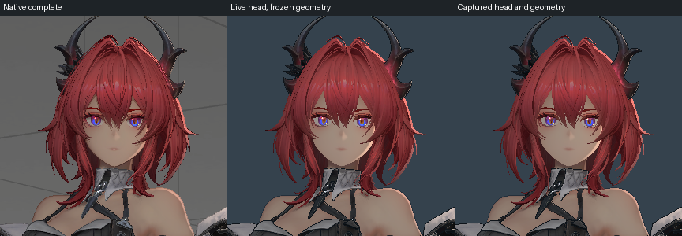
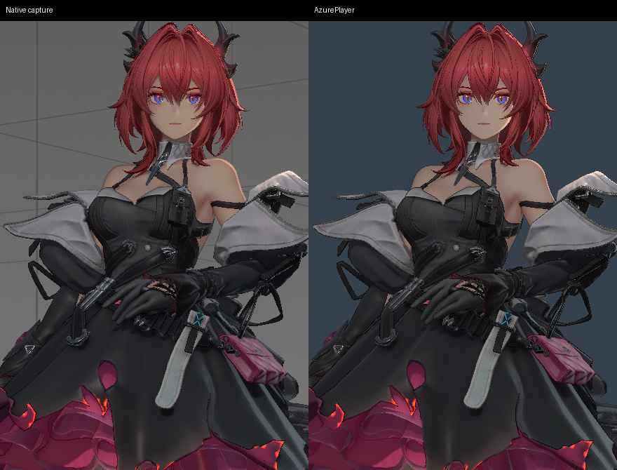

# 角色着色参考阶段计划

## 目标与已知输入

状态：执行中，归属于 Q1。
完整角色按既定区域、相似性及字节门槛验收。
头发、眼睛、皮肤和透明衣料分别持有来源证据。
场景反射及间接照明继续按总计划执行。

联合候选与固定姿态的十三份材质画像相同。
角色参考灯以角色节点为父节点。
场景快照使用父级世界矩阵转换灯位和方向。
相机、姿态和实际绘制阶段继续独立核验。

## 原生参考

原生不透明缓冲在事件 950 保存。
完整角色包含后续描边及透明绘制。
正式区域、像素数量和阈值保持来源定义。
阶段对照分别记录适用条件和失败范围。

## 执行与验证

1. 核对角色灯的父级、世界方向及材质画像。
2. 按索引数量定位原生角色的实际绘制。
3. 导出皮肤、脸部、头发及衣料的片元程序。
4. 核对轮廓光的输入、采样及坐标空间。
5. 核对描边与透明阶段的几何及深度条件。
6. 对确认的差异添加失败用例并实现公共修正。
7. 使用匹配姿态、灯组及相机完成实际采集。
8. 完成联合场景、缺省兼容及生命周期回归。

脸部遮罩响应见[专项计划](2026-11-04-face-masked-rim.md)。
固定姿态与动画资产使用相同的头部绑定变换。
动态头部坐标、相机角度及实际姿态继续核对。
联合虹膜采用原生纵轴和切线手性。
冻结区域的 255 个像素与独立基准至多相差一字节。

每项修正保留来源、输入摘要和可复用的配置。
完整画质通过前，计划保持执行中状态。

## 衣料描边覆盖

原生绘制 1079 和 1116 分别处理服饰一、二。
两次绘制的投影宽度均为 0.6，深度偏移为零。
缺省实例遮罩会剔除脚部和裙摆内部的可见描边。
这两份材质按深度测试绘制，并使用网格的平滑方向。
透明特效使用独立的坐标访问器。

| 固定姿态区域 | 像素数 | 结构相似度 | 验收 |
| --- | ---: | ---: | --- |
| 服饰一 | 45,988 | 0.9110 | 未通过 |
| 服饰五 | 17,990 | 0.9956 | 区域通过 |
| 服饰二 | 118,661 | 0.9480 | 未通过 |

服饰五的发光边缘另按原生事件 910 核验。
时序细线按近远八相位各自的 2% 预算核验。
投影描边的前帧有效性及深度覆盖见[历史深度核验](../acceptance/nr/outline-temporal-footprint.md)。
配置、覆盖及联合动画见[实测记录](../acceptance/nr/evidence/2026-11-04/cloth-outline-coverage/results.json)。
固定姿态的局部图见[衣料对照](../acceptance/nr/evidence/2026-11-04/cloth-outline-coverage/comparison.png)。

## 裙摆发光

原生事件 910 用第二组纹理坐标读取线性发光遮罩。
转换时按原始纹理格式解码，并保留原始透明度。
两层发光均绑定服饰五的同一图元，使用对应的骨骼动画。
混色灯的处理见[表面覆盖](../runtime/opaque-surface-overlays.md)。
验收分别核对裙边的来源像素、其他衣料、联合动画和独立重开。

## 固定姿态的头部坐标

原生帧 10401 的静态几何已包含蒙皮结果。该姿态的脸部和头发共用 `capture_material_frame_10401` 及单位基底。播放骨骼动画时，两份材质使用 `Bip001_Head` 的当前世界变换与已标定的头部基底。

固定几何使用两组材质坐标分别采集。相机、九盏局部灯、纹理、几何及显示设置相同。原生遮罩中的 17,017 个头发像素按最终写入颜色的绘制分类。

| 区域 | 像素数 | 使用动画头骨的超差数 | 使用捕获坐标的超差数 |
| --- | ---: | ---: | ---: |
| 完整头发遮罩 | 17,017 | 3,797 | 584 |
| 保留不透明阶段颜色 | 16,459 | 3,280 | 72 |
| 两次后续头发绘制 | 449 | 408 | 403 |

超差指 RGB 任一通道相差超过一个色阶。不透明区域的最大误差为六个色阶。事件 1291 与 1314 各保留两处硬件片元追踪，两次绘制的表面颜色和深度条件分别验收。动态材质帧按实际待机姿态另行核对。

图像、输入指纹和绘制归属见[固定头部对照](../acceptance/nr/evidence/2026-11-04/captured-head-frame/results.json)。

## 衣料描边颜色

服饰一、二的描边分别取自原生事件 1079、1116。
六处硬件片元均使用 0.5 倍底色亮度和 1.5 倍饱和度，再接受光照。正式材质通过可选的描边饱和度声明采样方式。
公共入口的固定姿态结果与着色探针逐像素一致。服饰一的 SSIM 为 0.94031，服饰二为 0.94958，既定门槛为 0.95。

两种构建配置分别通过记录打包、普通采样和多重采样回归。固定描述符与索引描述符另行核对独立裁剪图和底色的绑定。
来源片元、输入指纹和测试结果见[衣料描边采样记录](../acceptance/nr/evidence/2026-11-04/sampled-outline/results.json)。

## 半透明发片的轮廓光

原生绘制 1291 使用发片底色和透明度。材质轮廓灯根据法线、视线及灯光方向决定亮边宽度。两个相邻采样点的原生颜色分别为 RGB（255，141，132）和（218，115，106）。固定姿态的 Debug、Release 对照帧逐字节相同，两处采样的各通道误差均不超过一个色阶。

该次绘制最终保留 725 个可见像素，其中 531 个像素的各通道误差不超过一个色阶。背面发片由绘制 1314 单独验收。硬件片元、完整区域误差及失败范围见[固定姿态记录](../acceptance/nr/evidence/2026-11-04/translucent-hair/results.json)。

联合场景使用同一套发片参数和实时头骨坐标。八秒内记录了 2,112 次动画节点采样，重开后的四帧与连续序列逐字节一致。程序、资产和录像的指纹见[联合动画记录](../acceptance/nr/evidence/2026-11-04/translucent-hair/motion.json)。

## 衣料反射与皮肤区域

固定姿态的服饰一、二使用原生绘制绑定的六面反射图。布料按自身的基础反射率计算 GGX 多次散射响应。场景辐照输入、角色灯组、镜头和显示设置参与同一次采集。原生事件 889、910、928 的有效区域分别含 45,988、17,990、118,661 个像素，SSIM 分别为 0.95836、0.99694、0.96315，中位亮度相对误差分别为 3.39%、1.17%、0.63%。

身体皮肤和脸部沿用原生绘制的可见遮罩，向内腐蚀六像素。固定姿态下，两者的 SSIM 分别为 0.98830、0.99490。联合场景将衣料反射存入八面体图集的第 32 层。场景原有 32 层纹理在十个细节级别上逐字节相同。联合工程记录了 192 帧角色待机和物流运动，重开四帧均与连续序列一致。采集参数和各区域结果见[衣料反射核验记录](../acceptance/nr/evidence/2026-11-04/cloth-reflection/results.json)。

同一动作时点隐藏角色后，使用原图集与扩充图集的两张 2560×1440 画面逐像素一致。角色可见时，角色衣料和中央地面的倒影发生变化。顶棚、左门、右墙、左侧地板与青色环的固定区域保持逐像素一致。

## 发片径向法线

原生背面发片按物体原点计算水平径向照明法线。公共材质字段与透明高光开关通过 Debug、Release 的解析和 GPU 核验。固定姿态使用原生顶点阶段的输出定位同一批 236 个背面发片像素，平均通道误差为 5.16808 字节。该诊断的几何范围限于固定参考姿态。动态几何、屏幕法线和完整发片颜色继续核验。来源测量及构建记录见[径向法线记录](../acceptance/nr/evidence/2026-11-04/radial-hair/results.json)。
